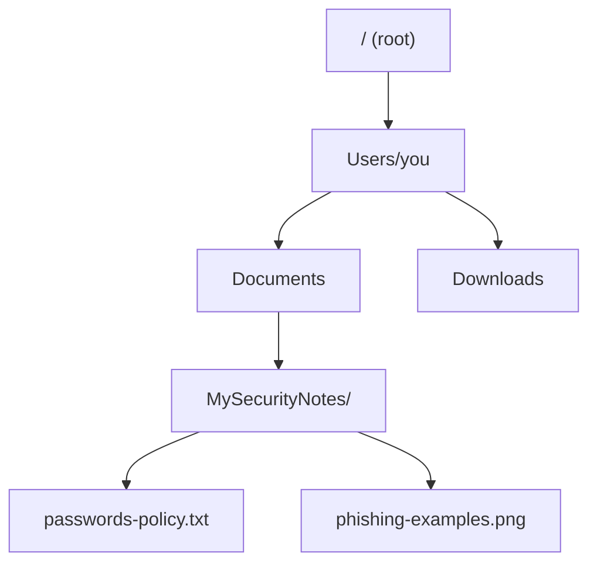

# Files, folders & organizing yourself

This lesson looks basic — and it is — but skipping it is one of the most common reasons beginners get stuck later in this course. Nearly every hands-on lab from here on involves navigating folders, running scripts from the right location, and finding files by their path. Get comfortable with this now and everything downstream gets easier.

## The core building blocks

- **File** — a single unit of data: a document, a photo, a script, a video. Every file has a **name** and usually an **extension** (the part after the dot, like `.txt`, `.jpg`, `.py`) that hints at what type of file it is and which program should open it.
- **Folder (directory)** — a container that holds files and other folders, used purely for organization. Folders can be nested inside other folders, forming a tree.
- **Path** — the full "address" of a file or folder, describing exactly where it lives in that tree.

## Absolute vs. relative paths

There are two ways to describe where a file lives:

- **Absolute path** — the full address starting from the very top (the "root"). On Windows: `C:\Users\You\Documents\MySecurityNotes\notes.txt`. On macOS/Linux: `/Users/you/Documents/MySecurityNotes/notes.txt`.
- **Relative path** — the address *relative to where you currently are*. If you're already inside the `Documents` folder, you could just refer to `MySecurityNotes/notes.txt`.

You'll see both constantly once you start using the command line (covered in depth in Path 03 — Linux & Operating Systems), and understanding the difference now will save you real confusion later.

## Hidden files — more relevant to security than you'd think

Most operating systems hide certain files by default — usually configuration files that regular users don't need to touch. On macOS/Linux, any file starting with a dot (like `.bashrc` or `.ssh`) is hidden by default. This matters in security because:

- Attackers sometimes hide malicious files by naming them like normal hidden system files, hoping you won't look closely.
- Sensitive configuration — like saved passwords for tools, API keys, or SSH credentials — often lives in these hidden files, which is exactly why they're a common target once an attacker gains access to a machine.

:::tip
On Windows, show hidden files via File Explorer → View → check "Hidden items." On macOS, press `Cmd + Shift + .` inside Finder. On Linux, run `ls -a` in a terminal. You'll be surprised how much lives in those "hidden" folders.
:::

## File extensions can lie

An extension is just a *hint*, not a guarantee, about what a file actually is — the operating system mostly trusts it, and so does the human looking at it. Attackers exploit this constantly:

:::danger Double extensions and disguised malware
A file named `invoice.pdf.exe` might display with just a PDF icon on a system configured to hide "known" extensions — tricking a victim into thinking they're opening a harmless PDF when they're actually launching an executable program. Always be suspicious of unexpected attachments, and configure your OS to always show full file extensions (Windows: File Explorer → View → check "File name extensions").
:::

## File permissions — a brief preview

Every file also has **permissions** attached to it — rules about who can read, write, or execute it. On a shared or multi-user computer, this is what stops one user from reading another's private documents by default. Path 03 covers Linux's permission model (`rwx`, `chmod`) in full depth once you're comfortable in a terminal, but the underlying idea is simple even now: a file isn't just data, it's data *plus a set of rules about who's allowed to touch it*, and those rules are exactly what an attacker is trying to bypass whenever you hear about a "privilege escalation" or "unauthorized access" vulnerability later in this course.

## Metadata — the hidden data inside your files

Beyond a file's visible content, many file types carry **metadata** — extra information embedded inside the file itself, often invisible unless you specifically look for it. The most well-known example is **EXIF data** in photos: modern phone cameras automatically embed the exact date, time, camera model, and — critically — often the precise **GPS coordinates** of where a photo was taken, directly inside the image file.

:::warn Photos can leak your exact location without you realizing it
Posting a photo online without stripping its EXIF data can reveal your home address, workplace, or real-time location to anyone who downloads and inspects the file — a genuinely real privacy risk, and directly relevant to Path 20's digital footprint lesson later in this course. Most social media platforms strip this data automatically on upload, but messaging apps and direct file sharing often don't. Check your phone's camera settings for an option to disable location tagging, or use a metadata-removal tool before sharing sensitive photos elsewhere.
:::

## Archives and compression — files within files

A **compressed archive** (`.zip`, `.tar.gz`, and similar) packages multiple files into one, often shrinking their total size in the process. These are genuinely useful for organizing and sharing, but worth knowing as a security-relevant format too: archives are a common way malware gets smuggled past email filters (some scanners don't automatically inspect *inside* a zip file), and a maliciously crafted archive can sometimes exploit flaws in the software that unpacks it — always be as cautious opening an unexpected `.zip` attachment as you would an unexpected executable.

## Cloud sync folders — convenience with a privacy tradeoff

Services like Google Drive, iCloud, OneDrive, and Dropbox create a special folder on your computer that automatically uploads and syncs its contents — genuinely convenient, but worth understanding clearly: anything placed in that folder is no longer *only* on your device, it's also stored on the provider's servers (and any other device you've linked to the same account). Sensitive files (the `certifications` folder from this lesson's lab, for instance) deserve a moment's thought about whether cloud sync is appropriate for them, or whether they're better kept local-only.

## 🧪 Hands-on lab — build your own organized structure

1. Create a new top-level folder called `MySecurityNotes` somewhere convenient (like your Documents folder).
2. Inside it, create three subfolders: `labs`, `notes`, and `certificates`.
3. Move (or copy) any files you've downloaded from this course so far into the appropriate subfolder.
4. Turn on hidden files (see the tip above) and spend two minutes just looking around your own system's hidden folders — don't change anything, just observe. Notice how many configuration files exist that you never knew about.
5. Turn on "always show file extensions" if it isn't already (see the danger box above) — this is a genuinely useful permanent security habit, not just a one-time lab step.
6. Take a photo with your phone (or use an existing one) and check its metadata — on a computer, right-click → Properties/Get Info often shows basic details; free online EXIF viewer tools (or a photo-metadata app) will show the full picture, including GPS coordinates if location tagging is enabled. Note whether your phone is currently embedding location data by default.
7. Right-click any file on your system and check its permissions/properties (Windows: Properties → Security tab; macOS: Get Info → Sharing & Permissions) — you don't need to change anything, just notice that this concept exists and is already actively protecting your files today.

:::challenge Test yourself
Why is "always show file extensions" considered a security best practice, rather than just a cosmetic preference?

Show answer
When extensions are hidden, an attacker can name a malicious executable something like <code>photo.jpg.exe</code>, and depending on OS settings, it may display to the victim as simply <code>photo.jpg</code> with an image-like icon — hiding the fact that it's actually a runnable program. Showing full extensions removes that disguise: you'd immediately see <code>photo.jpg.exe</code> and recognize it as suspicious. It's a small setting that closes off an entire category of social-engineering trick.

:::

## Key terms

- **File** — a single unit of stored data, identified by a name and extension.
- **Folder / directory** — a container for organizing files and other folders.
- **Path** — the full address describing where a file or folder lives.
- **Absolute path** — a path from the very top of the file system.
- **Relative path** — a path relative to your current location.
- **Hidden file** — a file not shown by default, often used for configuration.
- **File permissions** — rules attached to a file governing who can read, write, or execute it.
- **Metadata / EXIF data** — hidden information embedded inside a file, such as a photo's GPS location.

## Recap

- Files and folders form a tree structure, navigated via paths — absolute (from the root) or relative (from where you are).
- Hidden files are common on every OS and often hold sensitive configuration data.
- File extensions are just hints an attacker can fake — always show full extensions and stay suspicious of unexpected attachments.
- File permissions govern who can access a file — a preview of Path 03's much deeper Linux permissions coverage.
- Photo metadata (EXIF data) can silently leak your precise location — worth stripping before sharing sensitive images.
- Cloud sync folders trade convenience for the fact that your files now live on someone else's servers too, worth considering for sensitive content.

???refs
- [Filesystem Hierarchy Standard](https://refspecs.linuxfoundation.org/FHS_3.0/fhs/index.html) — the official spec for how Linux organizes its folder structure (useful reference for Path 03).
- [EFF: Metadata and privacy](https://ssd.eff.org/module/why-metadata-matters) — a free, clear explanation of why metadata matters for privacy, referenced again in Path 20.
???

**Next up →** [Passwords & accounts basics](#/lesson/00-fresher-basics/passwords-accounts)
