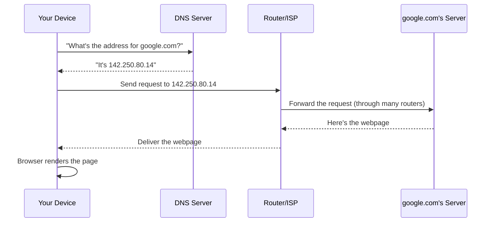

# How the internet works

The internet feels like magic — you type a few words and a page appears half a world away in under a second. It isn't magic. It's an enormous, extremely well-organized relay race between computers, and once you understand the stages of that race, a huge chunk of "hacker stuff" you'll see later (man-in-the-middle attacks, DNS spoofing, HTTPS, VPNs) stops being mysterious and starts being obvious.

## The journey of a single web request

Say you type `google.com` into your browser. Here's what actually happens, step by step:



1. **DNS lookup** — your device doesn't actually know where "google.com" lives. It asks a **DNS (Domain Name System)** server, which works like a phone book, translating human-friendly names into numeric **IP addresses** (e.g., `142.250.80.14`).
2. **Routing** — your request is broken into small chunks called **packets** and sent out through your router, then through your Internet Service Provider (ISP), then through a chain of other routers across the internet — often a dozen or more "hops" — until it reaches the destination server.
3. **The server responds** — the destination computer (a server, which is just a computer that's always on and waiting for requests) processes your request and sends the webpage back, broken into packets again.
4. **Your browser renders it** — the packets are reassembled, and your browser turns the raw HTML/CSS/JavaScript into the page you see.

All of this — DNS lookup, routing across dozens of hops, reassembly — typically happens in well under a second. That speed is exactly why it feels instantaneous, even though a huge relay of machines was involved.

## IP addresses — every device's "postal address"

Every device connected to the internet has an **IP address**, a unique numeric identifier so other computers know where to send data back to. There are two formats in use today:

- **IPv4** — the older, more familiar format: four numbers separated by dots, e.g. `142.250.80.14`. There are only about 4.3 billion possible IPv4 addresses, and we've essentially run out.
- **IPv6** — the newer format, e.g. `2607:f8b0:4005:80a::200e`, with a vastly larger address space designed to never run out.

## Why security matters at every step

Every stage of that journey is a potential attack point:

| Stage | What can go wrong |
|---|---|
| **DNS lookup** | An attacker can lie about the answer (**DNS spoofing**), sending you to a fake site that *looks* like the real one. |
| **Routing / the network in between** | An attacker positioned on the network path can read or alter your traffic (**man-in-the-middle attack**) if it isn't encrypted. |
| **The server itself** | If the destination server is compromised or malicious, it can serve you fake content or malware. |
| **Your own device** | Malware already on your machine can intercept requests before they even leave, or after they arrive. |

This is exactly why **HTTPS** (the padlock icon in your browser) exists — it encrypts traffic between you and the server so that even if someone is watching the network in between, they can't read or tamper with it. A **VPN (Virtual Private Network)** adds another layer, encrypting *all* your traffic and routing it through a trusted server, hiding your activity from your ISP and from anyone else on your local network (like on public Wi-Fi).

:::tip
When you type a website address, your browser is silently asking a DNS server for the real numeric address *before* it can send anything — that lookup is invisible to you, but it happens on nearly every request.
:::

:::warn Public Wi-Fi is a shared room, not a private line
On open (password-free) public Wi-Fi, other people on the same network can potentially see unencrypted traffic. HTTPS protects the content of what you send, but a VPN adds extra protection for *which sites* you're even visiting. Never do sensitive logins (banking, work accounts) on open public Wi-Fi without a VPN if you can help it.
:::

## 🧪 Hands-on lab — trace your own request

1. Open a terminal (Windows: Command Prompt or PowerShell; macOS/Linux: Terminal).
2. Run a DNS lookup by hand:
   ```bash
   nslookup google.com
   ```
   You should see an IP address in the response — that's DNS doing its job.
3. Trace the actual path your request takes across the internet:
   ```bash
   # Windows
   tracert google.com

   # macOS / Linux
   traceroute google.com
   ```
4. Count how many "hops" (intermediate routers) your request passes through before reaching Google's servers. It's usually somewhere between 8 and 20 — a genuinely surprising number for something that feels instant.
5. Open your browser, visit any HTTPS website, and click the padlock icon next to the address bar to see the certificate details — this is the proof that your connection to that specific site is encrypted.

:::challenge Test yourself
If DNS is just "asking a server for an IP address," why is DNS spoofing (an attacker lying about that answer) such a dangerous attack — even if the real destination server is perfectly secure?
<details><summary>Show answer</summary>Because DNS spoofing happens <em>before</em> you ever reach the real server — if an attacker can trick your device into believing a fake IP address is the correct one for, say, "yourbank.com," your browser will happily connect to the attacker's server instead, which can display a near-perfect copy of the real site to steal your login credentials. The real server being secure is irrelevant if you never actually reach it. This is exactly why HTTPS certificates matter: a fake site can copy the look of a real one, but it generally cannot present a valid certificate for a domain it doesn't own, which is your main defense against this class of attack.</details>
:::

## Key terms

- **DNS (Domain Name System)** — translates domain names into IP addresses.
- **IP address** — a device's unique numeric address on the internet.
- **Packet** — a small chunk of data that gets routed across the network.
- **HTTPS** — encrypted web traffic, shown as a padlock icon in the browser.
- **VPN** — encrypts and routes all of your device's traffic through a trusted server.
- **Man-in-the-middle attack** — intercepting or altering traffic between two parties.

## Recap

- Visiting a website involves DNS lookup → routing through many hops → the server responding → your browser rendering the page.
- Every device has an IP address; DNS exists so humans don't have to memorize them.
- Every stage of the journey (DNS, the network path, the server, your own device) is a potential attack point.
- HTTPS encrypts the content of your connection; a VPN adds a further layer of privacy over the network path.

???refs
- [How DNS Works (comic)](https://howdns.works/) — a genuinely fun, illustrated explanation of DNS.
- [Cloudflare: What happens when you type a URL into your browser?](https://www.cloudflare.com/learning/dns/what-is-dns/) — a solid, free deep dive.
???

**Next up →** [Files, folders & organizing yourself](#/lesson/00-fresher-basics/files-folders-you)
