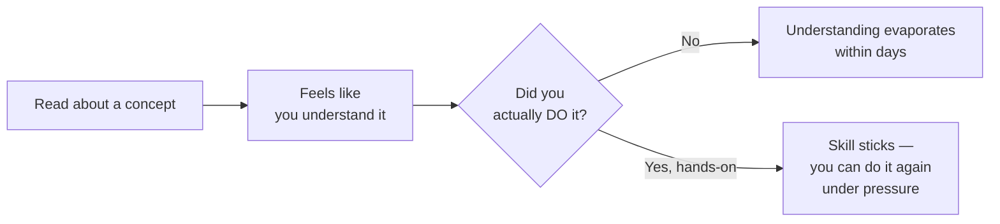

# How to learn tech effectively

You're about to move from Path 00 into 200+ lessons covering networking, Linux, programming, and real offensive/defensive security techniques. How you approach learning from here matters just as much as what you learn — this short lesson is the difference between finishing this course and quietly abandoning it in week three, which is what happens to most people who skip habits like these.

## Learn by doing, not just reading

Reading about a SQL injection is not the same skill as finding one. Every path in this course after this one includes hands-on labs and challenges specifically because **passive reading creates the illusion of understanding** — you nod along, it makes sense, and then you sit down to actually do it and discover you can't. Actively typing commands, breaking things, and fixing them is what builds real, durable skill.

## The habits that actually compound

- **Take notes in your own words.** Copy-pasting a definition doesn't force your brain to process it; rephrasing it does. This course's built-in **Notes** feature (available on every lesson) exists specifically for this — use it.
- **Build small projects, even bad ones.** A tiny script that checks for weak passwords, or a mini Python port scanner, teaches you more than another hour of reading ever will — even if it's rough and only 20 lines long.
- **Teach it back.** Explaining a concept to a friend, a rubber duck, or even just an empty room forces you to notice the gaps in your own understanding.
- **Consistency beats intensity.** One focused hour a day, five days a week, will take you dramatically further in three months than one exhausting 7-hour cram session followed by two weeks of nothing. Security skills compound — they build on each other — and compounding requires regular, spaced repetition, not bursts.

:::tip
This site tracks your progress automatically and shows a "Continue where you left off" button on the homepage — use it. Removing the friction of "where was I again?" is a small thing that measurably helps consistency.
:::

### The Feynman Technique — a concrete way to "teach it back"

Named after physicist Richard Feynman, this is a simple, genuinely powerful four-step study method: (1) pick a concept you just learned, (2) explain it in plain, simple language as if teaching a total beginner, avoiding jargon entirely, (3) notice exactly where you get stuck, hesitate, or have to fall back on jargon you don't fully understand — that's precisely where your understanding is actually weak, and (4) go back to the source material specifically to fill that gap, then try explaining it again. This works because vague understanding hides comfortably behind familiar-sounding jargon; forcing genuinely simple language exposes exactly what you don't yet understand.

### The testing effect — why quizzes matter more than rereading

Psychological research on learning consistently finds that actively *testing* yourself on material (even before you feel ready) produces dramatically better long-term retention than passively rereading the same material multiple times — a phenomenon researchers call the **testing effect**, or **active recall**. This is exactly why every path in this course ends with a quiz: taking it, even if you get some questions wrong, measurably strengthens retention more than simply rereading the lesson one more time would have. Treat a quiz as a genuine learning tool, not just an assessment tacked on at the end.

## Join communities — you don't have to figure this out alone

Cybersecurity has an unusually generous, active community culture. Getting stuck and asking for help (after trying yourself first) is completely normal, not a sign of weakness:

- **Discord servers** dedicated to security and CTFs (Capture The Flag competitions) are extremely active and beginner-friendly.
- **Reddit** — communities like r/cybersecurity, r/netsec, and r/AskNetsec are great for questions and staying current.
- **CTF platforms** like TryHackMe and Hack The Box have huge, welcoming communities built specifically around learning together.

### Finding or forming a study group

Beyond individual community participation, consider finding (or starting) a small study group working through this course in parallel — even two or three people, meeting briefly on a regular schedule to compare notes, quiz each other, or work through a lab together. Explaining concepts to peers is exactly the Feynman Technique in a social setting, and having someone else expecting you at a scheduled time is a genuinely effective, low-effort accountability mechanism against the natural tendency to skip a session "just this once."

## Avoiding burnout — this is a marathon

- **Take real breaks.** Stepping away from a stuck problem for an hour (or a day) often unlocks the answer faster than grinding on it for six more hours.
- **Celebrate small wins.** Finishing a lesson, passing a quiz, solving your first lab — these deserve genuine recognition, not just "on to the next thing."
- **Don't compare your Day 10 to someone else's Day 1000.** Every expert in this field started exactly where you are right now. Progress that feels slow day-to-day is often dramatic when you look back three months later.
- **It's okay to not understand something the first time.** Security topics are frequently layered — a concept from Path 07 will make more sense in retrospect once you've done Path 09. Revisit lessons later; it's a feature of how this material is structured, not a sign you're behind.

### Growth mindset and imposter syndrome, briefly

Two genuinely useful psychological concepts worth knowing by name as you move forward: a **growth mindset** — the belief that ability is developed through effort and practice, not fixed from birth — consistently correlates with better learning outcomes than a **fixed mindset** ("I'm just not a technical person"), because it reframes struggle as the normal mechanism of getting better, rather than evidence you don't belong. Relatedly, **impostor syndrome** — the persistent feeling that you don't actually deserve your progress or that you'll be "found out" as inadequate — is extremely common, including among genuinely accomplished, experienced security professionals, and is not a reliable signal about your actual competence. Both concepts will resurface directly in Path 13's career-prep material, since they matter as much in a first security job as they do in this course.

## 🧪 Hands-on lab — commit to a plan

1. Open this site's **Roadmap** page (in the nav bar) and look at the full path structure ahead of you.
2. Pick a realistic daily or weekly time commitment — be honest with yourself; a sustainable 30 minutes a day beats an ambitious 2 hours you'll abandon after a week.
3. Write a short 30-day plan in your own words: which paths you'll aim to finish, and what "done" looks like for you at the 30-day mark. Save it in your notes (in this course's built-in Notes feature, or your own `MySecurityNotes` folder from an earlier lesson).
4. Bookmark this lesson (use the site's bookmark feature) so you can revisit your plan and check in with yourself in a month.
5. Pick any single concept from Path 00 so far and practice the Feynman Technique on it: write a plain-language explanation as if teaching a friend with zero technical background, and note exactly where you hesitate or reach for jargon.
6. Consider whether you know anyone (a friend, a coworker, an online acquaintance) who might want to work through this course alongside you, even loosely — send one message this week actually inviting them, rather than just considering it.

:::challenge Test yourself
Why does "one hour a day, five days a week" tend to produce better long-term results than "seven hours in one sitting, once a week," even though the total time is similar?

Show answer
Skill retention relies heavily on <strong>spaced repetition</strong> — your brain consolidates and reinforces new information during the gaps between study sessions, not just during the session itself. A single 7-hour cram session has no gaps for that consolidation to happen, and mental fatigue sets in well before the end, meaning much of that later time is spent in a low-retention state. Regular shorter sessions instead give your brain repeated, spaced opportunities to reinforce the material, which is why consistent practice reliably outperforms cramming for skills that need to actually stick — not just be recognized on a quiz the next day.

:::

## Key terms

- **Spaced repetition** — learning reinforced through regular, spaced-out practice rather than one long session.
- **CTF (Capture The Flag)** — a hands-on security competition/challenge format used throughout this course and the wider industry.
- **Active recall / testing effect** — testing yourself or explaining a concept strengthens retention more than passively re-reading it.
- **Feynman Technique** — explaining a concept in plain language to expose exactly where your understanding is weak.
- **Growth mindset** — the belief that ability develops through effort and practice, correlated with better learning outcomes than a fixed mindset.

## Recap

- Hands-on practice builds real, durable skill; passive reading alone creates a false sense of understanding.
- Small, consistent study sessions outperform occasional long cram sessions.
- The Feynman Technique and active recall (quizzing yourself) both reliably outperform passive rereading for actual retention.
- The security community is unusually welcoming — use Discord, Reddit, CTF platforms, and consider a study group when you're stuck.
- Burnout is a real risk over this course's 200+ lessons — pace yourself, celebrate small wins, and revisit earlier material as later lessons make it click. Impostor syndrome is nearly universal and not a reliable signal of your actual competence.

???refs
- [TryHackMe](https://tryhackme.com/) — beginner-friendly, guided hands-on security labs and an active community.
- [Hack The Box](https://www.hackthebox.com/) — hands-on labs and CTFs, from beginner to advanced.
- [How to Take Smart Notes (summary concepts)](https://fortelabs.com/blog/basboverview/) — a widely referenced approach to note-taking that compounds over time.
- [The Feynman Technique, explained](https://fs.blog/feynman-technique/) — a free, clear walkthrough of the method described in this lesson.
???

**Congratulations!** You've completed Path 00. You now have the foundation — computers, the internet, files, passwords, phishing awareness, and a learning plan — to start Path 01: Introduction to Cybersecurity, where the real technical journey begins.

**Next up →** [Path 01 — Introduction to Cybersecurity](#/lesson/01-introduction)
