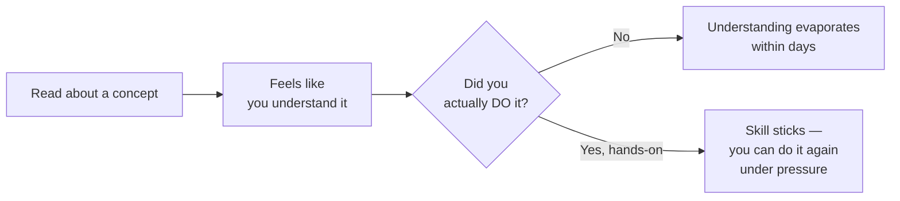

# How to learn tech effectively

You're about to move from Path 00 into 150+ lessons covering networking, Linux, programming, and real offensive/defensive security techniques. How you approach learning from here matters just as much as what you learn — this short lesson is the difference between finishing this course and quietly abandoning it in week three, which is what happens to most people who skip habits like these.

## Learn by doing, not just reading

Reading about a SQL injection is not the same skill as finding one. Every path in this course after this one includes hands-on labs and challenges specifically because **passive reading creates the illusion of understanding** — you nod along, it makes sense, and then you sit down to actually do it and discover you can't. Actively typing commands, breaking things, and fixing them is what builds real, durable skill.

## The habits that actually compound

- **Take notes in your own words.** Copy-pasting a definition doesn't force your brain to process it; rephrasing it does. This course's built-in **Notes** feature (available on every lesson) exists specifically for this — use it.
- **Build small projects, even bad ones.** A tiny script that checks for weak passwords, or a mini Python port scanner, teaches you more than another hour of reading ever will — even if it's rough and only 20 lines long.
- **Teach it back.** Explaining a concept to a friend, a rubber duck, or even just an empty room forces you to notice the gaps in your own understanding.
- **Consistency beats intensity.** One focused hour a day, five days a week, will take you dramatically further in three months than one exhausting 7-hour cram session followed by two weeks of nothing. Security skills compound — they build on each other — and compounding requires regular, spaced repetition, not bursts.

:::tip
This site tracks your progress automatically and shows a "Continue where you left off" button on the homepage — use it. Removing the friction of "where was I again?" is a small thing that measurably helps consistency.
:::

## Join communities — you don't have to figure this out alone

Cybersecurity has an unusually generous, active community culture. Getting stuck and asking for help (after trying yourself first) is completely normal, not a sign of weakness:

- **Discord servers** dedicated to security and CTFs (Capture The Flag competitions) are extremely active and beginner-friendly.
- **Reddit** — communities like r/cybersecurity, r/netsec, and r/AskNetsec are great for questions and staying current.
- **CTF platforms** like TryHackMe and Hack The Box have huge, welcoming communities built specifically around learning together.

## Avoiding burnout — this is a marathon

- **Take real breaks.** Stepping away from a stuck problem for an hour (or a day) often unlocks the answer faster than grinding on it for six more hours.
- **Celebrate small wins.** Finishing a lesson, passing a quiz, solving your first lab — these deserve genuine recognition, not just "on to the next thing."
- **Don't compare your Day 10 to someone else's Day 1000.** Every expert in this field started exactly where you are right now. Progress that feels slow day-to-day is often dramatic when you look back three months later.
- **It's okay to not understand something the first time.** Security topics are frequently layered — a concept from Path 07 will make more sense in retrospect once you've done Path 09. Revisit lessons later; it's a feature of how this material is structured, not a sign you're behind.

## 🧪 Hands-on lab — commit to a plan

1. Open this site's **Roadmap** page (in the nav bar) and look at the full 14-path structure ahead of you.
2. Pick a realistic daily or weekly time commitment — be honest with yourself; a sustainable 30 minutes a day beats an ambitious 2 hours you'll abandon after a week.
3. Write a short 30-day plan in your own words: which paths you'll aim to finish, and what "done" looks like for you at the 30-day mark. Save it in your notes (in this course's built-in Notes feature, or your own `MySecurityNotes` folder from an earlier lesson).
4. Bookmark this lesson (use the site's bookmark feature) so you can revisit your plan and check in with yourself in a month.

:::challenge Test yourself
Why does "one hour a day, five days a week" tend to produce better long-term results than "seven hours in one sitting, once a week," even though the total time is similar?

Show answer
Skill retention relies heavily on <strong>spaced repetition</strong> — your brain consolidates and reinforces new information during the gaps between study sessions, not just during the session itself. A single 7-hour cram session has no gaps for that consolidation to happen, and mental fatigue sets in well before the end, meaning much of that later time is spent in a low-retention state. Regular shorter sessions instead give your brain repeated, spaced opportunities to reinforce the material, which is why consistent practice reliably outperforms cramming for skills that need to actually stick — not just be recognized on a quiz the next day.

:::

## Key terms

- **Spaced repetition** — learning reinforced through regular, spaced-out practice rather than one long session.
- **CTF (Capture The Flag)** — a hands-on security competition/challenge format used throughout this course and the wider industry.
- **Active recall** — testing yourself or explaining a concept, rather than passively re-reading it.

## Recap

- Hands-on practice builds real, durable skill; passive reading alone creates a false sense of understanding.
- Small, consistent study sessions outperform occasional long cram sessions.
- The security community is unusually welcoming — use Discord, Reddit, and CTF platforms when you're stuck.
- Burnout is a real risk over a 151-lesson course — pace yourself, celebrate small wins, and revisit earlier material as later lessons make it click.

???refs
- [TryHackMe](https://tryhackme.com/) — beginner-friendly, guided hands-on security labs and an active community.
- [Hack The Box](https://www.hackthebox.com/) — hands-on labs and CTFs, from beginner to advanced.
- [How to Take Smart Notes (summary concepts)](https://fortelabs.com/blog/basboverview/) — a widely referenced approach to note-taking that compounds over time.
???

**Congratulations!** You've completed Path 00. You now have the foundation — computers, the internet, files, passwords, phishing awareness, and a learning plan — to start Path 01: Introduction to Cybersecurity, where the real technical journey begins.

**Next up →** [Path 01 — Introduction to Cybersecurity](#/lesson/01-introduction)
