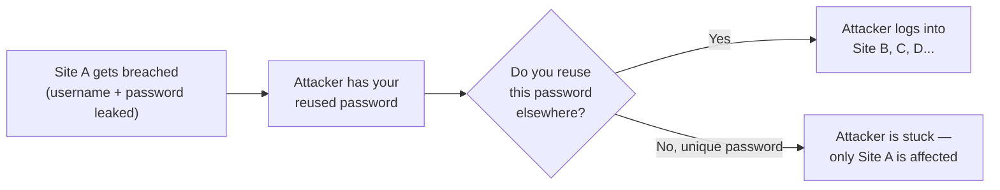

# Passwords & accounts basics

Almost every hack you'll read about in the news traces back, at some point, to a password problem — a weak password, a reused password, or a stolen password with no second layer of defense behind it. This lesson covers the small number of habits that eliminate the vast majority of account-takeover risk, before we get into anything more technical.

## Why passwords fail so often

Attackers don't usually "guess" your password one character at a time in real time. Instead, they rely on a few predictable weaknesses:

- **Weak passwords** — short, common, or based on personal info (`password123`, your pet's name, your birth year) are crackable in seconds using pre-built lists of common passwords.
- **Reused passwords** — if you use the same password on multiple sites, a breach at *any one* of them exposes your account everywhere else. Attackers automate this with a technique called **credential stuffing**: taking leaked username/password pairs from one breach and trying them against thousands of other sites.
- **Phishing** — tricking you into typing your real password into a fake login page (covered in depth two lessons from now).

## What makes a password actually strong

- **Length matters more than complexity.** A 16-character phrase like `correct-horse-battery-staple-42` is dramatically harder to crack than an 8-character mess like `P@ssw0rd!`, despite looking "less complicated." Every extra character multiplies the number of possible combinations an attacker has to try.
- **Uniqueness matters more than memorability.** Every account should have a completely different password. This sounds impossible to manage by hand — which is exactly why the next section exists.
- **Avoid personal information.** Names, birthdays, and pet names are the first things attackers guess, because they're often findable from your social media.

## Password managers — the actual solution

You are not expected to memorize dozens of unique 16+ character passwords — nobody does. A **password manager** generates and stores a unique strong password for every single account, protected behind one strong master password you memorize. Popular free/freemium options include Bitwarden, 1Password, and the password managers built into modern browsers.

:::tip
The single highest-leverage security habit you can adopt today: install a password manager, and let it generate a unique random password every time you sign up for something new. You'll never need to think of a password again.
:::

## Two-factor authentication (2FA / MFA)

**Two-factor authentication (2FA)**, also called **multi-factor authentication (MFA)**, requires a second piece of proof beyond your password to log in — usually a time-based code from an app on your phone, or a physical security key. Even if an attacker steals your password entirely (through a breach or phishing), they're stopped cold without that second factor.

Common types of second factor, roughly from weakest to strongest:

| Type | How it works | Notes |
|---|---|---|
| **SMS code** | A text message with a one-time code | Better than nothing, but vulnerable to SIM-swapping attacks |
| **Authenticator app** (Google Authenticator, Authy) | A rotating 6-digit code generated on your phone, no network needed | Solid, widely supported |
| **Hardware security key** (YubiKey) | A physical USB/NFC device you tap or plug in | Strongest option, resistant to phishing |

:::danger Enable 2FA everywhere you can
According to Microsoft's own security research, enabling MFA blocks over 99% of automated account-takeover attempts. It is, by a wide margin, the single highest-impact security control an individual can turn on. Start with your email account — it's the "master key" that can reset almost everything else if compromised.
:::

## Account recovery — the overlooked weak link

Attackers who can't get into your password will often go after your **account recovery** options instead — the "Forgot password?" flow. Make sure your recovery email and phone number are current, and be aware that some recovery questions ("What's your mother's maiden name?") are often publicly findable and shouldn't be your only line of defense.

## 🧪 Hands-on lab — lock down your own accounts

1. Install a password manager (Bitwarden is free and open-source, a solid first choice).
2. Pick your single most important account — usually your primary email — and check whether 2FA is available. If it is, enable it using an authenticator app rather than SMS if you have the choice.
3. Use your password manager to generate a new, unique, 16+ character password for that account, replacing whatever you were using before.
4. Check whether your email address has appeared in any known data breaches using [Have I Been Pwned](https://haveibeenpwned.com/) — this is a legitimate, widely trusted service (you'll see it referenced again throughout this course).
5. If any breached account still uses a password you recognize as reused elsewhere, change it now.

:::challenge Test yourself
Why does length generally matter more for password strength than throwing in symbols and numbers?

Show answer
Password strength against brute-force guessing comes down to the total number of possible combinations, which grows <em>exponentially</em> with length — each additional character multiplies the search space by the size of your character set. An 8-character password using a big mixed character set still has far fewer total combinations than a 16-character password using a smaller, simpler character set, because length compounds far more aggressively than complexity per character. This is exactly why long passphrases (several random words strung together) are both easier to remember <em>and</em> harder to crack than short, symbol-heavy passwords.

:::

## Key terms

- **Password manager** — software that generates and securely stores unique passwords per account.
- **Two-factor authentication (2FA) / MFA** — a second proof of identity beyond your password.
- **Credential stuffing** — trying leaked username/password pairs against many other sites.
- **Account recovery** — the "Forgot password?" flow, often a weaker link than the password itself.

## Recap

- Most account takeovers stem from weak, reused, or phished passwords — not sophisticated cracking.
- Length beats complexity; uniqueness beats memorability — a password manager solves both.
- 2FA blocks the vast majority of automated takeover attempts and should be your top security priority.
- Account recovery flows are a commonly overlooked weak point — keep recovery info current.

???refs
- [Have I Been Pwned](https://haveibeenpwned.com/) — check if your email has appeared in a known data breach.
- [Bitwarden](https://bitwarden.com/) — free, open-source password manager.
- [Microsoft: One simple action you can take to prevent 99.9% of attacks on your accounts](https://www.microsoft.com/en-us/security/blog/2019/08/20/one-simple-action-you-can-take-to-prevent-99-9-percent-of-account-attacks/) — the research behind the MFA statistic above.
???

**Next up →** [Staying safe online](#/lesson/00-fresher-basics/staying-safe-online)
