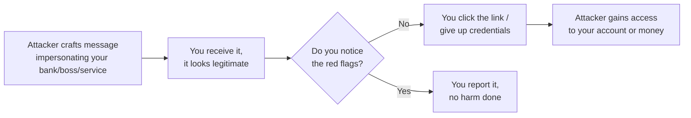

# Staying safe online (phishing & scams)

Here's a fact that surprises most beginners: the vast majority of successful cyberattacks don't involve any "hacking" of computers at all — they involve tricking a human. This category of attack is called **social engineering**, and **phishing** is by far its most common form. Understanding it is arguably more immediately useful to your own safety than any technical skill in this entire course.

## What is phishing?

**Phishing** is the practice of sending fraudulent messages — usually email, but increasingly text messages ("smishing") and phone calls ("vishing") — that impersonate a trusted source to trick you into revealing sensitive information, clicking a malicious link, or transferring money.

## The most common phishing patterns

- **Urgency and fear** — "Your account will be suspended in 24 hours unless you verify now." Attackers manufacture pressure so you act before you think.
- **Impersonation of authority** — fake emails from your bank, your company's IT department, a delivery service, or even your own boss (this specific one is called **CEO fraud** or **business email compromise**).
- **Too-good-to-be-true offers** — fake prize wins, investment schemes, and "click here to claim" links.
- **Lookalike domains** — a link that looks like `paypa1.com` (with a "1" instead of an "l") or `amaz0n-support.net`, close enough to fool a quick glance.
- **Attachments disguised as documents** — invoices, resumes, or shipping notices that are actually malware (tying directly back to the file-extension trick from an earlier lesson).

:::danger Real-world scale of the problem
Phishing consistently ranks as the #1 initial access method in major data breach reports year after year (see Verizon's annual Data Breach Investigations Report in the references below). This isn't a rare, exotic threat — it's the everyday front door attackers use most.
:::

## Spotting the red flags

When you receive an unexpected message asking you to act, check these before doing anything:

1. **Hover before you click** — on desktop, hover over any link (without clicking) to see the actual destination URL in your browser or email client's status bar. Does it match where it claims to go?
2. **Check the sender's actual email address**, not just the display name — "Amazon Support" can be typed as the display name for literally any email address.
3. **Look for urgency and pressure tactics** — legitimate organizations rarely demand instant action under threat.
4. **Check for generic greetings** — "Dear Customer" instead of your actual name can be a sign of a mass phishing campaign (though targeted attacks, called **spear phishing**, can be personalized and much harder to spot).
5. **Verify through a separate channel** — if an email claims to be from your bank, don't click anything in it; instead, open your browser separately and log in directly, or call the number printed on your card.

:::tip
When in doubt, don't click — go directly to the website yourself by typing the address you already know, or call the organization using a phone number you find independently (not one provided in the suspicious message itself).
:::

## Beyond email — other common scam channels

- **Fake tech support calls/pop-ups** — a pop-up claiming "Your computer is infected, call this number now" is virtually always a scam designed to get remote access to your machine or your credit card.
- **Social media scams** — fake giveaways, romance scams, and cryptocurrency "investment" schemes are extremely common and specifically designed to exploit trust and urgency.
- **QR code phishing ("quishing")** — a malicious QR code (on a poster, a parking meter, or even printed on a fake sticker over a legitimate one) that leads to a phishing site — increasingly common as QR codes became a normal part of daily life.

## 🧪 Hands-on lab — build your own phishing radar

1. Look through your email's spam/junk folder — most providers catch a lot of phishing automatically, giving you a safe, real-world sample to study.
2. Pick one flagged email and identify at least three red flags from the list above (sender address, urgency language, suspicious links, generic greeting, etc.) without clicking anything inside it.
3. Try [Google's free Phishing Quiz](https://phishingquiz.withgoogle.com/) — a short, well-designed interactive test that shows real (defanged) phishing examples and explains what gives each one away.
4. Write down, in your own words, the one red flag you personally find hardest to spot — awareness of your own blind spot is genuinely valuable.

:::challenge Test yourself
Why is "hover over the link to check where it actually goes" more reliable than just reading the link text itself?

Show answer
The visible text of a link and its actual destination are two completely independent things in HTML — an attacker can display the text <code>https://yourbank.com</code> while the link secretly points anywhere they want, such as <code>https://yourbank-secure-login.attacker.net</code>. Hovering (or long-pressing on mobile) reveals the <em>real</em> underlying URL your browser will actually navigate to, which is the only reliable way to verify a link before clicking — reading the displayed text alone tells you nothing trustworthy about where you'll actually end up.

:::

## Key terms

- **Phishing** — fraudulent messages impersonating a trusted source to steal information or money.
- **Spear phishing** — a personalized, targeted phishing attack aimed at a specific individual.
- **Social engineering** — manipulating people (rather than exploiting technical flaws) to gain access or information.
- **Smishing / vishing** — phishing via text message / phone call.
- **Business email compromise (CEO fraud)** — impersonating a company executive to authorize fraudulent transfers.

## Recap

- Most successful attacks target humans, not machines — phishing is the most common form.
- Watch for urgency, impersonation, lookalike domains, and unexpected attachments.
- Hover to verify real link destinations; verify unexpected requests through a separate, trusted channel.
- Scams have expanded well beyond email into texts, calls, social media, and even QR codes.

???refs
- [Google's Phishing Quiz](https://phishingquiz.withgoogle.com/) — free, interactive, genuinely useful practice.
- [Verizon Data Breach Investigations Report](https://www.verizon.com/business/resources/reports/dbir/) — the annual industry-standard report on how real breaches actually happen.
- [CISA: Recognize and Report Phishing](https://www.cisa.gov/secure-our-world/recognize-and-report-phishing) — official US government guidance.
???

**Next up →** [How to learn tech effectively](#/lesson/00-fresher-basics/how-to-learn-tech)
