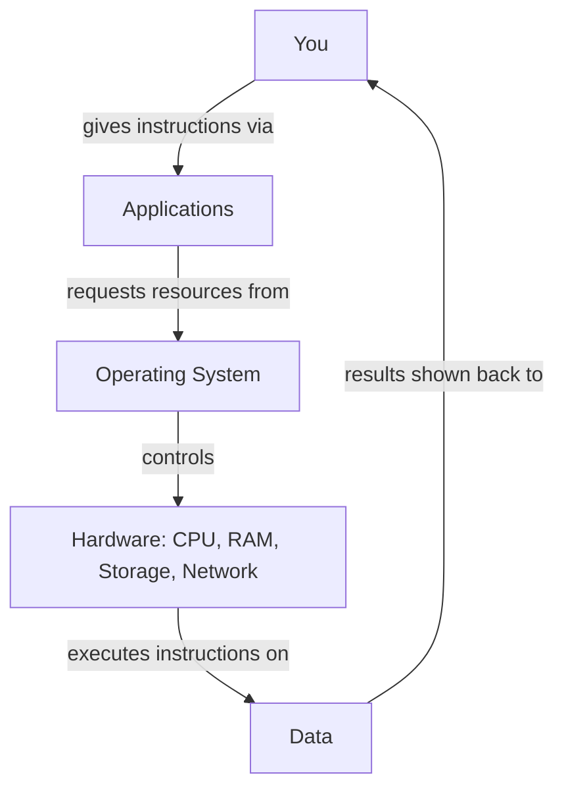
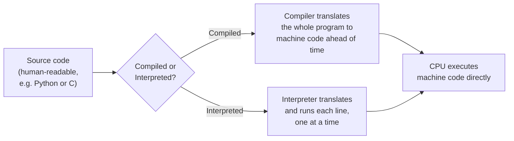

# What is a computer really?

Before you can secure a computer, you need to know what one actually is — not the marketing version, the *engineering* version. A computer is a machine that stores instructions and data as numbers, and executes those instructions blindingly fast, one tiny step at a time. Everything else — the desktop, the icons, the apps — is just a friendly costume built on top of that simple idea.

This matters for security because **every single attack you'll ever study in this course eventually boils down to one thing**: making a computer execute instructions its owner never intended, or making it reveal data it was supposed to protect. You can't understand *how that happens* until you understand what a computer fundamentally is.

## The four pieces that make up every computer

- **Hardware** — the physical parts you can touch: the processor (CPU), memory (RAM), storage (hard drive/SSD), and input/output devices (keyboard, screen, network card).
- **Software** — the instructions that tell the hardware what to do. This ranges from a single script you write, to a game, to the browser you're reading this in.
- **Operating System (OS)** — the "boss" program (Windows, macOS, Linux, Android, iOS) that manages hardware, runs other software, and enforces rules about who can do what.
- **Data** — the actual information being processed and stored: your photos, your passwords, this lesson's text, everything.



## The CPU: a very fast, very literal employee

The **CPU (Central Processing Unit)** is the part that actually *does* things. It doesn't understand English, or even the programming language a developer wrote — it only understands a tiny vocabulary of raw numeric instructions called **machine code**. Everything you interact with — a website, a game, an app — eventually gets translated down into millions of these tiny steps, executed billions of times per second.

The CPU is also completely obedient and has zero judgment. It will execute *any* valid instruction it's given, without asking "should I?" That single fact is the root of almost every security vulnerability in this course: attackers aren't fighting the CPU, they're finding ways to get *their own* instructions into a place the CPU will execute them.

### Cores, clock speed, and multitasking

Modern CPUs typically have multiple **cores** — essentially several independent CPUs packaged onto one chip, each capable of executing instructions simultaneously. A quad-core CPU can genuinely run four separate streams of instructions at the exact same instant, which is a big part of why modern computers can run dozens of programs "at once" without grinding to a halt.

But even with multiple cores, you're usually running far more than four programs at a time. This works because the operating system rapidly switches each core between different tasks — running a slice of your browser, then a slice of your music player, then a slice of a background update, over and over, many times per second. It happens so fast that everything *feels* simultaneous, even on a single core, though it technically isn't. This rapid switching is called **time-slicing** or **context switching**, and the OS component that manages it is called the **scheduler**.

**Clock speed** (measured in GHz — billions of cycles per second) roughly describes how many of these tiny instruction-steps a single core can execute per second. A higher clock speed generally means faster execution, though modern performance depends on many other factors too (core count, cache size, instruction efficiency) — which is exactly why comparing CPUs by clock speed alone is misleading.

## Memory vs. storage — a distinction that trips everyone up

- **RAM (memory)** — fast, but *temporary*. Whatever a program is actively working on lives here. Turn the power off, and it's gone.
- **Storage (hard drive / SSD)** — slower, but *permanent*. Your files, installed apps, and the OS itself live here, surviving a restart.

Think of storage as a filing cabinet and RAM as your desk — you pull a folder out of the cabinet (storage) onto your desk (RAM) to actually work on it, and put it back when you're done.

:::tip
Your phone is also a computer — it has a CPU, RAM, storage, and an OS (iOS or Android), just squeezed into your pocket. Everything about hardware/software/OS in this lesson applies to it directly.
:::

### HDDs vs. SSDs — two very different kinds of storage

Not all storage is the same. **Hard Disk Drives (HDDs)** store data magnetically on spinning physical disks, read by a moving mechanical arm — genuinely similar in principle to an old record player. **Solid State Drives (SSDs)** store data electronically in flash memory chips, with no moving parts at all.

| | HDD | SSD |
|---|---|---|
| **Speed** | Slower (mechanical movement takes time) | Much faster (no physical movement) |
| **Durability** | More vulnerable to physical shock (moving parts) | More resistant to physical shock |
| **Cost per GB** | Cheaper | More expensive, though the gap has narrowed considerably |
| **Data recovery after deletion** | Data often remains physically recoverable until overwritten | Similar risk, though some SSDs proactively erase deleted data faster (a feature called TRIM) |

This distinction genuinely matters for security and forensics: when you "delete" a file, most storage doesn't immediately, securely erase the underlying data — it just marks that space as available to be overwritten later. Until something else actually overwrites it, the original data often remains physically recoverable, which is exactly how forensic investigators (and, less legitimately, attackers with physical access to a discarded drive) can sometimes recover "deleted" files.

## Binary — how a computer "thinks"

At the very bottom, a computer only knows two states: on and off, represented as `1` and `0`. This is called **binary**. Every photo, password, video, and piece of text you've ever seen on a screen is, underneath, an enormous sequence of 1s and 0s — grouped into 8-bit chunks called **bytes**.

```
The letter "A" in binary:  01000001
The letter "B" in binary:  01000010
```

You don't need to memorize binary to work in security, but knowing it exists — and that *everything* eventually reduces to it — demystifies a lot of what feels like "hacker magic" later in this course (encoding, encryption, and file formats all sit on top of this idea).

### How text actually becomes numbers — ASCII and Unicode

That binary representation of "A" above (`01000001`, which is `65` in decimal) isn't arbitrary — it comes from a standard called **ASCII**, an agreed-upon table mapping every English letter, digit, and common symbol to a specific number. Modern computers mostly use **Unicode** instead, a much larger standard extending this same idea to cover every language and symbol on Earth, including emoji. The core concept is identical either way: text is just numbers, interpreted according to an agreed-upon table, and that table is exactly what lets every computer in the world display "A" the same way.

This matters in security more than it first appears: encoding confusion (a system expecting one character standard while receiving another) has historically been the root cause of real vulnerabilities, and understanding that "text" is really just "numbers plus an interpretation rule" is a foundational idea you'll see resurface throughout this entire course, especially once you reach cryptography and encoding topics later on.

## From source code to a running program

You'll eventually write your own code (Path 04 covers this in depth), so it's worth understanding, even briefly, what actually happens between "a person writes readable code" and "the CPU executes it":



Some languages (like C) are **compiled** — translated entirely into machine code ahead of time, producing a standalone program the CPU can run directly. Others (like Python, referenced throughout Path 04) are **interpreted** — a separate program (the interpreter) reads and translates your code line-by-line while it runs. Compiled programs generally run faster since the translation work happens once, upfront; interpreted programs are typically easier to write and test, since you can run code immediately without a separate compilation step. This exact distinction becomes directly relevant much later in this course, when Path 16's reverse engineering material discusses reading compiled machine code back into readable form.

## Why this matters for security

Every attack you'll study eventually touches one or more of these four pieces:

- **Hardware attacks** — physically stealing a device, tampering with a USB port, or exploiting a chip-level flaw.
- **Software attacks** — tricking an application into running code it shouldn't (this is most of what this course covers: SQL injection, XSS, buffer overflows, malware).
- **OS attacks** — exploiting the "boss" program itself to gain more control than you should have (privilege escalation).
- **Data attacks** — stealing, corrupting, or holding data hostage (data breaches, ransomware).

Understanding this map is genuinely useful: whenever you learn a new attack later in this course, you can ask "which of these four is this actually targeting?" — and it will click into place much faster.

## 🧪 Hands-on lab — meet your own machine

You don't need any special tools for this one — just your own computer.

1. **Windows**: press `Ctrl + Shift + Esc` to open Task Manager, click the **Performance** tab. **macOS**: open **Activity Monitor** (search with Spotlight, `Cmd + Space`). **Linux**: open a terminal and run `htop` or `top`.
2. Find your CPU usage, RAM usage, and how much storage is free. Note how many CPU cores your machine has.
3. Open a few apps (a browser, a text editor) and watch RAM usage climb in real time — that's your "desk" filling up.
4. Close them again and watch it drop back down.
5. Find out what OS version you're running (Windows: `winver`; macOS: **About This Mac**; Linux: `uname -a`). Knowing your exact OS version matters a lot in security — vulnerabilities are usually tied to specific versions.
6. Check whether your machine's main drive is an HDD or SSD (Windows: Task Manager's Performance tab labels each disk; macOS: **About This Mac → Storage**; Linux: `lsblk -d -o name,rota` — a `1` under ROTA means HDD, `0` means SSD).
7. Open a plain text editor, type the letter "A", save the file, then reopen it in a hex editor or run `xxd filename.txt` (macOS/Linux) in a terminal — confirm you see `41` (hexadecimal for 65, "A"'s ASCII value) in the raw output, directly connecting this lesson's binary/ASCII discussion to something you can see with your own eyes.

:::challenge Test yourself
If RAM is temporary and storage is permanent, why do you sometimes lose unsaved work when an application crashes, but a file you already saved is still there afterward?

<details><summary>Show answer</summary>An open, unsaved document only exists in RAM while you're editing it — the moment the application crashes, that memory is wiped and the changes are gone. A file you've already saved has been written to storage, which survives independently of whether the application (or even the whole computer) is running. This is exactly why "save often" is good advice, and it's also why forensic investigators can often recover files from a device's storage even after a crash — but almost never recover unsaved changes that only ever lived in RAM.</details>
:::

## Key terms

- **Hardware** — the physical components of a computer.
- **Software** — instructions that tell hardware what to do.
- **Operating System (OS)** — the program that manages hardware and runs other software.
- **CPU** — the component that executes instructions; modern CPUs have multiple independent cores.
- **RAM** — fast, temporary working memory.
- **Storage** — slower, permanent memory (HDD or SSD).
- **Binary** — the 1s-and-0s representation everything reduces to.
- **ASCII / Unicode** — standards mapping numbers to text characters.
- **Compiled / interpreted** — two different ways source code gets translated into something a CPU can execute.

## Recap

- A computer is hardware + software + an OS managing it all, working on data.
- The CPU executes instructions with zero judgment — it does whatever it's told, which is the root of most security vulnerabilities. Multiple cores and rapid time-slicing let it juggle many tasks that feel simultaneous.
- RAM is temporary working memory; storage (HDD or SSD) is permanent — though "deleted" data on either often remains recoverable until overwritten.
- Text is just numbers interpreted through a standard like ASCII or Unicode — everything ultimately reduces to binary.
- Source code becomes a running program either through compilation (translated ahead of time) or interpretation (translated line-by-line at runtime).
- Every attack you'll learn in this course targets hardware, software, the OS, or data — usually some combination.

???refs
- [How Computers Work — Crash Course Computer Science](https://www.youtube.com/playlist?list=PL8dPuuaLjXtNlUrzyH5r6jN9ulIgZBpdo) — a genuinely excellent, free video series covering everything from binary to operating systems.
- [MDN: What is a computer?](https://developer.mozilla.org/en-US/docs/Learn_web_development/Getting_started/Web_standards/How_the_web_works) — Mozilla's beginner-friendly overview of how computers and the web fit together.
- [Unicode Consortium: What is Unicode?](https://home.unicode.org/basic-info/overview/) — the official, free explanation of how modern text encoding actually works.
???

**Next up →** [How the internet works](#/lesson/00-fresher-basics/how-internet-works)
