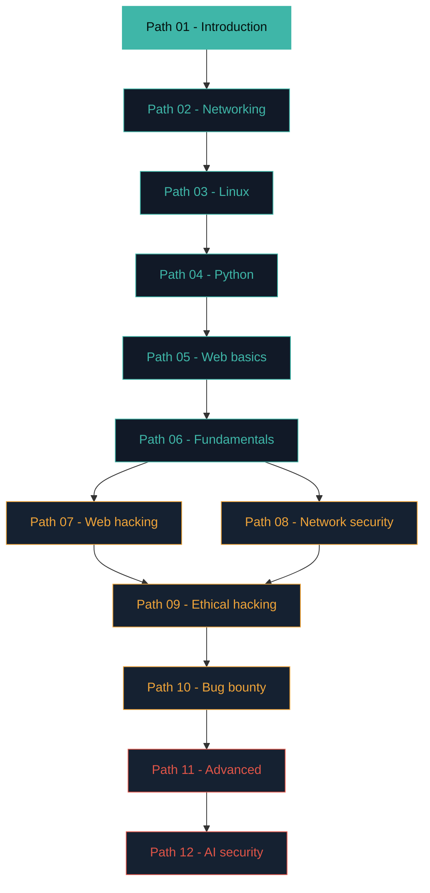

# How to actually learn this (and not give up)

Most people who start cybersecurity quit — not because it's too hard, but because they **study it the wrong way** and burn out. A few simple habits make the difference between quitting in a month and still going strong in a year.

:::tip TAKE THIS SERIOUSLY
Skimming this lesson feels tempting because it's not "technical." Don't. The habits below are what turn "just learning" into "a career." They matter more than any tool.
:::

## Habit 1 — Build the base before the fun

It's tempting to jump straight to "hacking." Resist it. The people who last are the ones who first understand **networking, Linux, and how the web works.** Skipping these is the single biggest reason beginners plateau and feel stuck — they can run a tool but have no idea what it's actually doing.

That's exactly why this course spends its early paths on foundations. **Trust the order.**

## Habit 2 — Learn by doing, not just reading

Reading about a command teaches you almost nothing; **typing it and seeing what happens** teaches you a lot. Do every 🧪 lab. Break things in your lab on purpose and fix them. Knowledge that passes through your fingers sticks; knowledge that only passes through your eyes fades by morning.

A useful concept from learning science is the "**learning pyramid**" — passive reading has the lowest retention; teaching or doing has the highest.

~~~svg The learning retention pyramid (approximate)
<svg viewBox="0 0 620 260" xmlns="http://www.w3.org/2000/svg" font-family="Inter, sans-serif">
  <g font-size="12">
    <polygon points="200,30 420,30 400,60 220,60" fill="#152131" stroke="#213043"/>
    <text x="310" y="50" text-anchor="middle" fill="#8496A6">Lecture (~5%)</text>
    <polygon points="220,60 400,60 380,95 240,95" fill="#152131" stroke="#213043"/>
    <text x="310" y="82" text-anchor="middle" fill="#8496A6">Reading (~10%)</text>
    <polygon points="240,95 380,95 360,130 260,130" fill="#111927" stroke="#213043"/>
    <text x="310" y="117" text-anchor="middle" fill="#E9EEF3">Demonstration (~30%)</text>
    <polygon points="260,130 360,130 340,165 280,165" fill="#0f2b26" stroke="#3FB6A8"/>
    <text x="310" y="152" text-anchor="middle" fill="#3FB6A8">Discussion (~50%)</text>
    <polygon points="280,165 340,165 320,200 300,200" fill="#2b1f0a" stroke="#EFA43A"/>
    <text x="310" y="187" text-anchor="middle" fill="#EFA43A">Practise doing (~75%)</text>
    <polygon points="300,200 320,200 315,235 305,235" fill="#3a1414" stroke="#E05548"/>
    <text x="310" y="222" text-anchor="middle" fill="#E05548">Teach others (~90%)</text>
    <text x="80" y="120" font-size="11" fill="#8496A6" font-weight="600">Passive</text>
    <text x="80" y="205" font-size="11" fill="#E05548" font-weight="600">Active</text>
    <line x1="120" y1="90" x2="150" y2="90" stroke="#8496A6" stroke-width="1"/>
    <line x1="120" y1="215" x2="150" y2="215" stroke="#E05548" stroke-width="1"/>
  </g>
</svg>
~~~

:::tip TEACH TO LEARN
The single fastest way to solidify a concept is to try teaching it to a friend (or a rubber duck). If you can't explain something plainly, you don't truly know it yet — and that's information.
:::

## Habit 3 — Take notes like a professional

Real hackers keep detailed notes — every command, every finding, every "aha." Writing something in your own words is how you find out whether you actually understood it. Your notes will also become:

- Your personal reference (you *will* forget things — that's fine).
- The basis of your engagement reports later.
- Your public portfolio if you choose to publish them.

### Good note-taking tools

You don't need anything fancy. Pick one and stick with it:

- **[Obsidian](https://obsidian.md/)** — free, popular in the security community, uses local markdown files. Very hacker-friendly.
- **[CherryTree](https://www.giuspen.net/cherrytree/)** — hierarchical notes, pentester-favourite for engagement notebooks.
- **[Joplin](https://joplinapp.org/)** — free and open-source, syncs across devices.
- **A simple folder of `.md` files** — genuinely fine. Simplicity wins.

## Habit 4 — Get comfortable being stuck

You will be confused constantly, forever. That is not a sign you're failing — **it is the job.** Every professional spends their day googling errors and reading documentation. Being stuck, searching, and slowly working it out **is the actual skill.** Learn to enjoy the puzzle.

Some concrete "stuck" strategies that pros use:

1. **Read the error message.** Actually read it. Nine times out of ten it tells you what's wrong.
2. **Google the exact error** in quotes. Someone else has already had it.
3. **Try the simplest possible test.** If a tool won't run, run `--version`. If a lab won't respond, ping it. Isolate what works.
4. **Sleep on it.** Your brain solves problems while you rest. This is real — many breakthroughs come the next morning.
5. **Take a break and come back.** Fresh eyes catch what tired ones miss.
6. **Ask for help — but well.** "It doesn't work" is a bad question. "I ran X, expected Y, got Z, error message was W, tried A/B/C" is a great one.

:::note THE RUBBER DUCK
Explaining your problem out loud to a rubber duck (or any inanimate object) works so well that "rubber duck debugging" is a real professional practice. Try it before asking a human.
:::

## Habit 5 — Go slow to go fast

There's no prize for rushing. **It is far better to deeply understand one lesson a day than to skim ten and retain none.** Depth beats speed every time in this field.

A realistic pace:

- **Sub-lesson a day** (about 15–20 minutes reading + labs)
- **One weekend "focus session"** (a bigger lab, a longer read, or a CTF)
- **A short weekly review** — read your notes from the week, revise anything hazy

At that pace, the whole course takes **3–4 months**. That's ideal. If you go faster, that's fine — as long as you're actually *doing* the labs.

## Habit 6 — Join a community

Learning alone is much harder than learning with others. You don't need many people, just a few who care.

Places to hang out:

- **[TryHackMe Discord](https://discord.gg/tryhackme)** — hugely active, beginner-friendly.
- **[Hack The Box community](https://www.hackthebox.com/community)** — deeper, but welcoming.
- **[r/cybersecurity](https://www.reddit.com/r/cybersecurity/)** and **[r/AskNetsec](https://www.reddit.com/r/AskNetsec/)** — Reddit.
- **X/Twitter security community** — follow 20 great researchers and your feed becomes a free education.
- **Local meetups** — search for "OWASP chapter" or "DEF CON group" in your city.

:::challenge Reflection
Pick the *single habit* above you know you struggle with most. Write it down. Then write one small, specific action you'll take this week to work on it.

Show an example
Habit I struggle with: "Take notes like a professional."
This week I will: create an Obsidian vault called "cybersec-notes" and write a note after every sub-lesson I finish.

:::

## 🧪 Lab — Set up your notes

Take 10 minutes now:

1. Create a folder called `cyber-notes` on your computer, or start a free [Obsidian](https://obsidian.md/) vault.
2. Make your first note titled **"Path 01 — Introduction"**.
3. In your own words, write down:
   - What cybersecurity is.
   - The golden rule about permission.
   - Which career interests you *right now* (it's fine if that changes).
4. From now on, add a short note after every sub-lesson. **This habit alone will put you ahead of most learners.**

## Recap

- Build foundations (networking → Linux → Python → web) before jumping to hacking.
- Learn by doing — do every lab. Try teaching things too.
- Take notes in your own words from day one.
- Being stuck is normal *and* is the real skill.
- Go slow to go fast — a sub-lesson a day beats a burnout binge.
- Join a community; you don't have to do this alone.

???refs
- [Obsidian](https://obsidian.md/) — the note-taking app most security people love.
- [Rubber duck debugging](https://en.wikipedia.org/wiki/Rubber_duck_debugging) — the classic technique explained.
- [OWASP Chapters](https://owasp.org/chapters/) — free local meetups worldwide.
- [The Cyber Mentor's roadmap](https://tcm-sec.com/) — free videos with a practical bent.
- ["How to Ask a Good Question" — Stack Overflow](https://stackoverflow.com/help/how-to-ask) — turn "it doesn't work" into a question that gets answered.
???

## 🎉 You've finished Path 01

You now understand:

- What cybersecurity is
- Why it matters (to you and as a career)
- The types of hackers and the careers ahead
- The one legal rule that keeps you safe
- The habits that will get you through the next 11 paths

That's a real achievement. Take a moment.

**Next up →** [Path 02 — Networking Fundamentals: What is a network?](#/lesson/02-networking/what-is-a-network)
