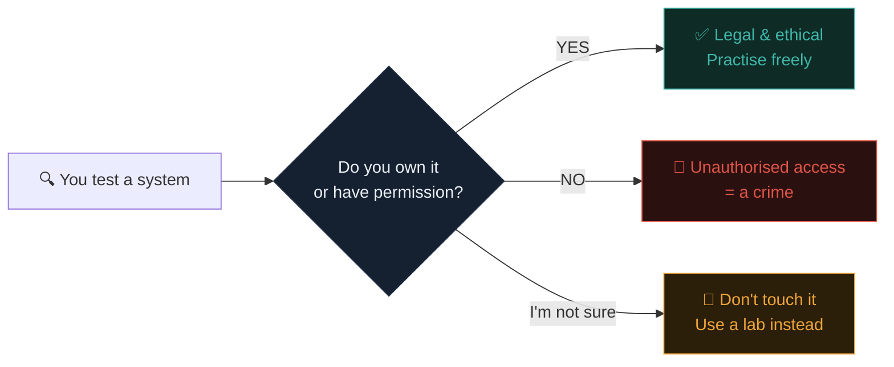

# The golden rule: only touch what you're allowed to

:::danger THE MOST IMPORTANT LESSON IN THE COURSE
If you forget everything else in Path 01, remember this. Everything you'll learn is genuinely powerful, and power pointed at the wrong target causes real harm and real legal trouble. Read this slowly, twice.
:::

## The rule

> **Never test, scan, or hack any system unless you own it, or you have clear, explicit permission.**

That's the whole thing. It sounds simple — and it is — but people get into trouble by inventing exceptions. **There are none.**

The excuses that will not save you in court:

- "I only *looked*" — still unauthorised access.
- "I was just *curious*" — not a defence in any court.
- "I didn't *change* anything" — doesn't matter.
- "I wasn't going to abuse it" — irrelevant.
- "The site was insecure — they were asking for it" — laughable, and illegal.

In most countries, simply **accessing a computer system without permission is a crime**, even if you cause no damage at all.

## Why the law is this strict

Imagine someone walking down your street at night, quietly trying every front-door handle to see which are unlocked. Even if they never step inside, you'd feel violated, and the police would take it seriously. Networks work the same way. **"Just checking whether the door is open" on a computer you don't own is treated as an attempt to break in** — because the owner can't read your mind to know your intentions were harmless.

### The laws worth knowing

Different countries have different laws, but nearly every developed country has one that criminalises unauthorised computer access:

| Country / region | Main law |
|---|---|
| USA | Computer Fraud and Abuse Act (CFAA) |
| UK | Computer Misuse Act 1990 |
| EU | Directive 2013/40/EU + national laws |
| India | IT Act 2000 (Sec. 43 & 66) |
| Canada | Criminal Code s. 342.1 |
| Australia | Cybercrime Act 2001 |

You don't need to memorise these. Just know that **the laws exist everywhere, and they are strict.**

:::warn REAL CASES
Teenagers who "just wanted to learn" have been arrested, charged, and — in some cases — jailed. A criminal record follows you for life and, ironically, shuts you out of the very security career you were trying to build. It is never worth it.
:::

## The good news: endless legal ground to practise on

You will never need to touch a system you don't own, because the community has built an enormous amount of **legal, safe, and often free** places designed specifically for practice.

~~~svg Where you're allowed to hack
<svg viewBox="0 0 640 240" xmlns="http://www.w3.org/2000/svg" font-family="Inter, sans-serif">
  <g font-size="12">
    <rect x="20" y="30" width="140" height="180" rx="10" fill="#111927" stroke="#3FB6A8" stroke-width="2"/>
    <text x="90" y="58" text-anchor="middle" font-size="26">🏠</text>
    <text x="90" y="80" text-anchor="middle" fill="#3FB6A8" font-weight="700">YOUR LAB</text>
    <text x="90" y="105" text-anchor="middle" fill="#E9EEF3">Your Kali VM</text>
    <text x="90" y="125" text-anchor="middle" fill="#E9EEF3">Vulnerable VMs</text>
    <text x="90" y="145" text-anchor="middle" fill="#E9EEF3">you download</text>
    <text x="90" y="175" text-anchor="middle" fill="#8496A6">Built in Path 03</text>

    <rect x="180" y="30" width="140" height="180" rx="10" fill="#111927" stroke="#3FB6A8" stroke-width="2"/>
    <text x="250" y="58" text-anchor="middle" font-size="26">🎓</text>
    <text x="250" y="80" text-anchor="middle" fill="#3FB6A8" font-weight="700">TRAINING SITES</text>
    <text x="250" y="105" text-anchor="middle" fill="#E9EEF3">TryHackMe</text>
    <text x="250" y="125" text-anchor="middle" fill="#E9EEF3">Hack The Box</text>
    <text x="250" y="145" text-anchor="middle" fill="#E9EEF3">PortSwigger</text>
    <text x="250" y="175" text-anchor="middle" fill="#8496A6">Free tiers &amp; labs</text>

    <rect x="340" y="30" width="140" height="180" rx="10" fill="#111927" stroke="#3FB6A8" stroke-width="2"/>
    <text x="410" y="58" text-anchor="middle" font-size="26">🎯</text>
    <text x="410" y="80" text-anchor="middle" fill="#3FB6A8" font-weight="700">OFFICIAL TARGETS</text>
    <text x="410" y="105" text-anchor="middle" fill="#E9EEF3">scanme.nmap.org</text>
    <text x="410" y="125" text-anchor="middle" fill="#E9EEF3">testphp.vulnweb</text>
    <text x="410" y="145" text-anchor="middle" fill="#E9EEF3">HTTPBin</text>
    <text x="410" y="175" text-anchor="middle" fill="#8496A6">Built for practice</text>

    <rect x="500" y="30" width="140" height="180" rx="10" fill="#111927" stroke="#3FB6A8" stroke-width="2"/>
    <text x="570" y="58" text-anchor="middle" font-size="26">💰</text>
    <text x="570" y="80" text-anchor="middle" fill="#3FB6A8" font-weight="700">BUG BOUNTIES</text>
    <text x="570" y="105" text-anchor="middle" fill="#E9EEF3">HackerOne</text>
    <text x="570" y="125" text-anchor="middle" fill="#E9EEF3">Bugcrowd</text>
    <text x="570" y="145" text-anchor="middle" fill="#E9EEF3">Intigriti</text>
    <text x="570" y="175" text-anchor="middle" fill="#8496A6">In-scope only!</text>
  </g>
</svg>
~~~

### 1. Your own lab
In **Path 03** you'll build a safe practice computer *inside* your own machine (a "virtual machine"). You own it, so attack it all you like. This is the professional's setup.

### 2. Training platforms
- **[TryHackMe](https://tryhackme.com)** — guided, beginner-friendly, browser-based labs. Excellent free tier.
- **[Hack The Box](https://hackthebox.com)** — more advanced, with an "Academy" for structured learning and a "Labs" area for CTF-style machines.
- **[PortSwigger Web Security Academy](https://portswigger.net/web-security)** — the gold standard for web hacking, entirely free. You'll live here in Path 07.
- **[OverTheWire](https://overthewire.org/wargames/)** — classic Linux and networking wargames.

### 3. Official practice targets
Some tool authors deliberately provide targets:

- **`scanme.nmap.org`** — the Nmap team runs this specifically so you can practise scanning.
- **`testphp.vulnweb.com`** — Acunetix's deliberately vulnerable web app.
- **`http://testfire.net`** — IBM's altoro mutual test site.

### 4. Bug bounty programs
Real companies **publicly invite** hackers to test their sites — and even pay rewards. But you must stay strictly inside the **scope** (the published list of what you're allowed to touch) and the rules. Path 10 covers this in depth.

## A simple test before you ever act

Before running any tool at anything, ask yourself one question:

:::tip THE ONE-QUESTION CHECK
**"Do I own this, or has someone clearly given me permission to test it?"**

If the answer isn't a confident *yes*, stop. Don't touch it. When in doubt, practise on your lab or a training platform. **This one habit will protect you for your entire career.**
:::

## Special cases that people get wrong

Beginners get tripped up by these — here are the answers:

- **"But it's my old school's website."** No. Not yours.
- **"But my friend said I could test his server."** Get it *in writing*. Verbal permission evaporates when things go wrong.
- **"But this company doesn't seem to have a bug bounty."** No bounty = no permission. Don't test.
- **"But I found a login page publicly accessible."** Public accessibility isn't permission. Don't try passwords.
- **"But the flaw is so obvious!"** Doesn't matter. Don't confirm it. Report suspicion to the company via their security contact (if any) and move on.

:::challenge Real scenario
You find a website with an obvious-looking flaw. You're sure you could confirm it in seconds and you'd never cause harm. It's not yours and you have no permission. **What do you do?**

Show answer
Nothing — you leave it alone. Without ownership or permission, testing it is illegal regardless of intent. Practise the same technique on a legal lab instead. If the company runs a bug bounty program, test only within its scope. If they don't, and you want to warn them, look for a security.txt file or contact address, and share your <em>suspicion</em> (not a confirmed exploit).

:::

## Key terms

- **Authorisation / permission** — explicit approval to test a system.
- **Scope** — the exact list of assets a program allows you to test.
- **Unauthorised access** — touching a system without permission; a crime in most places.
- **security.txt** — a standard file (`/.well-known/security.txt`) where sites publish how to report security issues responsibly.

## Recap

- **Only ever test what you own or have explicit permission to test.** No exceptions.
- Unauthorised access is a crime in most countries, even with no damage or bad intent.
- There's endless legal ground: your lab, TryHackMe, Hack The Box, PortSwigger, `scanme.nmap.org`, in-scope bug bounties.
- Before acting, always ask: *"Do I own this or have clear permission?"* If not, stop.

???refs
- [CFAA — Wikipedia](https://en.wikipedia.org/wiki/Computer_Fraud_and_Abuse_Act) — the main US computer crime law.
- [Computer Misuse Act 1990 — UK gov](https://www.legislation.gov.uk/ukpga/1990/18/contents) — the UK equivalent.
- [security.txt spec (RFC 9116)](https://www.rfc-editor.org/rfc/rfc9116) — how to find a site's security contact.
- [Disclose.io](https://disclose.io/) — a directory of companies with responsible-disclosure policies.
- [scanme.nmap.org](https://nmap.org/book/legal-issues.html#legal-issues-scanme) — Nmap's own note about their legal practice target.
???

**Next up →** [How to actually learn this](#/lesson/01-introduction/how-to-learn)
