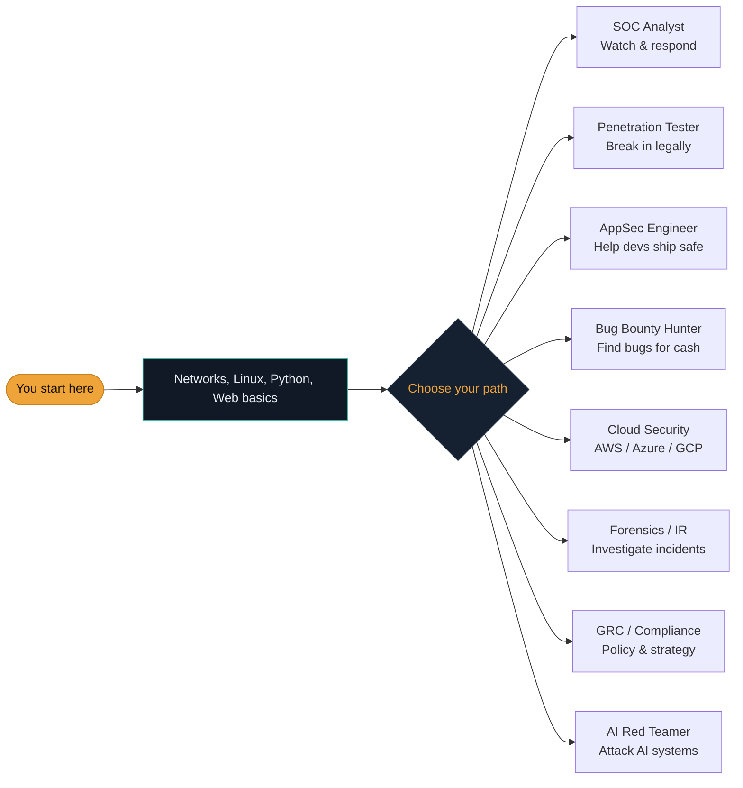

# Types of hackers & the careers ahead

The word "hacker" carries a lot of baggage. Before you can decide what kind of security person *you* want to become, you need the real map — who's who, and the surprising variety of careers this field contains.

## What a "hacker" really is

Strip away the movies and a hacker is simply:

> **Someone who deeply understands how a system works and can make it do things it wasn't designed to do.**

That skill, by itself, is neither good nor evil. A locksmith and a burglar have the exact same knowledge of locks. The difference is **intent and permission** — not knowledge.

## The "hats": good, bad, and in between

The field traditionally sorts hackers by the colour of an imaginary hat, borrowed from old cowboy films where the hero wore white and the villain wore black.

~~~svg The three hats
<svg viewBox="0 0 620 220" xmlns="http://www.w3.org/2000/svg" font-family="Inter, sans-serif">
  <!-- White hat -->
  <g>
    <rect x="30" y="40" width="170" height="150" rx="10" fill="#111927" stroke="#3FB6A8" stroke-width="2"/>
    <text x="115" y="70" font-size="30" text-anchor="middle">🎩</text>
    <text x="115" y="100" font-size="15" font-weight="700" text-anchor="middle" fill="#3FB6A8">WHITE HAT</text>
    <text x="115" y="130" font-size="11" text-anchor="middle" fill="#E9EEF3">Legal</text>
    <text x="115" y="150" font-size="11" text-anchor="middle" fill="#E9EEF3">With permission</text>
    <text x="115" y="170" font-size="11" text-anchor="middle" fill="#E9EEF3">Reports findings</text>
    <text x="115" y="190" font-size="10" text-anchor="middle" fill="#8496A6">— you —</text>
  </g>
  <!-- Grey hat -->
  <g>
    <rect x="225" y="40" width="170" height="150" rx="10" fill="#111927" stroke="#EFA43A" stroke-width="2"/>
    <text x="310" y="70" font-size="30" text-anchor="middle">🎩</text>
    <text x="310" y="100" font-size="15" font-weight="700" text-anchor="middle" fill="#EFA43A">GREY HAT</text>
    <text x="310" y="130" font-size="11" text-anchor="middle" fill="#E9EEF3">Legally risky</text>
    <text x="310" y="150" font-size="11" text-anchor="middle" fill="#E9EEF3">No permission</text>
    <text x="310" y="170" font-size="11" text-anchor="middle" fill="#E9EEF3">Reports anyway</text>
    <text x="310" y="190" font-size="10" text-anchor="middle" fill="#8496A6">— avoid this zone —</text>
  </g>
  <!-- Black hat -->
  <g>
    <rect x="420" y="40" width="170" height="150" rx="10" fill="#111927" stroke="#E05548" stroke-width="2"/>
    <text x="505" y="70" font-size="30" text-anchor="middle">🎩</text>
    <text x="505" y="100" font-size="15" font-weight="700" text-anchor="middle" fill="#E05548">BLACK HAT</text>
    <text x="505" y="130" font-size="11" text-anchor="middle" fill="#E9EEF3">Illegal</text>
    <text x="505" y="150" font-size="11" text-anchor="middle" fill="#E9EEF3">No permission</text>
    <text x="505" y="170" font-size="11" text-anchor="middle" fill="#E9EEF3">Harmful intent</text>
    <text x="505" y="190" font-size="10" text-anchor="middle" fill="#8496A6">— criminal —</text>
  </g>
  <text x="310" y="20" font-size="13" text-anchor="middle" fill="#E9EEF3" font-weight="600">The single line between them is permission</text>
</svg>
~~~

### The three hats explained

- **White hat** — the good guys, also called **ethical hackers**. They break in *with permission* to find weaknesses and help fix them before criminals do. They're hired by companies or work through official programs. **This is what you are training to become.**
- **Black hat** — the criminals. They break in *without permission* to steal, damage, or spy. This is illegal and can lead to prison. We study how they think so we can defend — we never act like them.
- **Grey hat** — the murky middle. They might poke at a system without permission but without meaning harm (e.g., finding a flaw and reporting it uninvited). Intentions may be good, but because there was **no permission**, what they do is usually still illegal and risky.

:::warn THE ONE LINE
The single line separating a white hat from a criminal is **permission**. Same skills, same tools — but the ethical hacker was *invited*. Sub-lesson 1.4 is entirely about this line.
:::

## Beyond the three hats — a few more labels worth knowing

The hat system is a useful simplification, but you'll encounter several more specific labels throughout this course and the wider industry:

- **Script kiddie** — someone with limited technical skill who runs pre-built attack tools written by others, often without fully understanding how they work. Not a skill level to aspire to, but a genuinely common starting point many professionals honestly admit to — the difference is whether you keep learning *why* the tools work, which this entire course is built around.
- **Hacktivist** — an attacker motivated by political or social causes rather than money, defacing websites or leaking data to make a statement. Legally, hacktivism is treated the same as any other unauthorized access, regardless of motive.
- **State-sponsored actor / APT (Advanced Persistent Threat)** — hackers working for or on behalf of a national government, typically extremely well-resourced, patient, and focused on long-term espionage or sabotage rather than quick financial gain. "Persistent" is the key word — these groups often maintain covert access to a target network for months or years before being discovered, referenced again in Path 10's attackers and kill chain lesson.

## Red team, blue team, and purple team — a preview

You'll see these three terms constantly once you reach Path 16's advanced material, so it's worth planting the vocabulary now:

- **Red team** — plays the attacker's role, testing an organization's defenses through realistic, often prolonged simulated attacks (broader in scope and duration than a typical pentest engagement).
- **Blue team** — plays the defender's role, monitoring, detecting, and responding to those simulated (or real) attacks.
- **Purple team** — not a separate group of people, but a *collaborative approach* where red and blue teams actively share findings with each other during an engagement, specifically to improve detection faster than either working in isolation would — Path 16 has a dedicated purple teaming lab built around exactly this idea.

## The jobs you can aim for

"Cybersecurity" isn't one job — it's a whole industry, the way "medicine" contains surgeons, nurses, and pharmacists. Here are the most popular roles:

Let's meet each role briefly. You'll see the full career details in the **[Careers page](#/careers)** and in the roadmap at the end of Paths 11, 09, and 10.

### SOC Analyst
**SOC** stands for **Security Operations Centre** — a kind of security control room. These analysts watch alerts and network activity in real time, spot attacks as they happen, and respond.

:::tip GREAT FIRST JOB
SOC Analyst is one of the most common **first jobs** in security. Entry-friendly, and it gives you a broad view of real-world attacks.
:::

### Penetration Tester ("pentester")
Paid to legally break into a company's systems, then write a report explaining exactly how, so the holes can be closed. Very hands-on, offensive, and hands-on-keyboard.

### Bug Bounty Hunter
An independent hacker who finds flaws in companies' websites through official programs and earns a cash reward for each valid one. Work from home, on your own schedule, for companies worldwide. **Path 15** covers this in depth.

### AppSec (Application Security) Engineer
Works alongside software developers to build safe software from the start, so bugs never ship. Great if you also enjoy building things.

### Cloud Security Engineer
Secures the huge systems companies run on cloud services (Amazon, Microsoft, Google). Fast-growing and in high demand. Path 16 covers this.

### Digital Forensics & Incident Responder (DFIR)
The detective. When an attack happens, they investigate what the attacker did, how they got in, and how to recover. Path 16 covers this too.

### GRC / Security Analyst
**Governance, Risk & Compliance** — the strategic side: managing risk, writing policy, making sure the organisation meets security standards. Great for people who love organisation and structured thinking.

### AI Red Teamer *(new frontier)*
Adversarially tests AI systems (like ChatGPT-style products) for safety and security flaws. Path 18 covers this brand-new field.

## The rough salary shape (just so you know)

Salaries vary enormously by country, but a rough shape looks like this:

| Role | Entry (0–2 yrs) | Mid (3–5 yrs) | Senior (5+ yrs) |
|---|---|---|---|
| SOC Analyst | Entry-friendly | Solid mid | Team lead / SIEM engineer |
| Pentester | Junior consultant | Independent | Principal / Red Team lead |
| Bug Bounty Hunter | Variable | Side income → main | Top hunters do very well |
| AppSec Engineer | Junior | Solid | Principal at big tech |
| Cloud Security | Growing | Strong | Very well compensated |

:::note DON'T CHOOSE YET
You don't have to choose your specialisation now. As you move through this course you'll naturally discover what excites you — breaking things, defending them, investigating them, or building safe ones.
:::

## Which paths in this course lead to which jobs?

Here's the quick map — see the [Careers page](#/careers) for all eight.

| Role | Recommended path order |
|---|---|
| SOC Analyst | 02 → 06 → 08 |
| Penetration Tester | 03 → 09 → 07 |
| AppSec Engineer | 04 → 05 → 07 |
| Bug Bounty Hunter | 05 → 07 → 10 |
| Cloud Security | 06 → 11 |
| Digital Forensics / IR | 03 → 08 → 11 |
| AI Red Teamer | 05 → 07 → 12 |
| GRC / Compliance | 01 → 06 |

:::challenge Test yourself
An ethical hacker and a criminal can have identical skills and use identical tools. What single thing separates them?

Show answer
Permission — the ethical hacker was authorised to test.

:::

## Key terms

- **White / black / grey hat** — ethical, criminal, and in-between hackers.
- **SOC** — Security Operations Centre; a real-time defence team.
- **Pentester** — a professional who legally breaks in and reports how.
- **DFIR** — Digital Forensics & Incident Response; the investigators.
- **GRC** — Governance, Risk & Compliance; the strategic side.

## Recap

- A hacker is someone who deeply understands and can bend systems — the skill is neutral.
- Permission is the one line between ethical and criminal.
- Security is many careers: SOC, pentest, bug bounty, AppSec, cloud, forensics, GRC, AI red team.
- You can wait to choose — clarity comes from working through the course.

???refs
- [Cyberseek — US cybersecurity career pathway](https://www.cyberseek.org/pathway.html) — interactive map of security roles and how they connect.
- [SANS Cybersecurity Career Roadmap](https://www.sans.org/cybersecurity-careers/) — a comprehensive career guide from a top training organisation.
- [TryHackMe Career Paths](https://tryhackme.com/paths) — hands-on paths mapped to real roles.
- [Cyber Career Framework — UK Cyber Security Council](https://www.ukcybersecuritycouncil.org.uk/careers-and-learning/cyber-career-framework/) — 16 cyber specialisms with role descriptions.
???

**Next up →** [A tour of common cyberattacks](#/lesson/01-introduction/common-cyberattacks-overview)
