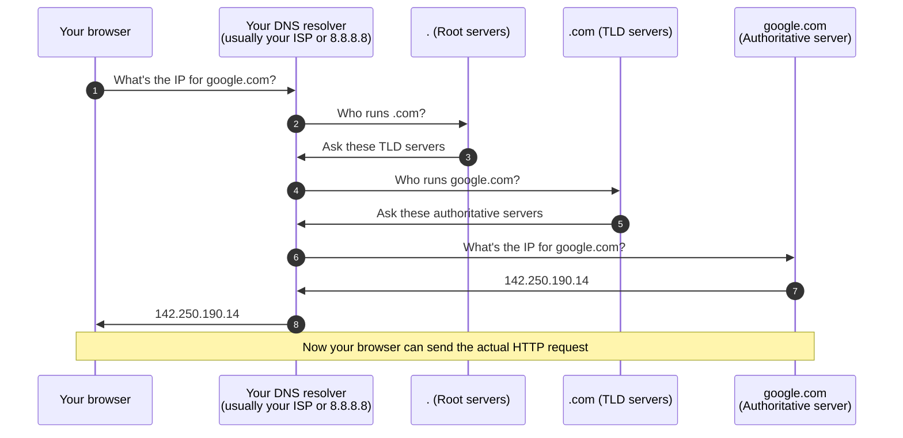

# DNS: the internet's phonebook

You type names, computers use numbers. **DNS** is the translator in between — and it quietly leaks a target's structure, making it a favourite of both attackers and defenders.

## What DNS does

You type `google.com`, but computers find each other using IP addresses like `142.250.190.14`. Something must translate the friendly name into the number. That something is **DNS** (Domain Name System) — think of it as the **internet's phonebook**.

You give it a name, it gives back the number. Without it, you'd have to memorise numeric addresses for every site you visit.

## How a lookup actually works

When you hit Enter on an address, before the page can load, this happens in a fraction of a second:



Almost all these lookups are **cached** so they only really happen once in a while — but this is the flow behind every website you ever open.

## Types of DNS records

DNS stores different kinds of entries. Knowing a few helps in recon:

| Record | What it does |
|---|---|
| **A** | Maps a name → IPv4 address (the main one) |
| **AAAA** | Maps a name → IPv6 address |
| **CNAME** | Alias pointing one name at another |
| **MX** | The mail servers for a domain (reveals email provider) |
| **NS** | Which servers run the domain's DNS |
| **TXT** | Free text — often exposes services in use (SPF, DMARC, verification tokens) |
| **PTR** | Reverse lookup — IP → name |
| **SOA** | Administrative info about the zone |

## Try it yourself

```bash
# Ask DNS for a website's address:
dig google.com +short

# See its mail servers:
dig google.com MX +short

# See TXT records — often reveals services:
dig google.com TXT +short

# Reverse lookup:
dig -x 8.8.8.8

# The simpler cross-platform version:
nslookup google.com

# Modern tool with pretty output:
dog google.com
```

## 🧪 Lab — Explore a domain's phonebook

1. In a terminal, run `dig example.com +short` and note the IP.
2. Run `dig example.com MX +short` — see the mail servers?
3. Run `dig google.com TXT +short` — notice all the third-party services listed?
4. Try it on your own domain if you have one. Notice how much you can learn about a company's tech stack from public records alone, without touching their servers.

## TTL — how long a lookup gets remembered

Every DNS record has a **TTL (Time To Live)** — a number, in seconds, telling resolvers how long they're allowed to cache (remember) that answer before asking again. A low TTL (like 60 seconds) means changes propagate to the world quickly, but generates more repeated lookup traffic; a high TTL (like 86400, a full day) means better caching efficiency, but changes take longer to take effect everywhere. This matters practically: administrators often deliberately lower a record's TTL shortly *before* making a planned change (like moving to a new server), specifically to shrink the window where some users see the old answer and others see the new one — and it matters for reconnaissance too, since historical DNS data (referenced in this path's earlier hands-on lab) exists precisely because some resolvers and services log every answer they've ever cached, TTL or not.

## Why hackers care about DNS

The phonebook quietly reveals structure. By exploring DNS, an attacker can discover forgotten **subdomains** like `mail.company.com`, `test.company.com`, or `old-server.company.com` — each a possible side entrance the owner forgot about. This is a core recon technique in Paths 14 and 10.

Beyond subdomain hunting, DNS has several attack surfaces:

- **DNS spoofing / cache poisoning** — feeding false records into a resolver so users end up on attacker sites.
- **DNS tunneling** — smuggling data (like exfiltrated files or C2 commands) inside DNS queries. Sneaky because DNS is rarely blocked.
- **DNS amplification** — abusing open resolvers for DDoS.
- **Subdomain takeover** — a subdomain points at a service (S3, GitHub Pages, Heroku) that's been deleted; an attacker claims it and hosts anything they like on your domain.

## Defences worth knowing

- **DNSSEC** — signed DNS records; makes forgery detectable.
- **DoH / DoT** — DNS over HTTPS / TLS; encrypts your queries so ISPs and eavesdroppers can't see them.
- **DNS filtering** — services like Cloudflare 1.1.1.1 for Families or Quad9 block known-malicious domains at resolution time.

:::tip A REAL SPEED / PRIVACY TIP
Change your device's DNS server to **1.1.1.1** (Cloudflare) or **8.8.8.8** (Google) or **9.9.9.9** (Quad9). Usually faster than your ISP's default and often better for privacy.
:::

:::challenge Test yourself
Which DNS record type tells you a domain's mail servers?

<details><summary>Show answer</summary>The <strong>MX</strong> record (Mail eXchange).</details>
:::

## Key terms

- **DNS** — turns names into IP addresses (the internet's phonebook).
- **A / AAAA / MX / NS / TXT / CNAME** — different DNS record types.
- **Subdomain** — a name under a domain, e.g. `mail.company.com`.
- **DNS resolver** — the server that does the lookup work for you.
- **Cache** — remembered lookups, to avoid asking again.
- **DoH / DoT** — encrypted DNS.

## Recap

- DNS turns names into IP addresses; without it you'd memorise numbers.
- A lookup happens automatically before any page loads.
- Records like A, MX, and TXT reveal a target's structure.
- `dig` and `nslookup` let you query DNS — a core recon source for finding subdomains.
- Attacks include spoofing, tunneling, amplification, and subdomain takeover.

???refs
- [How DNS works — Cloudflare](https://www.cloudflare.com/learning/dns/what-is-dns/) — best free intro.
- [dnsleaktest.com](https://www.dnsleaktest.com/) — check which DNS server you're actually using.
- [Subdomain takeover explained — HackerOne](https://www.hackerone.com/application-security/guide-subdomain-takeovers) — a classic recon-driven bug.
- [Quad9](https://www.quad9.net/), [Cloudflare 1.1.1.1](https://1.1.1.1/), [OpenDNS](https://www.opendns.com/) — public resolvers with privacy/security features.
???

**Next up →** [HTTP & HTTPS](#/lesson/02-networking/http-https)
