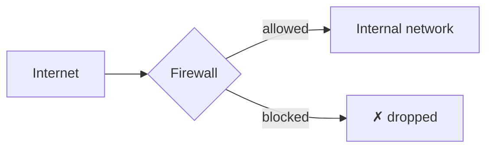

# Firewalls: the basics

You've now met routers, switches, NAT, and VLANs — the pieces that move and organize traffic. This lesson introduces the piece whose entire job is deciding what traffic is even *allowed* to move at all: the **firewall**.

## What a firewall actually does

A **firewall** inspects network traffic against a set of rules and decides whether to allow or block it — the network-level equivalent of the Windows Firewall setting covered in Path 07, but this lesson focuses on **network firewalls**: dedicated devices or software protecting an entire network segment, not just a single machine.

## Rule logic: allow-lists vs. deny-lists

Firewall rules generally work one of two ways:

- **Default-deny (allow-list)** — block everything by default, and explicitly permit only specific, known-necessary traffic. This is the stronger, more secure approach, and it's exactly the same "default-deny" principle Path 24's micro-segmentation lesson champions
- **Default-allow (deny-list)** — allow everything by default, and explicitly block only specific known-bad traffic. Weaker in principle, since it requires anticipating every bad thing in advance, but sometimes used where usability is prioritized over strict security

## Stateful vs. stateless filtering

- **Stateless firewalls** evaluate each individual packet in isolation, using only that packet's own header information
- **Stateful firewalls** track ongoing connections and remember context — recognizing that a specific incoming packet is a legitimate reply to a request your own network already sent out, similar in spirit to how NAT's translation table works from the earlier lesson. Most modern firewalls are stateful, since it allows much smarter, context-aware decisions than evaluating packets one at a time with no memory of what came before

## Where firewalls typically sit

- **Perimeter firewalls** — at the boundary between an internal network and the internet, the most traditional placement
- **Internal/segmentation firewalls** — between internal network segments (VLANs, subnets), directly enforcing the micro-segmentation principle from earlier in this path and covered fully in Path 24
- **Host-based firewalls** — running on an individual device (exactly the Windows Firewall from Path 07), providing a last layer of defense even if network-level firewalls are somehow bypassed

## Why a firewall alone isn't a complete defense

A genuinely important point, worth stating directly: a firewall controls *what's allowed to connect*, but it can't inspect encrypted traffic's actual content in most configurations, and it does nothing to stop an attack riding along on traffic the firewall was specifically configured to allow (a SQL injection attack traveling over an already-permitted HTTPS connection to a web server, for instance). This is exactly why this course covers dozens of other controls (from encryption to input validation to monitoring) rather than treating "we have a firewall" as sufficient on its own.

:::challenge Test yourself
Why is a default-deny firewall policy generally considered more secure than a default-allow policy, even though it requires more upfront configuration work?

Show answer
A default-deny policy only allows traffic that's been explicitly reviewed and approved, meaning anything unanticipated — a new attack technique, a misconfigured service accidentally listening on an unexpected port — is blocked by default rather than allowed through simply because nobody thought to add a rule blocking it specifically. A default-allow policy requires anticipating every possible bad thing in advance and writing a rule to block each one, which is a losing race against attackers who only need to find one thing the defenders didn't think to block. This is exactly the same reasoning behind the default-deny principle covered throughout this course, from micro-segmentation to least-privilege access control.

:::

## Key terms

- **Firewall** — a device or software that inspects traffic and allows or blocks it based on defined rules.
- **Default-deny** — a rule policy blocking everything except explicitly permitted traffic.
- **Stateful firewall** — a firewall that tracks ongoing connection context, rather than evaluating each packet in isolation.

## Recap

- Firewalls decide what network traffic is allowed to pass, using rules that can be default-deny (stronger) or default-allow (weaker).
- Stateful firewalls track connection context, enabling smarter decisions than evaluating isolated packets alone.
- Firewalls exist at multiple layers — perimeter, internal/segmentation, and host-based — each serving a distinct role.
- A firewall alone is never a complete defense; it's one layer among many this entire course covers.

**Next up →** [Common Network Attacks: An Overview](#/lesson/02-networking/common-network-attacks-overview)
