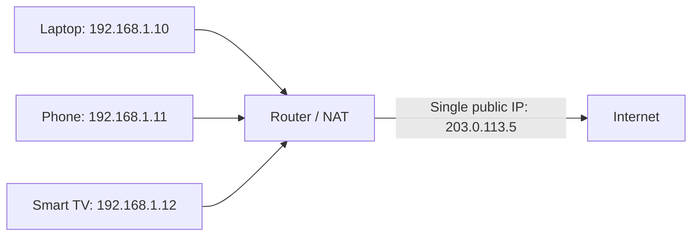

# NAT & Port Forwarding

If your home has five devices online right now, they almost certainly all share a single public IP address as far as the rest of the internet can tell. This lesson explains the clever trick that makes that possible: **NAT**.

## Private addresses vs. public addresses

The subnetting lesson mentioned address ranges. A specific set of IPv4 ranges (`10.0.0.0/8`, `172.16.0.0/12`, and `192.168.0.0/16`) are reserved as **private addresses** — they're not routable on the public internet at all, and every home and office network reuses these exact same ranges internally without conflict, because they never need to be globally unique.

## NAT: sharing one public address among many devices

**Network Address Translation (NAT)** is what your router does to let every device on your private network share a single public IP address when talking to the internet. Your router keeps a translation table tracking which internal device made which outbound request, so when a response comes back, it knows exactly which device on your network to deliver it to.

## Why NAT accidentally works like a basic firewall

A genuinely useful side effect: because NAT only knows how to route *responses* to requests your devices already initiated, unsolicited incoming traffic from the internet generally has nowhere to go by default — there's no existing translation-table entry for it to match. This isn't the same as a real firewall (Path 12 covers that properly), but it does mean home networks behind NAT get a meaningful baseline of protection almost by accident, simply from how NAT is designed to work.

## Port forwarding: deliberately opening a door

Sometimes you genuinely want the outside world to reach a specific device on your network — hosting a game server, running a home security camera you want to check remotely. **Port forwarding** is how you tell your router "any incoming traffic on this specific port should always go to this specific internal device," deliberately punching a hole through the protection NAT provides by default.

:::danger Port forwarding removes a real layer of protection
Every port you forward is a door you've deliberately opened from the entire internet straight to a specific device on your home network. This is exactly why the RDP-exposure lesson in Path 07 warned so strongly against exposing remote access directly — port forwarding is frequently how that exposure actually happens on a home network, often set up for a legitimate reason and then forgotten about entirely.
:::

:::challenge Test yourself
Why does NAT provide accidental protection against unsolicited incoming internet traffic, even though it wasn't designed as a security feature?

Show answer
NAT's translation table only knows how to route <em>responses</em> to requests that a device behind it already initiated — it has no entry, and therefore no idea what to do, with traffic arriving unprompted from the internet. This means an attacker scanning the internet generally can't directly reach a specific device sitting behind a home router's NAT, simply as a side effect of how NAT was designed to solve address-sharing, not as a deliberate security control. Port forwarding deliberately removes this protection for one specific port and device, which is exactly why it should be used sparingly and only when genuinely necessary.

:::

## Key terms

- **Private address** — an IP address range reserved for internal networks, not routable on the public internet.
- **NAT (Network Address Translation)** — the technique letting many devices on a private network share one public IP address.
- **Port forwarding** — deliberately configuring a router to send specific incoming traffic to a specific internal device.

## Recap

- Private IP address ranges are reused across countless home and office networks, since they're never directly reachable from the internet.
- NAT lets many devices share one public IP address, and accidentally provides a baseline of protection against unsolicited incoming traffic as a side effect.
- Port forwarding deliberately opens a specific door through that protection — genuinely useful when needed, but a real, commonly-forgotten exposure risk.

**Next up →** [Ports: the doors of a computer](#/lesson/02-networking/ports)
