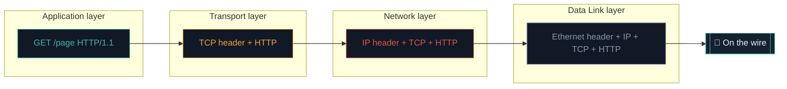

# Packets & the OSI layers

Here's something that surprises most beginners: when you send a large email, watch a video, or download a file, that data **does not travel as one lump.** It's chopped into small pieces called **packets**, which travel separately and are reassembled at the other end.

A lot of both attacking and defending happens at the packet level, so this is a genuine "click" moment.

## The jigsaw-in-envelopes picture

Imagine mailing a completed jigsaw puzzle, but you may only use small envelopes. So you take the puzzle apart, put each piece in its own envelope, and on every envelope write two things: the destination address, and a **number** saying which piece it is (piece 1 of 500, 2 of 500...).

You post them all. They might take different routes and arrive out of order — that's fine, because each is numbered, so your friend lays them out and rebuilds the puzzle perfectly. If one envelope is lost, your friend just asks you to re-send *that one piece*, not the whole puzzle.

~~~svg Data → packets → reassembled data
<svg viewBox="0 0 700 260" xmlns="http://www.w3.org/2000/svg" font-family="Inter, sans-serif">
  <g font-size="12">
    <!-- Source -->
    <rect x="30" y="80" width="120" height="100" rx="8" fill="#111927" stroke="#3FB6A8" stroke-width="2"/>
    <text x="90" y="115" text-anchor="middle" font-size="26">📄</text>
    <text x="90" y="145" text-anchor="middle" fill="#E9EEF3" font-weight="600">Big data</text>
    <text x="90" y="165" text-anchor="middle" fill="#8496A6" font-size="10">"Hello, this is..."</text>
    <!-- Packet 1-4 -->
    <g>
      <rect x="200" y="40" width="90" height="40" rx="4" fill="#2b1f0a" stroke="#EFA43A"/>
      <text x="245" y="65" text-anchor="middle" fill="#EFA43A" font-size="11">📦 #1 "Hello"</text>
      <rect x="200" y="90" width="90" height="40" rx="4" fill="#2b1f0a" stroke="#EFA43A"/>
      <text x="245" y="115" text-anchor="middle" fill="#EFA43A" font-size="11">📦 #2 ", this"</text>
      <rect x="200" y="140" width="90" height="40" rx="4" fill="#2b1f0a" stroke="#EFA43A"/>
      <text x="245" y="165" text-anchor="middle" fill="#EFA43A" font-size="11">📦 #3 " is..."</text>
      <rect x="200" y="190" width="90" height="40" rx="4" fill="#2b1010" stroke="#E05548" stroke-dasharray="3"/>
      <text x="245" y="215" text-anchor="middle" fill="#E05548" font-size="11">📦 #4 lost!</text>
    </g>
    <!-- Different paths -->
    <g stroke="#8496A6" stroke-width="1" fill="none">
      <path d="M 300 60 Q 400 30 500 100" marker-end="url(#a4)"/>
      <path d="M 300 110 Q 400 110 500 130" marker-end="url(#a4)"/>
      <path d="M 300 160 Q 400 200 500 160" marker-end="url(#a4)"/>
    </g>
    <defs><marker id="a4" markerWidth="10" markerHeight="10" refX="9" refY="3" orient="auto"><polygon points="0 0, 10 3, 0 6" fill="#8496A6"/></marker></defs>
    <text x="400" y="20" text-anchor="middle" fill="#8496A6" font-size="10">Different roads across the internet</text>
    <!-- Destination -->
    <rect x="530" y="80" width="140" height="120" rx="8" fill="#111927" stroke="#3FB6A8" stroke-width="2"/>
    <text x="600" y="110" text-anchor="middle" font-size="20">🧩</text>
    <text x="600" y="135" text-anchor="middle" fill="#E9EEF3" font-weight="600">Reassemble</text>
    <text x="600" y="155" text-anchor="middle" fill="#8496A6" font-size="10">by order number</text>
    <text x="600" y="180" text-anchor="middle" fill="#E05548" font-size="10">(re-request #4)</text>
  </g>
</svg>
~~~

That's exactly how packets work. Each packet is one small envelope carrying a piece of your data:

- Each packet carries a **small chunk** of the overall data.
- Each has a **header** — the writing on the envelope — with the destination IP, source IP, port, and order number.
- Packets can take **different paths** and arrive **out of order**.
- The receiver uses the order numbers to **reassemble** everything.
- If a packet is **lost**, only that one is re-sent.

## The layers (a gentle first look at OSI)

Networking is built in **layers**, each doing one job and wrapping the one above it (called **encapsulation**). You don't need to memorise this now, but seeing it once makes everything click later.

The **OSI model** has 7 layers; in practice you'll mostly deal with the simpler **TCP/IP** view of 4 or 5. Here's the honest, simplified version:

| # | Layer | Job | Real-world examples |
|---|---|---|---|
| 7 | **Application** | The programs you actually use | HTTP, DNS, SSH, SMTP |
| 6 | Presentation | Format & encoding | TLS, JSON, JPEG |
| 5 | Session | Session state | (Rare to touch directly) |
| 4 | **Transport** | Reliable delivery + ports | TCP, UDP |
| 3 | **Network** | Routing between networks | IP, ICMP |
| 2 | **Data Link** | On-the-wire framing + MAC | Ethernet, Wi-Fi |
| 1 | **Physical** | The actual signal | Cables, radio waves |

:::tip THE MEMORISATION TRICK
Bottom to top: **P**lease **D**o **N**ot **T**ell **S**ecret **P**asswords **A**nymore.
Physical → Data Link → Network → Transport → Session → Presentation → Application.
:::

## Encapsulation — envelopes inside envelopes

When you send an HTTP request, it doesn't just go as HTTP. It's wrapped up like a Russian nesting doll:



Your HTTP request sits *inside* a TCP segment, *inside* an IP packet, *inside* an Ethernet frame — like a letter inside an envelope inside a mailbag inside a truck. **Wireshark** (Path 08) peels these apart for you and it's genuinely magical to see the first time.

## MTU and fragmentation — when a packet is too big

Every network link has a **Maximum Transmission Unit (MTU)** — a limit on how large a single packet is allowed to be (commonly 1500 bytes on standard Ethernet). If a packet is larger than the MTU of a link it needs to cross, it must be broken down further into smaller pieces, a process called **fragmentation** — genuinely just another, smaller-scale version of the same "break it into pieces" idea this lesson has been building throughout, just happening automatically at a lower layer than the packet numbering described above. Fragmentation is worth knowing about specifically because it's historically been a source of real vulnerabilities — some older attacks exploited how different operating systems handled reassembling deliberately malformed, overlapping fragments differently, causing crashes or security bypasses.

## Why this matters so much for security

Because your data is broken into labelled envelopes travelling shared roads:

- Someone in the middle could try to **read** your envelopes as they pass — which is why **encryption** (scrambling contents, as HTTPS does) matters so much.
- An attacker could **forge** the address on an envelope to impersonate someone — a trick called **spoofing**.
- A defender can **inspect** packets to spot ones that look malicious (deep-packet inspection, IDS).
- Packet-level attacks include **SYN floods, ARP poisoning, DNS spoofing, and packet injection** — all covered later.

:::note THE MOST IMPORTANT LAYERS FOR YOU
As a security learner, you'll mostly work with:
- **Layer 2** (MAC, ARP) — Wi-Fi and local network attacks
- **Layer 3** (IP) — routing, scanning, spoofing
- **Layer 4** (TCP, UDP) — port scanning, connection attacks
- **Layer 7** (HTTP, DNS, TLS) — where most application attacks live

Skip the middle layers until you need them.
:::

:::challenge Test yourself
If one packet gets lost on the way, does the whole message need re-sending?

<details><summary>Show answer</summary>No — only the single lost packet is re-sent, because each is numbered and can be replaced individually. This is what makes TCP reliable and efficient.</details>
:::

## 🧪 Lab — See encapsulation in action

You'll do this properly with Wireshark in Path 08, but a taste now:

1. On Linux/Mac, run:
   ```bash
   sudo tcpdump -c 5 -nn -v icmp
   ```
2. In another terminal, ping a site: `ping -c 3 8.8.8.8`.
3. `tcpdump` will show 5 packets with details. Look at the IP header (`8.8.8.8` and your IP), the ICMP type, sequence numbers — you're seeing real-live layered packets.

## Key terms

- **Packet** — a small numbered chunk of data with a header.
- **Header** — the "writing on the envelope": addresses, port, order number.
- **Encapsulation** — each layer wrapping the one above it.
- **OSI model** — the 7-layer conceptual model of networking.
- **TCP/IP model** — the simpler 4-layer real-world model.
- **Spoofing** — forging an address to impersonate someone.

## Recap

- Data is split into small packets, each a numbered envelope with a header.
- Packets take different routes, arrive out of order, get reassembled; lost ones are re-sent alone.
- Networking is layered (physical → data link → network → transport → application), with encapsulation wrapping each layer.
- Shared roads mean packets can be read, forged, or inspected — the reason encryption and packet analysis exist.

???refs
- [OSI model — Cloudflare Learning](https://www.cloudflare.com/learning/ddos/glossary/open-systems-interconnection-model-osi/) — nicely visual.
- [TCP/IP vs OSI model](https://en.wikipedia.org/wiki/Internet_protocol_suite) — Wikipedia.
- [PacketLife.net cheat sheets](https://packetlife.net/library/cheat-sheets/) — printable references for TCP/IP, IPv4, IPv6.
- [Practical Packet Analysis (book)](https://nostarch.com/packetanalysis3) — Chris Sanders' classic Wireshark book.
???

**Next up →** [What is a protocol?](#/lesson/02-networking/protocols)
