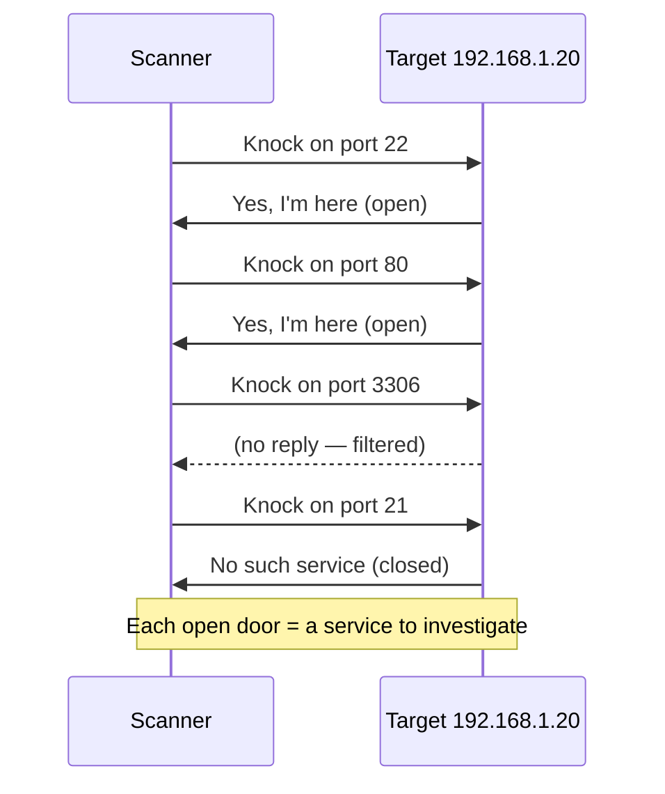

# Ports: the doors of a computer

An IP address gets you to the right *building*. But a computer runs many services at once — a website, an email server, a database, a remote-login service — so once your letter arrives, how does it reach the right *department*? **Ports.**

Understanding ports is the heart of scanning — one of the first things every pentester does on any target.

## Ports are numbered doors

A **port** is a number (from 1 to 65,535) that identifies a specific service on a computer. Picture the building again: the IP gets you to the building, and the port is the specific **door** you knock on.

~~~svg IP + Port = full address
<svg viewBox="0 0 700 260" xmlns="http://www.w3.org/2000/svg" font-family="Inter, sans-serif">
  <g font-size="12">
    <rect x="200" y="30" width="300" height="200" rx="10" fill="#111927" stroke="#EFA43A" stroke-width="2"/>
    <text x="350" y="55" text-anchor="middle" fill="#EFA43A" font-weight="700">Server at 192.168.1.20</text>
    <!-- Doors -->
    <rect x="230" y="80" width="70" height="60" rx="4" fill="#152131" stroke="#3FB6A8"/>
    <text x="265" y="102" text-anchor="middle" font-size="20">🌐</text>
    <text x="265" y="125" text-anchor="middle" fill="#3FB6A8" font-weight="700">:80</text>
    <text x="265" y="155" text-anchor="middle" fill="#8496A6" font-size="10">Website</text>
    <rect x="315" y="80" width="70" height="60" rx="4" fill="#152131" stroke="#3FB6A8"/>
    <text x="350" y="102" text-anchor="middle" font-size="20">🔒</text>
    <text x="350" y="125" text-anchor="middle" fill="#3FB6A8" font-weight="700">:443</text>
    <text x="350" y="155" text-anchor="middle" fill="#8496A6" font-size="10">HTTPS</text>
    <rect x="400" y="80" width="70" height="60" rx="4" fill="#152131" stroke="#3FB6A8"/>
    <text x="435" y="102" text-anchor="middle" font-size="20">💻</text>
    <text x="435" y="125" text-anchor="middle" fill="#3FB6A8" font-weight="700">:22</text>
    <text x="435" y="155" text-anchor="middle" fill="#8496A6" font-size="10">SSH</text>
    <rect x="230" y="160" width="70" height="45" rx="4" fill="#2b1010" stroke="#E05548" stroke-dasharray="3"/>
    <text x="265" y="185" text-anchor="middle" fill="#E05548" font-size="11">closed</text>
    <text x="265" y="200" text-anchor="middle" fill="#8496A6" font-size="10">:3306</text>
    <rect x="315" y="160" width="70" height="45" rx="4" fill="#2b1010" stroke="#E05548" stroke-dasharray="3"/>
    <text x="350" y="185" text-anchor="middle" fill="#E05548" font-size="11">closed</text>
    <text x="350" y="200" text-anchor="middle" fill="#8496A6" font-size="10">:23</text>
    <rect x="400" y="160" width="70" height="45" rx="4" fill="#2b1010" stroke="#E05548" stroke-dasharray="3"/>
    <text x="435" y="185" text-anchor="middle" fill="#E05548" font-size="11">closed</text>
    <text x="435" y="200" text-anchor="middle" fill="#8496A6" font-size="10">:21</text>
    <!-- attacker -->
    <text x="80" y="120" text-anchor="middle" font-size="35">🔎</text>
    <text x="80" y="150" text-anchor="middle" fill="#E05548" font-weight="600">Scanner</text>
    <text x="80" y="170" text-anchor="middle" fill="#8496A6" font-size="10">Knocks on</text>
    <text x="80" y="185" text-anchor="middle" fill="#8496A6" font-size="10">every door</text>
    <line x1="130" y1="130" x2="195" y2="115" stroke="#EFA43A" stroke-width="1.2" marker-end="url(#a3)"/>
    <line x1="130" y1="140" x2="195" y2="140" stroke="#EFA43A" stroke-width="1.2" marker-end="url(#a3)"/>
    <line x1="130" y1="150" x2="195" y2="165" stroke="#EFA43A" stroke-width="1.2" marker-end="url(#a3)"/>
    <defs><marker id="a3" markerWidth="10" markerHeight="10" refX="9" refY="3" orient="auto"><polygon points="0 0, 10 3, 0 6" fill="#EFA43A"/></marker></defs>
  </g>
</svg>
~~~

Ports let one machine offer many services without messages getting mixed up. There are **65,535** possible ports on every machine.

## The well-known ports

A small set of "well-known" ports are used again and again for the same jobs, everywhere in the world:

| Port | Service | What it's for |
|------|---------|---------------|
| **20/21** | FTP | Transferring files (old, insecure) |
| **22** | SSH | Secure remote login to a command line |
| **23** | Telnet | Ancient remote login (never use — plaintext!) |
| **25** | SMTP | Sending email |
| **53** | DNS | The internet's phonebook |
| **80** | HTTP | Normal (unencrypted) websites |
| **110** | POP3 | Receiving email (old) |
| **143** | IMAP | Receiving email |
| **443** | HTTPS | Secure websites (the padlock) |
| **445** | SMB | Windows file sharing |
| **3306** | MySQL | A common database |
| **3389** | RDP | Windows remote desktop |
| **5432** | PostgreSQL | Another common database |
| **8080** | HTTP-alt | Alternate HTTP (often admin panels) |

You don't need to memorise the whole table — but **`22`, `80`, `443`, and `53`** should become second nature.

:::tip HOW PORTS ARE CATEGORISED
Ports 0–1023 are **well-known ports** (assigned by IANA). 1024–49151 are **registered ports**. 49152–65535 are **dynamic/private** ports used for short-lived client-side connections. The service you're scanning nearly always lives in the first range.
:::

## Open, closed, filtered

A port can be in one of three states you'll see constantly:

- **Open** — a service is listening; ready to talk. **This is what attackers hunt for.**
- **Closed** — nothing is listening; the port responds with a "no" but is reachable.
- **Filtered** — a firewall is silently blocking the port. You don't know if it's open or closed.

So the full address of a service is really two parts together:

```
192.168.1.20:443
```

That reads as *"the secure-web door of the machine at 192.168.1.20."* Every service on the internet has this shape.

## Ephemeral ports — the other side of every connection

The well-known ports table above describes the *server's* side of a connection — but your own device also uses a port for every outgoing connection, typically a randomly chosen number from the dynamic/private range (49152–65535) mentioned in the tip above. This is called an **ephemeral port**, and it's genuinely temporary — used only for the duration of that one connection, then released for reuse. This is exactly why, when you open several browser tabs to the same website, each tab's connection uses a *different* ephemeral port on your side, even though they're all talking to the same server port 443 — it's how your device (and the server replying to it) keeps each individual connection distinct.

## How firewalls relate to ports

A **firewall** (covered in full in Path 12) makes its allow/block decisions largely based on ports — a basic firewall rule might say "allow anything on port 443 (HTTPS), block everything on port 3389 (remote desktop) from outside the local network." This is exactly why an unnecessarily open port is a real security risk even before any vulnerability in the service behind it is considered: every open port is one more thing a firewall has to deliberately allow, and one more potential entry point an attacker can find during reconnaissance. The general security principle — **close every port you don't genuinely need running** — is a direct, practical application of the "attack surface" concept from Path 01.

## Scanning = knocking on doors

When you hear a hacker "scanned" a machine, this is exactly what they did: they knocked on many doors to see which open.



Each open door is a service to investigate and a potential way in. In **Path 12** you'll run **Nmap** to do this for real, legally, on `scanme.nmap.org`.

## 🧪 Lab — Match the ports (paper exercise)

Without looking back, write down what these ports are for:

- `22`
- `80`
- `443`
- `53`
- `3389`

Then scroll up and check yourself. Repeat until you can do all five instantly — these five come up constantly.

:::lab BONUS: SEE OPEN PORTS ON YOUR OWN MACHINE
On Linux/Mac, run `ss -tulnp` (or `netstat -tulnp` on older systems).
On Windows, run `netstat -ano`.
You'll see every port currently *listening* on your own computer. Notice how many services are quietly running — even a fresh laptop usually has several.
:::

:::challenge Test yourself
Secure websites (the padlock ones) listen on which port?

<details><summary>Show answer</summary>Port <strong>443</strong> — the secure version of the normal web port, 80.</details>
:::

## Key terms

- **Port** — a numbered door for a specific service (0–65535).
- **Well-known ports** — 0–1023, reserved for standard services.
- **Open / closed / filtered** — the three states a port scan reveals.
- **Listening** — a service is waiting for connections on a port.

## Recap

- Ports are numbered doors that let one computer run many services at once.
- IP finds the building; port finds the right door.
- Key ports: 22 SSH, 53 DNS, 80 web, 443 secure web, 3389 remote desktop.
- Scanning means checking which doors are open — every open door is a possible way in.

???refs
- [IANA Service Name and Port Number Registry](https://www.iana.org/assignments/service-names-port-numbers/service-names-port-numbers.xhtml) — the official global list of every port assignment.
- [Wikipedia: List of TCP and UDP port numbers](https://en.wikipedia.org/wiki/List_of_TCP_and_UDP_port_numbers) — friendly reference.
- [SANS common ports cheat sheet](https://www.sans.org/security-resources/tcpip.pdf) — printable pocket reference.
- [Nmap Port States explained](https://nmap.org/book/man-port-scanning-basics.html) — the definitive doc.
???

**Next up →** [Packets & the OSI layers](#/lesson/02-networking/packets)
