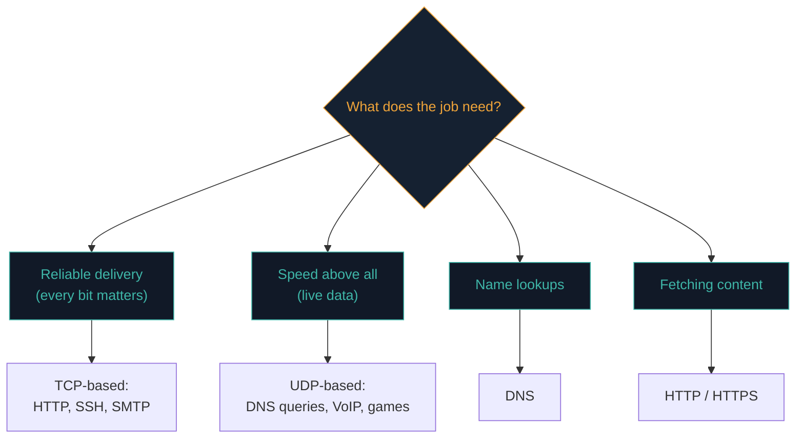

# What is a protocol?

Computers "talk," but talking only works if both sides follow the same rules. Those rules are **protocols**, and the rest of this path is about the specific ones that run the internet.

## Just an agreed set of rules

Think about a phone call. You both follow unspoken rules: one says "hello" first, you take turns, you speak a shared language, and someone says "goodbye" to end it. Without those rules, chaos.

A **protocol** is exactly that for computers: an agreed set of rules for how two machines communicate — how they start, what format messages take, how they confirm receipt, and how they end.

:::tip THE ONE RULE
**Both machines must use the same protocol.** Just as two people must share a language, a Windows machine speaking HTTP can talk to a Linux server speaking HTTP — but neither can suddenly understand a machine speaking a random invented protocol.
:::

## Why there are many protocols

Different jobs have different needs, and rules perfect for one job are clumsy for another.



Loading a web page, sending an email, and running a live video call all need different rules. So we have many specialised protocols, each tuned to its purpose.

Over the next three lessons you'll meet the ones that matter most:

- **TCP and UDP** — how data is carried
- **DNS** — how names become numbers
- **HTTP and HTTPS** — how websites load

You've already met them without realising — port 80 is HTTP, port 443 is HTTPS, port 53 is DNS. Those port numbers are the *doors* where each protocol listens.

## Watching a protocol's rules in action

Protocols aren't abstract — you can watch their actual back-and-forth "conversation" directly. A classic, genuinely educational example is **SMTP** (the email-sending protocol), which is simple enough to speak by hand using a raw text connection:

```
telnet smtp.example.com 25
220 smtp.example.com ESMTP ready
HELO mytest.com
250 smtp.example.com Hello mytest.com
MAIL FROM:<you@mytest.com>
250 OK
RCPT TO:<friend@example.com>
250 OK
DATA
354 Start mail input
Subject: Test
This is a test message.
.
250 OK: queued
QUIT
```

Notice the strict back-and-forth structure: the server greets first (`220`), you introduce yourself (`HELO`), then a rigid sequence of `MAIL FROM` → `RCPT TO` → `DATA` → a message body ending with a lone `.` on its own line. Neither side can skip a step or respond out of order — this rigid structure *is* the protocol, and it's exactly why the same sequence works identically whether you're a Windows machine, a Linux server, or (as in this example) a human typing commands directly over a raw connection.

## Protocol versions — rules evolve too

Protocols aren't fixed forever — they get revised over time as weaknesses are found or better approaches emerge, and both sides of a connection typically negotiate which version to actually use. TLS (the encryption protocol underlying HTTPS, covered in the next lesson) is a good example: TLS 1.0 and 1.1 are now considered insecure and deprecated, while TLS 1.2 and 1.3 are the current, recommended versions — and during connection setup, client and server briefly negotiate the highest mutually-supported version before actual communication begins. Path 17's cryptography material and Path 07's web security lessons both reference this negotiation process directly, since forcing a connection down to an older, weaker protocol version (a technique called a **downgrade attack**) has historically been a real attack vector.

## Where protocols are defined

Real internet protocols are described in documents called **RFCs** (Request For Comments), published by the IETF. They're free, technical, and dense — but they're the actual standard everyone builds against. When you eventually want to know exactly how HTTP or TLS *should* behave, an RFC is your source of truth.

Examples:
- **RFC 9110** — HTTP semantics
- **RFC 1035** — DNS
- **RFC 793** — TCP (superseded by RFC 9293)

:::note YOU DON'T NEED TO MEMORISE PROTOCOLS
As a beginner, just **recognise the main ones and know what each is for.** Recognition, not memorisation. That's enough to understand what's happening in any packet capture or scan output.
:::

:::challenge Test yourself
Why do we have TCP *and* UDP instead of one universal transport protocol?

<details><summary>Show answer</summary>Because different jobs have different needs. Some (web, email) need every bit to arrive reliably in order; others (video calls, games) prioritise speed over perfect delivery. One-size-fits-all would be worse at both.</details>
:::

## Key terms

- **Protocol** — an agreed set of rules for how computers communicate.
- **RFC** — the formal specification document for a protocol.
- **IETF** — the Internet Engineering Task Force; the body that publishes RFCs.

## Recap

- A protocol is a set of rules for how machines talk.
- Both machines must use the same one.
- Many protocols exist because different jobs (web, email, video) have different needs.
- You only need to recognise the main ones and what each is for.

???refs
- [What is a protocol? — Cloudflare](https://www.cloudflare.com/learning/network-layer/what-is-a-protocol/) — beginner-friendly.
- [RFC index — IETF](https://www.rfc-editor.org/rfc-index.html) — the actual standards.
- [Wikipedia: Internet protocol suite](https://en.wikipedia.org/wiki/Internet_protocol_suite) — the big picture.
???

**Next up →** [TCP vs UDP](#/lesson/02-networking/tcp-vs-udp)
