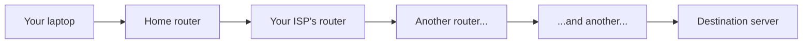

# Routing basics

The what-is-a-network lesson used the post office as an analogy. This lesson introduces the actual postal worker in that analogy: the **router**, the device that decides which direction a packet needs to travel next.

## What a router actually does

Every network you've ever used — your home Wi-Fi, your phone's mobile data, a coffee shop's guest network — sits behind at least one router. A **router**'s single job is looking at a packet's destination IP address (the next lesson goes deeper on IP addresses) and deciding which direction to forward it, based on a **routing table** — essentially a list of "if the destination looks like this, send it this way" rules.

## The default gateway: your network's exit door

Your device has a setting called the **default gateway** — the address of the router your device sends traffic to whenever it doesn't already know how to reach a destination directly. For almost every home device, the default gateway is your home router, and virtually all outbound traffic passes through it on its way anywhere else.

:::note Finding your own default gateway
On Windows, `ipconfig` shows a line labeled "Default Gateway." On Mac/Linux, `ip route` (or the older `netstat -nr`) shows the same thing. It's almost always something like `192.168.1.1` — the same private-range address style covered in the upcoming IP-addresses lesson.
:::

## Hop by hop: how a packet actually crosses the internet

A packet rarely reaches its destination in one jump. It travels **hop by hop** — router to router — with each router only needing to know "which direction gets this packet closer," not the entire path from start to finish. This is genuinely similar to asking for directions in an unfamiliar city: each person you ask doesn't need to know the whole route, just the next useful step.

## Why this matters for security

Understanding routing explains a real attack category you'll meet properly in Path 12: **rogue routers and route manipulation**. If an attacker can trick your device into using a router they control as its default gateway (or manipulate the routing tables along the path), they can potentially intercept, inspect, or alter traffic passing through — the same "man-in-the-middle" positioning idea that keeps showing up throughout this course.

:::challenge Test yourself
Why does a router only need to know "which direction gets a packet closer," rather than the entire path to every possible destination?

Show answer
The internet is far too large for any single router to store a complete map of every possible destination and exact route. Instead, each router only needs to know enough to make one good local decision — forward the packet toward a router that's "closer" in some sense — and trust that the next router will do the same. This hop-by-hop design is what lets the internet scale to billions of devices: no single point needs global knowledge, just good local decisions repeated many times.

:::

## Key terms

- **Router** — a device that forwards packets toward their destination based on a routing table.
- **Default gateway** — the router your device sends traffic to when it doesn't know a more direct path.
- **Hop** — one router-to-router jump along a packet's path.

## Recap

- A router's job is deciding which direction a packet needs to go next, using a routing table.
- Your default gateway is the router your device relies on for almost all outbound traffic.
- Packets cross the internet hop by hop, with no single router needing to know the entire path.
- Manipulating routing (a rogue router, tampered routing tables) is a real attack category covered fully in Path 12.

**Next up →** [IP addresses](#/lesson/02-networking/ip-addresses)
