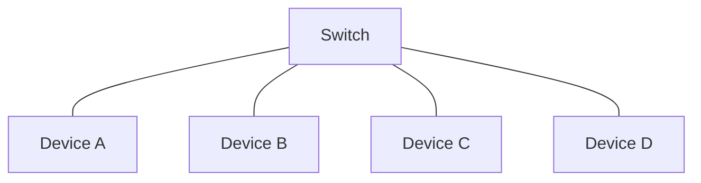

# Switches & VLANs

The routing-basics lesson covered routers, which move traffic *between* networks. This lesson covers the device that moves traffic *within* a single local network: the **switch** — and the clever trick that lets one switch behave like several separate networks at once.

## Switches: connecting devices on the same local network

A **switch** connects multiple devices on the same local network, and (unlike an old-fashioned hub, which simply repeats every signal to every port) intelligently learns which device sits on which port, and forwards traffic only to the port that specific device actually lives on. This is meaningfully more efficient and more private than a hub, since other devices on the switch never see traffic that wasn't meant for them in the first place.

## VLANs: one physical switch, several logical networks

A **VLAN (Virtual Local Area Network)** lets a single physical switch be divided into multiple separate, isolated logical networks — devices in different VLANs generally can't talk to each other at all unless something (typically a router, or a firewall) explicitly allows it, even though they're plugged into the exact same physical hardware.

This is precisely the same segmentation idea covered in Path 24's micro-segmentation lesson and Path 08's cloud subnetting concepts, just implemented at the physical-network layer: instead of buying separate physical switches for, say, a guest Wi-Fi network and an internal staff network, an organization can run both on the same hardware while keeping them logically completely separate.

## Why VLANs matter for security specifically

- **Containing a compromise** — if a device on the guest VLAN gets compromised, VLAN separation means the attacker doesn't automatically have a path to reach devices on the staff VLAN, directly applying the blast-radius reduction principle covered throughout this course
- **IoT and smart-device isolation** — a genuinely common, practical real-world use: putting smart TVs, cameras, and other IoT devices (often built with weaker security practices) on their own VLAN, separate from the devices actually holding sensitive data
- **Compliance and sensitive-data separation** — some regulatory requirements (Path 23's GRC material covers this) specifically expect sensitive systems to be network-isolated from general traffic, and VLANs are frequently the practical tool used to satisfy that requirement

:::danger VLAN hopping is a real, documented attack technique
An attacker who can manipulate specific switch configuration details can sometimes "hop" from one VLAN to another they shouldn't have access to — a genuine attack category covered more fully in Path 12's network security material. Properly configured switches (not accepting untrusted devices as trunk ports, disabling unused ports) meaningfully reduce this risk.
:::

:::challenge Test yourself
Why might an organization put its smart office devices (thermostats, security cameras) on a separate VLAN from the network its employee laptops use?

Show answer
IoT devices like thermostats and cameras are frequently built with weaker security practices than general-purpose computers — less frequent firmware updates, weaker default credentials, and less scrutiny overall. Placing them on a separate VLAN means that if one of these devices is compromised (a genuinely common real-world occurrence), the attacker's access is contained to that VLAN and doesn't automatically extend to the network segment holding employee laptops and sensitive business data — directly applying the blast-radius containment principle that shows up repeatedly throughout this course, from Zero Trust's micro-segmentation to cloud multi-account governance.

:::

## Key terms

- **Switch** — a device connecting multiple devices on the same local network, forwarding traffic only to the intended destination port.
- **VLAN (Virtual Local Area Network)** — a logically isolated network segment running on shared physical switch hardware.
- **VLAN hopping** — an attack technique for improperly crossing from one VLAN into another without authorization.

## Recap

- A switch efficiently connects devices on the same local network, forwarding traffic only to its actual destination.
- VLANs let one physical switch host multiple logically-isolated networks, directly applying the same segmentation principle covered throughout this course at the physical-network layer.
- VLAN separation is a practical, common tool for containing compromise, isolating weaker IoT devices, and meeting compliance requirements around sensitive-data isolation.

**Next up →** [What is a protocol?](#/lesson/02-networking/protocols)
