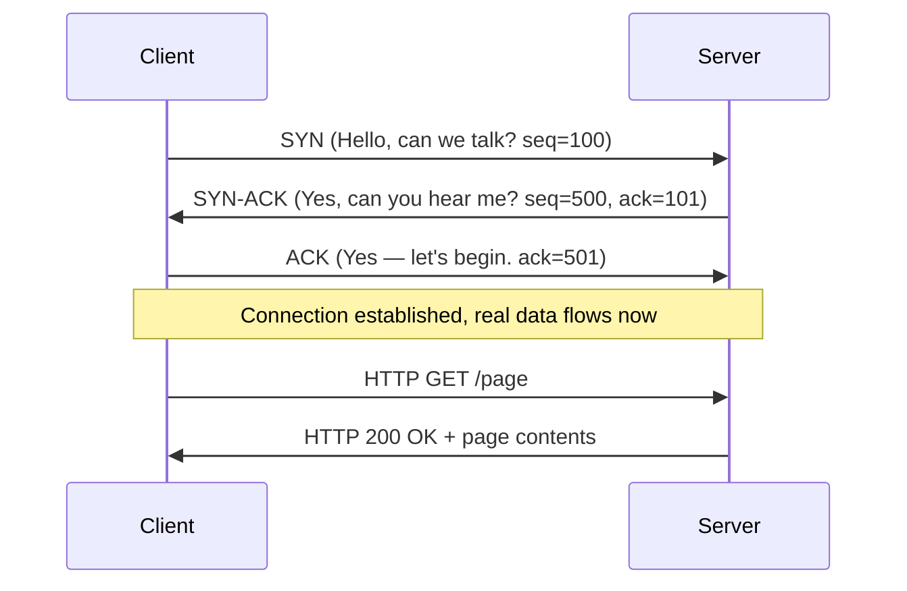

# TCP vs UDP

Almost everything on the internet is carried by one of two protocols: **TCP** or **UDP**. They make opposite trade-offs, and scanning, attacks, and defences behave differently on each. Learn the difference deeply and you'll understand a huge amount of what tools like Nmap and Wireshark are actually doing.

## TCP — the careful, reliable one

**TCP** (Transmission Control Protocol) is like **registered mail** with delivery confirmation. It makes sure every packet arrives, in the right order, and automatically re-sends anything lost. Nothing is lost; everything arrives complete and correct. The trade-off: all that checking makes it slightly slower.

Because it's reliable, TCP is used whenever **every bit matters**: websites, email, file downloads, remote logins. You wouldn't want half a downloaded file or an email with random missing words.

## UDP — the fast, no-fuss one

**UDP** (User Datagram Protocol) is like **dropping a postcard in the box**. Write it, send it, move on. No confirmation, no re-sending, no guarantee it arrives — but it's extremely fast because it skips the checking.

This is perfect when **speed beats perfection**: live video calls, online games, DNS queries. If one video frame is lost, you'd rather the call keep going than freeze while it re-sends an old frame. A tiny glitch beats a delay.

## The TCP three-way handshake

Before TCP sends any real data, the two computers do a quick three-step greeting to agree to talk, called the **three-way handshake**:

- **SYN** — "Hello, can we talk?"
- **SYN-ACK** — "Yes, can you hear me?"
- **ACK** — "Yes — let's begin."

You'll hear these terms constantly. Every TCP connection begins with this ritual.

:::tip WHY A SECURITY LEARNER CARES
Port scanners (like Nmap) work by *starting* this handshake with each port to see which answer — a door that completes the handshake is "open." Attackers can also *abuse* it: flooding a server with endless SYN "hello" requests it must try to answer is an attack called a **SYN flood** (a type of denial-of-service).
:::

## Ending a TCP connection — the teardown

Just as TCP opens carefully with a three-way handshake, it closes carefully too, using **FIN** (finish) and **ACK** packets exchanged by both sides — a graceful four-step process ensuring both computers agree the conversation is genuinely over before either discards its connection state, rather than one side abruptly vanishing mid-conversation. An abrupt, ungraceful termination instead uses a **RST (reset)** packet — immediately killing the connection with no negotiation, normally used to signal an error condition (like connecting to a closed port, referenced in the previous ports lesson) rather than a normal, planned goodbye. This distinction between a clean FIN-based close and an abrupt RST matters directly in Path 12's Wireshark labs, since it's one of the first things worth checking when a captured connection looks unusual — a graceful close suggests normal application behavior, while an unexpected RST often signals something worth investigating further.

## Connection states — a brief preview

Throughout a TCP connection's life, both sides track which "state" the connection is currently in — `LISTEN` (a server waiting for a connection), `SYN_SENT`/`SYN_RECEIVED` (mid-handshake), `ESTABLISHED` (actively exchanging data), and several teardown states. You'll see these exact state names appear directly in tools like `netstat` and `ss` output (Path 07's Windows networking commands, and their Linux equivalents) — recognizing them as literally the handshake and teardown steps you just learned, rather than mysterious jargon, makes reading that output far less intimidating.

## Side by side

|  | **TCP** | **UDP** |
|---|-----|-----|
| Reliability | Guaranteed, ordered | None |
| Speed | Slightly slower | Very fast |
| Handshake | Yes (SYN / SYN-ACK / ACK) | No |
| Ordering | Yes | No |
| Retransmission | Yes | No |
| Header size | 20 bytes | 8 bytes |
| Analogy | Registered mail | Postcard |
| Used for | Web, email, downloads, SSH | Video calls, games, DNS, DHCP |
| Nmap scan flag | `-sS` or `-sT` | `-sU` |

## Real-world example: a video call

A typical video call actually uses **both**:

- **Signalling** (setup, "who's calling whom") uses TCP or WebRTC over TCP — reliability matters.
- **The video/audio stream itself** uses UDP — speed matters more than perfection.

This is why the setup can seem fine but audio glitches: different layers, different protocols, different failure modes.

## Attacks specific to each

- **On TCP:**
  - **SYN flood** — send endless SYN packets, exhausting the server's connection table.
  - **RST injection** — forge a "reset" packet to kill a connection you don't own.
  - **Session hijacking** — predict sequence numbers to inject data into someone's connection (much harder on modern TCP but conceptually important).
- **On UDP:**
  - **UDP flood / amplification attacks** — send small requests that generate large replies to a victim (DNS/NTP amplification).
  - **UDP spoofing** — trivial to spoof source IPs on UDP because there's no handshake.

You'll see these in detail in Path 12.

:::lab TRY IT: SEE A REAL HANDSHAKE
Open Wireshark (Path 12 covers install). Start a capture. In a browser, visit `http://example.com`. Stop the capture. Filter for `tcp.flags.syn == 1`. You'll see the three-way handshake in the first three packets — SYN, SYN-ACK, ACK — before the actual HTTP request. Magic made visible.
:::

:::challenge Test yourself
Which protocol re-sends any lost pieces and guarantees delivery — TCP or UDP?

Show answer
TCP — the "registered mail" one that checks everything arrives.

:::

## Key terms

- **TCP** — reliable, ordered delivery (registered mail).
- **UDP** — fast, unchecked delivery (postcard).
- **Three-way handshake** — SYN, SYN-ACK, ACK to start a TCP conversation.
- **SYN flood** — abusing the handshake to overwhelm a server.
- **Amplification attack** — abusing UDP to bounce large replies at a victim.

## Recap

- TCP is reliable and ordered (web, email, downloads); UDP is fast and unchecked (video, games, DNS).
- TCP starts with a three-way handshake: SYN, SYN-ACK, ACK.
- Scanners use the handshake to find open ports; attackers can abuse it with SYN floods.
- Each protocol has its own attacks — SYN flood on TCP, amplification on UDP.

???refs
- [Cloudflare: What is TCP?](https://www.cloudflare.com/learning/ddos/glossary/tcp-ip/) — clear beginner intro.
- [Cloudflare: What is UDP?](https://www.cloudflare.com/learning/ddos/glossary/user-datagram-protocol-udp/) — same for UDP.
- [RFC 9293 — TCP](https://www.rfc-editor.org/rfc/rfc9293) — the current authoritative spec.
- [CloudflareLearning: SYN flood](https://www.cloudflare.com/learning/ddos/syn-flood-ddos-attack/) — the classic attack.
???

**Next up →** [Wireless networking basics](#/lesson/02-networking/wireless-networking-basics)
