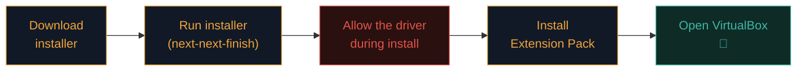

# Install VirtualBox

Time to build your lab. VirtualBox is a free, cross-platform hypervisor from Oracle — the friendliest starting point.

:::warn CHECK VIRTUALIZATION FIRST
Before installing, confirm hardware virtualization is enabled in your BIOS/UEFI. On Windows, open Task Manager → Performance → CPU, and look at the bottom for "Virtualization: Enabled." If it says Disabled, you'll need to reboot into BIOS and turn on **Intel VT-x** (Intel) or **AMD-V / SVM** (AMD). Search "how to enable virtualization [your laptop model]" — every model is a bit different.
:::

## Download

Go to [virtualbox.org/wiki/Downloads](https://www.virtualbox.org/wiki/Downloads) and grab the installer for your host OS:

- **Windows hosts** — VirtualBox for Windows
- **macOS hosts** — VirtualBox for macOS (separate downloads for Intel vs Apple Silicon)
- **Linux hosts** — follow the packages for your distro (Ubuntu, Debian, Fedora, etc.)

Also download the **Extension Pack** on the same page. It adds USB support and a few niceties.

:::note APPLE SILICON MACS
VirtualBox on M1/M2/M3 Macs is currently developer-preview and can be flaky. If you're on Apple Silicon, use **UTM** ([mac.getutm.app](https://mac.getutm.app/)) or **VMware Fusion Player** instead. The rest of this path applies the same way.
:::

## Install — walkthrough



### Windows

1. Double-click the `.exe`.
2. Accept the defaults on each screen.
3. When Windows asks about installing a "device software" from Oracle, click **Install**. Without it, networking inside VMs won't work.
4. Finish, then double-click the **Extension Pack** file — VirtualBox opens and installs it.

### macOS (Intel)

1. Double-click the `.dmg`, then the `.pkg` inside.
2. Follow the prompts.
3. On modern macOS you'll get a **System Extension Blocked** warning. Open **System Settings → Privacy & Security**, scroll down, click **Allow** next to "System software from Oracle America." **Reboot.**
4. Install the Extension Pack the same way as Windows.

### Linux (Debian/Ubuntu)

```bash
# Add Oracle's key & repo (from virtualbox.org/wiki/Linux_Downloads)
sudo apt update
sudo apt install virtualbox virtualbox-ext-pack -y
# Add your user to the vboxusers group (needed for USB):
sudo usermod -aG vboxusers $USER
# Log out and back in for the group to take effect.
```

## Verify it works

Open VirtualBox. You should see:

- A clean window titled **Oracle VM VirtualBox Manager**
- An empty VM list on the left
- A cheerful "Welcome" message

That's it — the lab foundation is built. In the next lesson you'll add Kali.

## Verify your download — a habit worth starting now

Before installing anything, especially security tooling, it's worth building the habit of verifying a download's integrity using its published **checksum** (referenced conceptually back in Path 17's hashing lesson) — a hash value the official site publishes alongside the download, which you can recompute locally and compare:

```bash
# macOS/Linux:
shasum -a 256 VirtualBox-installer.dmg

# Windows PowerShell:
Get-FileHash VirtualBox-installer.exe -Algorithm SHA256
```

If your computed hash doesn't match the one published on virtualbox.org, don't install it — the file may have been corrupted in transit or, in a worse case, tampered with somewhere along the way (exactly the supply-chain risk referenced in Path 11's DevSecOps lab). This habit costs 30 seconds and becomes second nature quickly.

## Common installation issues

| Symptom | Cause | Fix |
|---|---|---|
| "VT-x/AMD-V not available" | Virtualization off in BIOS | Enable Intel VT-x / AMD-V in BIOS |
| "VT-x is being used by another hypervisor" (Windows) | Hyper-V is enabled | Disable Hyper-V: `bcdedit /set hypervisorlaunchtype off` then reboot |
| macOS: extension blocked | Security prompt not answered | System Settings → Privacy & Security → Allow → reboot |
| Kernel driver won't load (Linux) | Secure Boot or missing headers | `sudo apt install linux-headers-$(uname -r)` and disable Secure Boot |
| Slow VM performance | Not enough RAM assigned or 3D acceleration off | Give VM 4 GB+, enable 3D acceleration |

:::tip WSL2 AND VIRTUALBOX
On Windows, if you use WSL2 or Docker Desktop, they both use Hyper-V and can clash with VirtualBox. VirtualBox 7 mostly plays nicely but if you hit issues, disable Hyper-V or use VMware Workstation Player instead.
:::

## 🧪 Lab — Confirm your install

1. Open VirtualBox.
2. Click **File → Preferences → Extensions**. You should see the Extension Pack listed as installed.
3. Click **File → Preferences → Network → Host-only Networks**. Confirm a "VirtualBox Host-Only Ethernet Adapter" exists — we'll use it for isolated lab networks.
4. Take a moment: your machine is now capable of hosting virtual computers. That's a real superpower.

:::challenge Test yourself
Why do we install the Extension Pack in addition to VirtualBox itself?

<details><summary>Show answer</summary>It adds USB device support, PXE boot, disk encryption, and other niceties that VirtualBox core doesn't ship with.</details>
:::

## Key terms

- **VirtualBox** — the free Type-2 hypervisor by Oracle.
- **Extension Pack** — optional add-on with USB support and extras.
- **VT-x / AMD-V** — the CPU features that make virtualization possible.
- **Hyper-V** — Microsoft's own hypervisor; can conflict with VirtualBox.

## Recap

- Download VirtualBox and its Extension Pack from virtualbox.org.
- Enable VT-x/AMD-V in your BIOS if virtualization is off.
- On macOS, allow the Oracle system extension and reboot.
- Apple Silicon users should use UTM or VMware Fusion instead.

???refs
- [VirtualBox Downloads](https://www.virtualbox.org/wiki/Downloads) — always start here.
- [VirtualBox Manual](https://www.virtualbox.org/manual/) — the official docs.
- [How to enable virtualization in BIOS — Intel guide](https://www.intel.com/content/www/us/en/support/articles/000005486/processors.html)
- [UTM for Apple Silicon](https://mac.getutm.app/) — the ARM Mac alternative.
???

**Next up →** [Install Kali Linux](#/lesson/03-linux/install-kali)
