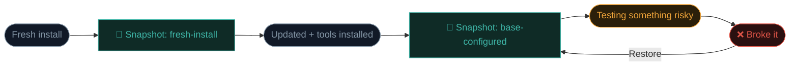

# Snapshots & lab safety

You've got a Kali VM. Before you point it at anything, spend ten minutes on the two habits that separate a professional's lab from a beginner's mess: **snapshots** and **network isolation**.

## Why safety matters — even in a lab

- You'll download and run tools whose behaviour you don't fully understand yet.
- Some deliberately-vulnerable targets you'll practise on (Metasploitable, DVWA) are *actually* insecure — you don't want them exposed to your real network.
- Malware analysis (Path 11) genuinely runs live samples.
- A misconfigured tool run against the wrong target is a career-ending mistake.

Snapshots and network isolation cost minutes. Not using them can cost days.

## Snapshots — undo, forever

A **snapshot** is a saved photo of the VM's state — RAM, disk, everything. You can restore it in seconds to the exact moment you took it. Think Git commits, but for whole machines.

### When to take snapshots

- **`fresh-install`** — right after import, before anything else. Done last lesson.
- **`base-configured`** — after updates and any personal config (hostname, packages, dotfiles).
- **Before each engagement or big experiment** — a snapshot named `pre-<what-you're-about-to-try>`.
- **Before installing a big new tool** you're unsure about.

### How to take one

In VirtualBox Manager: select the VM → **Snapshots** panel (top right) → **Take** → give it a clear name and description.

To restore: select a snapshot → **Restore**. You'll lose changes since that snapshot — that's exactly the point.

:::tip NAMING CONVENTION
Use `date-purpose` style names, e.g. `2026-01-15_before-msf-lab`. Future-you will thank present-you when there are 20 snapshots to sort through.
:::

### Snapshots eat disk

Each snapshot stores the differences from the parent. Ten snapshots on a VM you've been changing heavily can easily use 20–30 GB. Delete old ones (**Delete** in the Snapshots panel) to reclaim space. Deleting merges changes into the parent, so you don't lose newer state.

## Network modes — where does your VM talk to?

VirtualBox offers several network modes. The two that matter most:

| Mode | Guest can reach... | Host can reach guest? | Guest can reach host? |
|------|-------------------|----------------------|----------------------|
| **NAT** | ✅ Internet | ❌ Not by default | ✅ via host IP |
| **NAT Network** | ✅ Internet, other NAT-Net guests | ❌ | ✅ |
| **Bridged** | ✅ Internet **and** everything on your LAN | ✅ | ✅ |
| **Host-only** | Only host and other host-only guests | ✅ | ✅ |
| **Internal** | Only other internal-network guests | ❌ | ❌ |

### The rules that keep you safe

1. **General practise / internet needed → NAT.** Safe default. Your VM gets internet but is isolated from your home LAN.
2. **Attacking a target VM → Host-only or Internal network.** Both VMs on the same isolated segment; no internet, no LAN. Perfect for Metasploitable-style targets.
3. **Never Bridged unless you have a specific reason.** Bridged puts your VM on your real home network — your family's devices are now reachable to Kali (and its tools). Bad idea by default.

~~~svg Safe lab topology
<svg viewBox="0 0 700 280" xmlns="http://www.w3.org/2000/svg" font-family="Inter, sans-serif">
  <g font-size="12">
    <!-- Internet -->
    <ellipse cx="350" cy="50" rx="120" ry="30" fill="#111927" stroke="#8496A6"/>
    <text x="350" y="55" text-anchor="middle" fill="#E9EEF3">🌐 Internet (via NAT only)</text>
    <!-- Isolated lab box -->
    <rect x="30" y="120" width="640" height="140" rx="10" fill="#0C1119" stroke="#3FB6A8" stroke-width="2" stroke-dasharray="4"/>
    <text x="50" y="140" fill="#3FB6A8" font-weight="700">🔒 Isolated lab network (Host-only)</text>
    <!-- Kali -->
    <rect x="60" y="160" width="150" height="80" rx="8" fill="#111927" stroke="#EFA43A"/>
    <text x="135" y="185" text-anchor="middle" font-size="24">🐉</text>
    <text x="135" y="210" text-anchor="middle" fill="#EFA43A" font-weight="700">Kali</text>
    <text x="135" y="228" text-anchor="middle" fill="#8496A6" font-size="10">192.168.56.10</text>
    <!-- Target -->
    <rect x="280" y="160" width="150" height="80" rx="8" fill="#111927" stroke="#E05548"/>
    <text x="355" y="185" text-anchor="middle" font-size="24">🎯</text>
    <text x="355" y="210" text-anchor="middle" fill="#E05548" font-weight="700">Metasploitable</text>
    <text x="355" y="228" text-anchor="middle" fill="#8496A6" font-size="10">192.168.56.20</text>
    <!-- Another target -->
    <rect x="500" y="160" width="150" height="80" rx="8" fill="#111927" stroke="#E05548"/>
    <text x="575" y="185" text-anchor="middle" font-size="24">🎯</text>
    <text x="575" y="210" text-anchor="middle" fill="#E05548" font-weight="700">DVWA</text>
    <text x="575" y="228" text-anchor="middle" fill="#8496A6" font-size="10">192.168.56.30</text>
    <!-- NAT arrow to internet -->
    <line x1="135" y1="160" x2="200" y2="80" stroke="#3FB6A8" stroke-width="1.5" marker-end="url(#a6)"/>
    <text x="105" y="120" fill="#3FB6A8" font-size="10">NAT adapter #2</text>
    <defs><marker id="a6" markerWidth="10" markerHeight="10" refX="9" refY="3" orient="auto"><polygon points="0 0, 10 3, 0 6" fill="#3FB6A8"/></marker></defs>
  </g>
</svg>
~~~

You can add **two adapters** to Kali: adapter 1 as Host-only (for talking to targets), adapter 2 as NAT (for updates and downloads from the internet). Best of both worlds.

## Configure a host-only network

1. VirtualBox Manager → **File → Tools → Network Manager**.
2. **Host-only Networks** tab → **Create**. Note the network name (e.g., `vboxnet0`) and the IP range it gives out (usually `192.168.56.0/24`).
3. For each VM: **Settings → Network → Adapter 1** → *Attached to:* Host-only Adapter → pick the one you just made.

Now those VMs form a private ethernet segment. Kali and your target VM can scan and attack each other; the outside world can't see either.

## Golden rules of a safe home lab

1. **Vulnerable VMs never go on Bridged mode.** They shouldn't be reachable from anywhere but Kali.
2. **Snapshot before every experiment.**
3. **Only run malware in a fully-isolated VM with Internal network mode** — no internet, no host access.
4. **Don't share folders between host and a testing VM** unless you must.
5. **Reset target VMs regularly** — they get progressively "dirty" as you attack them.

:::danger DELIBERATELY VULNERABLE VMS ARE ACTUALLY VULNERABLE
Metasploitable, DVWA, and the like are real machines with real, exploitable flaws. If they touch the internet, they will be attacked by random scanners within minutes and become someone else's foothold. Always keep them on Host-only or Internal.
:::

## 🧪 Lab — Set up a two-adapter Kali

1. Shut down Kali if running.
2. In VirtualBox Manager → Kali → **Settings → Network**.
3. **Adapter 1:** Host-only Adapter → your `vboxnet0`.
4. **Adapter 2:** enable it → NAT.
5. Start Kali. In a terminal, run `ip a` — you'll see two interfaces, one with a `192.168.56.x` address (the host-only network), one with a `10.0.x.x` address (the NAT internet path).
6. Take a snapshot named **`base-configured`**.

You're now set up like a professional. Every future lesson in this course assumes you can get here.

:::challenge Test yourself
Which VirtualBox network mode puts your VM on your real home LAN alongside your family's devices — and why is that usually a bad idea for lab work?

Show answer
<strong>Bridged.</strong> It's bad because your lab VM (or a vulnerable target VM) becomes reachable to every device on your home network — and can reach them back. That defeats the whole purpose of an isolated lab and turns your Kali into a threat to your household.

:::

## Key terms

- **Snapshot** — a restorable saved state of a VM.
- **NAT / Host-only / Bridged / Internal** — VirtualBox network modes.
- **Two-adapter setup** — Host-only for targets + NAT for internet.
- **Metasploitable / DVWA** — deliberately vulnerable practice targets.

## Recap

- Snapshots are your undo button — take them liberally.
- Use Host-only or Internal networks for vulnerable VMs; never Bridged.
- Give Kali two adapters: Host-only (targets) + NAT (internet).
- Snapshot before every risky experiment; restore in seconds if things break.

???refs
- [Metasploitable 2](https://sourceforge.net/projects/metasploitable/) — a deliberately-vulnerable Linux VM to practise on.
- [VulnHub](https://www.vulnhub.com/) — dozens more vulnerable VMs.
- [VirtualBox Networking docs](https://www.virtualbox.org/manual/ch06.html) — the full explanation.
- [DVWA](https://github.com/digininja/DVWA) — Damn Vulnerable Web App, great for Path 07.
???

**Next up →** [Meet the terminal](#/lesson/03-linux/terminal-basics)
