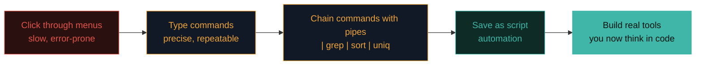

# Why hackers love Linux

There's a reason nearly every security course, tool, and job assumes Linux. Understanding *why* will motivate you to get comfortable with it rather than avoid it.

## The reasons, in plain terms

1. **It's free and open.** Anyone can see, study, and change how it works. That openness means you can understand your tools deeply and even build your own — impossible with closed systems.
2. **It's incredibly powerful from the keyboard.** In Linux you can do enormous things with short typed commands, and — crucially — you can **automate** them by chaining commands into scripts. Almost every hacking tool is really a clever combination of small command-line pieces.
3. **The tools live there.** The overwhelming majority of security tools are built for Linux first (often *only* for Linux). Kali comes with hundreds pre-installed and ready.
4. **It runs the targets.** Since most servers and internet infrastructure are Linux, knowing it helps you both attack and defend the systems you'll actually encounter.
5. **It's transparent.** You can see exactly what's happening — which processes run, what's listening on the network, what every file's permissions are. That visibility is gold for both attackers and defenders.

## By the numbers

Approximate share of Linux in modern computing:

| Where | Rough share |
|---|---|
| Public cloud servers | ~90%+ |
| Top 500 supercomputers | 100% |
| Web servers | ~70%+ |
| Android phones (Linux-based) | Billions |
| Embedded devices / IoT | Dominant |
| Desktop | ~5% (but rising) |

The world runs on Linux — you'll be paid to secure a Linux world.

## The mindset shift

Beginners often fear the terminal because it looks bare and unforgiving. But that bareness is *power*: instead of hunting through menus, you tell the computer precisely what to do and it does exactly that, instantly, repeatably. Once it clicks, going back to clicking through menus feels slow.

You're about to make that shift.



:::tip THE GOAL IS COMFORT, NOT MASTERY
You don't need to become a Linux expert overnight. You need to become **comfortable and unafraid.** Comfort comes from doing the labs, making mistakes in your safe lab, and slowly building muscle memory.
:::

## The Unix philosophy — why chaining commands works so well

Linux's command-line power comes from a deliberate design philosophy inherited from Unix: **write small programs that each do one thing well, and let them work together.** Rather than one giant, monolithic tool trying to do everything, you get dozens of small, focused tools (`grep` searches text, `sort` sorts lines, `uniq` removes duplicates, `wc` counts) that you combine using the pipe (`|`) — exactly the pattern Path 03's later Advanced Terminal Lab builds real skill in. This is precisely why Linux feels so composable once it clicks: instead of hoping a single tool has the exact feature you need, you combine several simple, well-understood pieces into something new, tailored exactly to your specific problem.

## A concrete example — the same task, two ways

Say you want to find every user account on a system with administrator privileges. On Windows, this typically means opening the GUI, navigating to Computer Management → Users and Groups, clicking into the Administrators group, and reading the list manually. On Linux, the same result is one line:

```bash
getent group sudo
```

This isn't just faster typing — it's genuinely more powerful, because that one line can be embedded directly into a larger script, run automatically on a schedule, or executed identically across a hundred remote servers via SSH in a loop — none of which a GUI workflow supports without significant extra tooling. This exact gap — a manual, repeatable-only-by-hand GUI process versus a scriptable, automatable command — is the practical core of why Linux dominates both server administration and security tooling.

## Windows Subsystem for Linux (WSL) — a bonus

If you're on Windows and don't want to run a full VM yet, you can install **WSL** — Windows Subsystem for Linux — which gives you a real Linux terminal inside Windows. It's not a full replacement for a Kali VM (some tools need more), but it's a wonderful way to *practise commands* while you set up the VM later.

```powershell
# In PowerShell as Administrator:
wsl --install
```

That single command installs WSL with Ubuntu. Log out, log back in, open "Ubuntu" from the Start menu, and you're in a real Linux shell. **Genuinely magic** the first time.

:::challenge Test yourself
Give one reason security tools are usually built for Linux rather than Windows.

<details><summary>Show answer</summary>Any of: it's free and open (easy to build on), it's powerful and scriptable from the command line, most servers run Linux, or it's transparent about what's happening. Any one is correct.</details>
:::

## Key terms

- **Open source** — software whose code anyone can view and modify.
- **Automation / scripting** — chaining commands to run tasks automatically.
- **Kali Linux** — a distro pre-loaded with security tools.
- **WSL** — Windows Subsystem for Linux; run Linux inside Windows.

## Recap

- Linux is free, open, powerful from the keyboard, and scriptable.
- Most security tools are built for it, and most targets run it.
- Its transparency helps both attackers and defenders.
- The goal is comfort, not mastery — built through practice.

???refs
- [The Linux Foundation](https://www.linuxfoundation.org/) — the organisation behind Linux.
- [WSL install guide — Microsoft](https://learn.microsoft.com/en-us/windows/wsl/install) — official instructions.
- [OverTheWire Bandit](https://overthewire.org/wargames/bandit/) — the classic free Linux command-line wargame. Do it while you learn this path.
???

**Next up →** [What is virtualization?](#/lesson/03-linux/virtualization)
