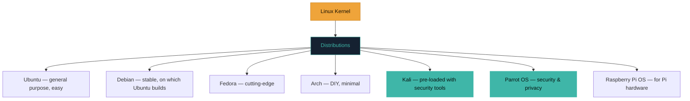

# Windows vs Linux vs macOS

You'll meet all three operating systems as a security professional — as your own workstation, and as systems you defend or test. Knowing their characters helps you pick the right tool and understand your targets.

## The big three

| OS | Made by | Common on | Command line | Permission model |
|---|---|---|---|---|
| **Windows** | Microsoft | Home & office desktops | PowerShell / Command Prompt | Users, groups, SYSTEM |
| **macOS** | Apple | MacBooks & iMacs | Unix-like terminal | Users, `root`, SIP |
| **Linux** | Community | Servers, cloud, embedded | Bash / zsh / others | Users, groups, `root` |

- **Windows** — by far the most common on home and office desktops. Familiar, huge software library, and therefore a huge target simply because so many people use it. Uses PowerShell and Command Prompt, plus a permission model with users, groups, and a powerful account called **SYSTEM**.
- **macOS** — Apple's system on MacBooks and iMacs. Under the hood it's built on **Unix**, which makes its terminal feel very similar to Linux — a nice bonus for security work.
- **Linux** — free, open, and endlessly customisable. It runs **most of the world's servers**, most of the internet's infrastructure, and it is the security professional's favourite working environment.

## Why "flavours" of Linux exist

Linux isn't one single product — it comes in many versions called **distributions** (or "distros"), each a different bundling of the same core system.

- **Ubuntu** and **Debian** are popular general-purpose ones.
- **Kali Linux** and **Parrot OS** are special distros pre-loaded with hundreds of security tools — you'll install Kali shortly.
- **Fedora**, **Arch**, and dozens more — pick your flavour, same kernel underneath.

## You don't have to abandon your current system

Here's the reassuring part: you do **not** need to wipe your laptop and switch to Linux. In the next module you'll run Linux *inside* your existing Windows or Mac, in a window, using virtualization. You keep everything you have and gain a safe Linux playground on top. Best of both worlds.

:::tip WHICH DISTRO SHOULD I USE FOR SECURITY?
As a beginner: **Kali Linux** in a VM. Later, some prefer **Parrot** or a custom **Ubuntu** with tools they install themselves. There's no wrong answer — Kali is the friendliest starting point.
:::

## Market share and why it shapes the threat landscape

Windows' dominance on desktops directly explains a huge share of malware statistics you'll encounter throughout this course: attackers, like any efficient actor, target where the largest number of potential victims are, which is exactly why the overwhelming majority of consumer malware historically targets Windows specifically — not because Windows is inherently less secure architecturally, but because building one exploit that works against the most common target reaches the most victims. Linux's dominance on *servers*, by contrast, means Linux-specific attacks tend to focus on web application vulnerabilities and server misconfigurations (Path 11, Path 12) rather than desktop malware. This "attackers follow the numbers" pattern is worth remembering broadly — it explains a lot of asymmetries you'll notice throughout this course.

## Open source vs. closed source — a security-relevant distinction

Linux's source code is **open source** — publicly viewable and modifiable by anyone — while Windows and macOS are largely **closed source**, with Microsoft and Apple controlling and hiding their internal code. This has a genuine security implication worth understanding both directions of: open source means vulnerabilities can be found by *anyone* examining the code (including many independent researchers constantly reviewing widely-used open source projects, often catching issues faster), but it also means attackers can study that same code for weaknesses. Closed source relies more on "you can't attack what you can't see" — though determined attackers routinely reverse-engineer closed-source software anyway (exactly the skill built in Path 17), so this protection is weaker than it might first appear. Neither model is definitively "more secure" in the abstract; both have genuine tradeoffs.

## File systems — a quick comparison

Each OS defaults to a different file system, briefly worth knowing by name since you'll encounter them in forensics contexts (Path 16's DFIR lab): Windows uses **NTFS**, macOS uses **APFS**, and Linux commonly uses **ext4** (though several alternatives exist). Each has different permission models, journaling behavior (how they recover from a crash without corrupting data), and forensic artifacts left behind — which is exactly why forensic tools are often file-system-aware, extracting meaningfully different evidence depending on which one they're examining.

## A quick sense of the differences

| Task | Windows | macOS | Linux |
|---|---|---|---|
| Install software | Store / installers | App Store / brew | Package manager (apt, dnf, pacman) |
| Change hostname | Settings GUI | Settings GUI | `hostnamectl set-hostname NAME` |
| Show IP | `ipconfig` | `ifconfig` / `ip a` | `ip a` |
| Kill a process | Task Manager | Activity Monitor | `kill <PID>` |
| Admin escalation | UAC prompt | `sudo` | `sudo` |

You'll get comfortable with all of these — but Linux commands are the one you'll type most.

:::challenge Test yourself
What's the word for a specific version/bundle of Linux, like Ubuntu or Kali?

Show answer
A <strong>distribution</strong> (or "distro").

:::

## Key terms

- **Windows / macOS / Linux** — the three major operating systems.
- **Unix** — the older family macOS and Linux both descend from.
- **Distribution ("distro")** — a specific version of Linux (Ubuntu, Kali, Parrot).
- **Package manager** — the built-in tool for installing/updating software (`apt`, `dnf`, `pacman`).

## Recap

- Windows is most common on desktops (and a big target); macOS is Unix-based; Linux runs most servers.
- Linux comes in many distributions; Kali and Parrot are security-focused ones.
- You can run Linux alongside your current OS using virtualization — no need to switch.

???refs
- [DistroWatch](https://distrowatch.com/) — the who's-who of Linux distributions.
- [Kali Linux](https://www.kali.org/) — the security distro you'll install.
- [Ubuntu](https://ubuntu.com/) — the beginner-friendly general distro.
- [Comparison of operating systems — Wikipedia](https://en.wikipedia.org/wiki/Comparison_of_operating_systems)
???

**Next up →** [Why hackers love Linux](#/lesson/03-linux/why-linux)
