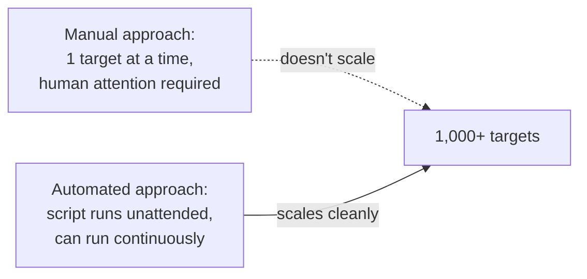

# Automation for Security

You've now built real Python skills — variables, loops, functions, and a working password checker. This lesson makes the case for *why* automation specifically matters so much in security work, before the next lesson has you build several real automation scripts hands-on.

## The scale problem automation solves

A single security analyst or tester simply cannot manually check thousands of subdomains, scan every port on a large network, or review every line of a sprawling log file in a reasonable amount of time — but a script can do exactly that in minutes, tirelessly, without getting bored or making the small copy-paste errors humans reliably make on repetitive tasks. This isn't a minor convenience; it's the difference between what's practically possible and impossible at real-world scale.



## Where automation earns its keep in security

- **Reconnaissance automation** — the recon pipeline referenced throughout this course (Path 14's reconnaissance lesson, Path 15's dedicated pipeline lab) chains subdomain enumeration, live-host probing, and URL gathering into a single script — turning what would be hours of manual tool-switching into one command.
- **Vulnerability scanning automation** — tools like Nmap's NSE scripts (Path 12) and Nuclei (Path 15) run hundreds of known-vulnerability checks automatically, something no analyst could realistically replicate by hand across a large scope.
- **Log analysis and alerting** — Path 16's threat hunting lab practices exactly this: turning a manual "read through the logs" process into a script or query that automatically flags suspicious patterns (repeated failed logins, unusual access times) the moment they appear, rather than requiring a human to notice them during periodic manual review.
- **Report generation** — automatically formatting scan results, findings, and evidence into a consistent report structure (Path 14's reporting lesson) saves substantial time on the tedious, error-prone parts of report writing, freeing attention for the analysis itself.
- **Continuous monitoring** — a one-time manual scan only tells you about right now; a scheduled script re-running your recon/scan pipeline daily or weekly (Path 15's automation & nuclei lesson covers exactly this pattern) catches new exposures — a newly deployed subdomain, a newly disclosed vulnerability affecting a service you already found — that a single point-in-time check would completely miss.

## Rate limiting — automation's most common real-world mistake

A genuinely important caveat, easy to overlook when you're excited about your first working automation script: hitting a target with hundreds or thousands of requests per second, simply because your script *can* run that fast, can crash the target's server, trigger its defensive rate-limiting or IP-blocking systems, or — in an authorized test — violate the explicit Rules of Engagement (Path 01's golden rule lesson) if the client specified acceptable request rates. Responsible automation deliberately throttles itself:

```python
import time

for target in targets:
    scan(target)
    time.sleep(0.5)   # a small, deliberate pause between requests
```

This single `time.sleep()` call is often the difference between a scan that runs invisibly in the background and one that sets off every alarm on the target's network (Path 12's IDS/IPS lesson) — or, worse, one that actually causes a denial of service you never intended. Building rate-limiting into your automation from the start is a genuinely important professional habit, not an afterthought.

## Automation doesn't replace judgment — it multiplies it

A critically important nuance: automation handles the *repetitive, well-defined* parts of security work extremely well, but it doesn't replace the human judgment needed to interpret results, investigate genuinely novel findings, or make the kind of nuanced business-logic assessment covered in Path 15's logic bug hunting lab. The realistic goal is automating away the tedious 80% so your limited attention concentrates on the interesting 20% that actually requires a human — exactly the same principle behind Path 11's discussion of `sqlmap` versus manual SQLi testing.

:::tip Start small — automate one annoying task, not everything at once
The single best way to build real automation skill is picking one specific, repetitive task you already do manually and scripting just that one thing — checking a list of subdomains for which ones are alive, for instance. A working 15-line script beats an ambitious, half-finished framework every time, and this exact "small, working, then extend" approach is what the next lesson's hands-on labs build on directly.
:::

:::challenge Identify your first automation target
Think back through any manual security task you've done in this course so far (checking multiple subdomains, testing several URLs, reviewing a log file line by line) and write down, in plain language, exactly what a script automating that task would need to do — the inputs it takes, the steps it performs, and what output it produces. You'll build this in Python directly in the next lesson.
:::

## Key terms

- **Recon pipeline** — a chained sequence of automated reconnaissance tools, covered in depth in Path 15.
- **NSE (Nmap Scripting Engine)** — Nmap's built-in automated vulnerability/detection scripting system, covered in Path 12.
- **Continuous monitoring** — automation that re-runs periodically to catch new exposures over time, not just a single point-in-time check.

## Recap

- Automation solves a genuine scale problem — checking thousands of targets manually simply isn't practical, while a script handles it in minutes.
- Recon, vulnerability scanning, log analysis, reporting, and continuous monitoring are the core areas where automation delivers the most value in security work.
- Automation multiplies human judgment rather than replacing it — the goal is freeing analyst attention for genuinely novel findings, not eliminating the need for analysis entirely.
- Starting with one small, real, annoying manual task is the most effective way to build genuine automation skill.

???refs
- [ProjectDiscovery tools](https://github.com/projectdiscovery) — subfinder, httpx, nuclei, and more; the free, widely-used toolkit referenced throughout Path 15's recon pipeline material.
???

**Next up →** [Security Scripting Lab](#/lesson/04-python/security-scripting-lab)
