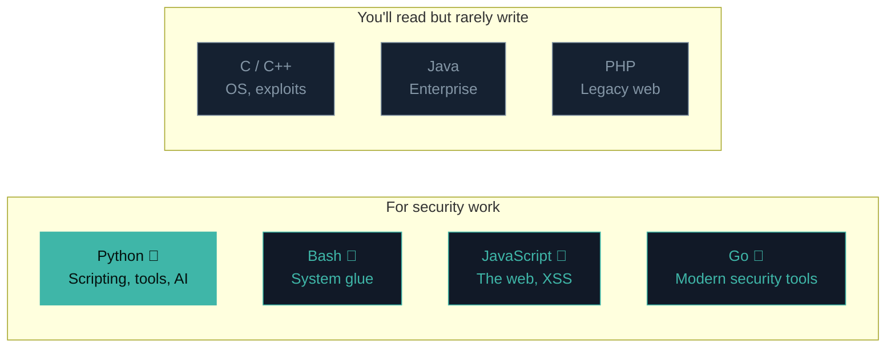
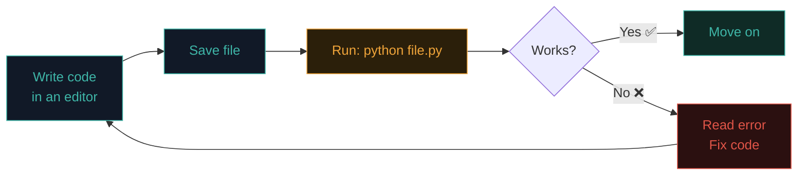

# What is programming?

You've been *typing* commands. Now you'll learn to *write* them — sequences of instructions that a computer can run on demand. That's programming, and it's the doorway to writing your own tools instead of only using other people's.

## The recipe metaphor

A **program** is a recipe. You write down a precise sequence of instructions in a language the computer understands, and it follows them exactly, every time.

The recipe words are English-like on purpose, so humans can read and write them. But the language must be precise — computers don't guess. Every misplaced comma, missing bracket, or wrong indent can change what happens (or crash the program).

## Why learn to program at all?

You don't strictly *need* to code to be in security. But every serious security career benefits enormously from it. Here's why:

- **Automation.** You'll want to check 1,000 URLs, not one. Programming turns "an hour of clicking" into "run this while I get coffee."
- **Understanding vulnerabilities.** Bugs live *in code*. If you can read code, you can see the bug. If you can't, you're guessing.
- **Custom tools.** Off-the-shelf tools cover 80% of what you need. The last 20% — the interesting bugs — often need a script you write on the spot.
- **Career leverage.** Security engineers who can code out-earn those who can't. Every job listing wants "familiarity with a scripting language."

## What "code" looks like

Here's a five-line Python program that keeps asking your name until you say something:

```python
name = ""
while name == "":
    name = input("What's your name? ")
print("Hello, " + name + "!")
```

Read it out loud in English: *"Start with an empty name. While it's still empty, ask for one. Then say hello."* Programming languages are designed to read almost like that.

## The languages you'll meet

You don't need to learn them all — but you'll see them constantly.



For a security beginner, **Python** is the right first language — friendly to read, huge ecosystem, universally used in security tooling. That's what this path teaches.

## How code gets run

Two broad flavours:

- **Interpreted (like Python, Bash, JavaScript):** you write a text file, a program called the *interpreter* reads and runs it line by line. Easy to start, easy to change.
- **Compiled (like C, Go, Rust):** you write a text file, a *compiler* turns it into a machine-code binary you then run directly. Faster to run; extra step to write.

Python is interpreted, so the loop is: **write file → run file → see result.** That fast feedback loop is what makes it perfect for learning.

## The write–save–run cycle



You'll go around this loop hundreds of times as you learn. Every professional does. Bugs are normal — the skill is **reading the error and fixing it.**

## What being "good at code" actually means

For security purposes, "good" doesn't mean writing beautiful abstract software architectures. It means:

1. You can **read** other people's code (exploits, tools, source files) and roughly understand what it does.
2. You can **write** small scripts (10–200 lines) to automate a task in front of you.
3. You can **debug** — when something doesn't work, you read the error and figure out why.
4. You know **when to reach for what** — a one-liner is Bash, a bigger tool is Python, a low-level exploit is C.

Path 04 gets you to points 1–3 with Python. Points 4 develops naturally over your first year.

:::challenge Test yourself
Why is Python usually preferred over Bash once a script grows past ~100 lines?

<details><summary>Show answer</summary>Python handles complex data structures (lists, dicts, objects), error handling, and libraries far more cleanly than Bash. Bash is unbeatable for gluing commands together; Python is unbeatable once real logic is involved.</details>
:::

## Key terms

- **Program / script** — a text file of instructions a computer runs.
- **Language** — the syntax rules (Python, Bash, JS, C, ...).
- **Interpreted / compiled** — run line-by-line vs converted to a binary first.
- **Debugging** — finding and fixing why a program does the wrong thing.
- **Interpreter / compiler** — the tools that run/build your code.

## Recap

- A program is a precise recipe of instructions.
- Programming = automation + understanding + custom tools + career leverage.
- Python is interpreted, friendly, and ideal for a security beginner.
- The write–save–run loop is the whole rhythm.
- Being "good at code" for security means reading, writing, debugging small scripts confidently.

???refs
- [Python.org — About Python](https://www.python.org/doc/essays/blurb/) — official one-page intro.
- [Automate the Boring Stuff with Python](https://automatetheboringstuff.com/) — free full book, project-based, perfect for beginners.
- [freeCodeCamp — Learn Python](https://www.freecodecamp.org/learn) — interactive lessons, free.
- [Real Python](https://realpython.com/) — huge library of tutorials for every stage.
???

**Next up →** [Variables & data types](#/lesson/04-python/variables-types)
