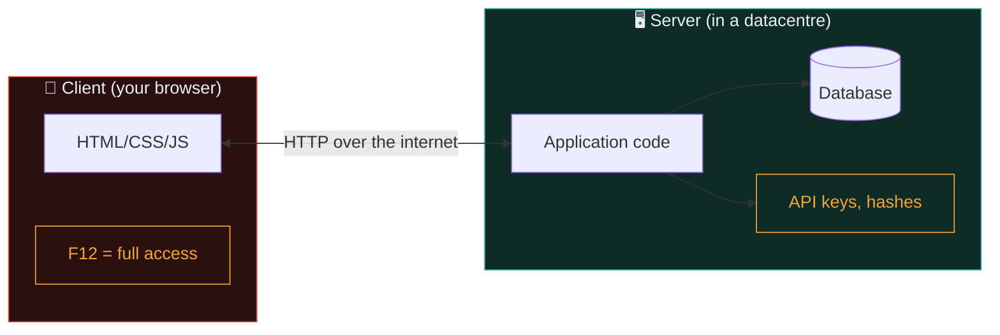

# Client vs server

Half of web security comes down to one question: *whose machine is this running on, and can I trust it?* Let's make that distinction concrete.

## The two sides

- **Client** — the user's browser. Runs HTML, CSS, JavaScript. Fully visible and modifiable by the user.
- **Server** — the machine on the internet the client talks to. Runs the business logic, has the database, holds the secrets.

Every HTTP conversation has both ends. The words "front-end" and "back-end" are the same distinction from a developer's angle.



## The unshakeable rule

**Never trust anything the client sends.**

The user controls the browser. They can:

- Open DevTools and change any value on the page.
- Intercept and modify every request with a proxy (Burp Suite — Path 07).
- Skip your JavaScript entirely and craft a raw HTTP request in `curl` or Python.
- Replay old requests, tamper with cookies, remove headers.

Anything you decide "at the client" — a price on a page, a role in a hidden field, an allowed action grayed-out in the UI — the user can flip. **All security decisions must happen on the server.**

## Classic beginner "security" bugs

Every one of these is a real, common bug beginners write:

### 1. "Admin" checkbox in the request body

```html
<form action="/create-user" method="POST">
  <input type="text" name="username">
  <input type="hidden" name="is_admin" value="false">
  <button>Create</button>
</form>
```

The server *reads* `is_admin` from the form and stores it. But the client controls that field — the attacker just changes `false` to `true` and creates themselves as admin. The `type="hidden"` fools no one.

**Fix:** The server decides admin-ness. Never trust the client's word for it.

### 2. Price on the cart

```html
<input type="hidden" name="price" value="299.99">
```

Same problem. If the server accepts the price the client sends, users buy things for `0.01`. Real e-commerce breaches have looked exactly like this.

**Fix:** The server looks up the price from its own database.

### 3. "Access denied" only in the UI

```javascript
if (user.role !== "admin") {
    hideAdminButton();
}
```

The button is hidden — but the *endpoint* is still there. The attacker just calls it directly:

```bash
curl -X POST https://target/admin/delete-user?id=42 \
     -H "Cookie: session=..."
```

If the server doesn't recheck the role, boom.

**Fix:** Every sensitive endpoint checks authorisation on the server, every single request.

### 4. Client-side validation as security

```javascript
if (email.length > 100) return false;   // client check
```

Great for user experience. Zero security value — the attacker just skips it. You must revalidate on the server.

**Fix:** Validate on the client for UX; **re-validate** on the server for security.

### 5. Trusting the client's math

```javascript
const total = quantity * unitPrice - discount;
fetch("/checkout", { method: "POST", body: JSON.stringify({ total }) });
```

The client computed `total` and simply *told* the server what to charge. Whatever formula ran in the browser is invisible from the server's side — the attacker can open DevTools, edit `total` to `0.01` before the request fires, and the server has no way to know the number didn't come from the real calculation. This exact pattern — trusting a client-computed total, tax amount, or shipping cost — has caused real financial losses at real companies.

**Fix:** The server recomputes the total itself from trusted server-side prices; it never accepts a final number from the client for anything that involves money or permissions.

## What lives where — the honest picture

| Layer | Runs on | Attacker can | Suitable for |
|---|---|---|---|
| **HTML** | Client | Read + edit freely | Structure only |
| **CSS** | Client | Read + edit freely | Style only |
| **JavaScript** | Client | Read + edit + replace | UX, no security |
| **Server code** | Server | Only affect via HTTP | Business logic, security |
| **Database** | Server (usually) | Never directly | Persistent data |

That fourth row is the security boundary. Everything protecting your users must live on the server.

## The API/UI split — same story

Modern apps have a JavaScript UI that calls JSON APIs on the server. Attackers skip your beautiful UI entirely and hit the API directly. They'll find endpoints your UI doesn't even *use* — old ones, admin ones, forgotten ones.

That's why in Path 10 (Bug Bounty) recon focuses heavily on **enumerating APIs**, not just clicking through the UI.

## Cases where the browser IS the target

There's a whole class of attacks where the *client* is the victim, not the server:

- **XSS** — attacker gets their JS running in your victim's browser.
- **CSRF** — attacker tricks the victim's browser into sending a state-changing request.
- **Clickjacking** — attacker embeds your page in a hidden frame and hijacks clicks.
- **Malicious extensions / supply-chain compromised JS** — attacker owns the client via a script you unknowingly loaded.

For these, the *server* is well-behaved; the *browser* is the battleground. You'll defend with headers like CSP, X-Frame-Options, and cookie flags. All covered in Path 07.

## Server-side vs client-side rendering — quick note

You'll hear the terms "server-side rendered" (SSR) and "single-page app" (SPA).

- **SSR:** the server builds the full HTML on every request and ships it. Old-school and a lot of enterprise sites. Bugs skew towards traditional injection.
- **SPA:** the server ships a JS app once; the app then talks JSON APIs. Bugs skew towards DOM-XSS, insecure client-side routing, API auth issues.

Both have plenty of bugs — the *shape* just differs.

## Mobile apps and desktop clients — the same rule, less obvious

It's tempting to think "client vs server" is only about web browsers, but the exact same rule applies to a mobile app talking to an API, or a desktop client talking to a backend. Path 15's mobile security material covers this directly: a mobile app is just as fully in the attacker's control as a browser is — they can decompile it, intercept its traffic with a proxy, and send whatever requests they want directly to the API, completely bypassing the app's own UI and its client-side checks. The lesson generalises far beyond "web pages": **any code running on a device you don't control is a client, and the server must never trust it.**

## 🧪 Lab — Change reality in your own browser

1. Open [example.com](https://example.com) in Firefox → F12 → **Inspector**.
2. Find the `<h1>Example Domain</h1>` element. Double-click, change to `<h1>Hacked</h1>`. Press Enter.
3. Take a screenshot. Show a friend.

You didn't hack anything — you edited *your own copy* of the page. The server is untouched. If you reload, your change is gone.

**Point of the lab:** what you see in DevTools is *your* browser's state. Attackers changing "their" copy of a page changes *nothing* about a server; that would be pointless. Attacks that matter always involve making the *server* do something wrong (steal data, change state, run code).

The dangerous thing they *can* do in DevTools is change what their browser *sends back* to the server. That's the boundary the server has to defend.

:::challenge Test yourself
A developer says "I made this action safe — the button is hidden if you're not an admin." What's the missing sentence you'd add?

<details><summary>Show answer</summary>"And the server also checks the user's role before performing the action." UI hiding is UX, not security. Without a server-side check, the attacker just calls the endpoint directly.</details>
:::

## Key terms

- **Client / server** — user's machine / the internet-facing service machine.
- **Front-end / back-end** — same distinction from a dev's angle.
- **API / UI** — machine-callable / human-facing surfaces.
- **SSR / SPA** — server-rendered / single-page app.
- **Trust boundary** — the point across which data becomes untrusted.

## Recap

- Client = the user's browser and everything they can modify.
- Server = the trusted machine that must enforce security decisions.
- Never trust the client. Validate, authorise, and price on the server.
- Attackers routinely skip the UI and hit APIs directly.
- Some attack classes target the client itself — defended with browser security headers.

???refs
- [OWASP — Insecure Design](https://owasp.org/Top10/A04_2021-Insecure_Design/) — top-10 category that captures many of these mistakes.
- [OWASP API Security Top 10](https://owasp.org/API-Security/editions/2023/en/0x11-t10/) — the API-side parallel.
- [PortSwigger — Business logic vulnerabilities](https://portswigger.net/web-security/logic-flaws)
- [Mozilla — Web security basics](https://developer.mozilla.org/en-US/docs/Web/Security)
???

**Next up →** [Cookies & sessions](#/lesson/05-web-basics/cookies-sessions)
