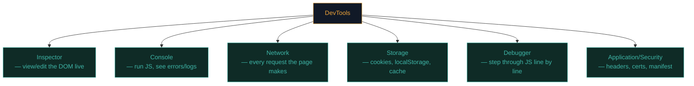

# Browser DevTools tour

DevTools is the single most-used "tool" in web security — and it's already sitting in every browser, free. This lesson is a proper tour so you're fluent before Path 07's hands-on labs.

## Opening DevTools

- **F12** or **Ctrl+Shift+I** (Windows/Linux), **Cmd+Opt+I** (Mac)
- Right-click any element → **Inspect**

We'll use Firefox (pre-installed on Kali), but Chrome's DevTools are nearly identical.

## The panels that matter



### Inspector — the DOM, live

Right-click any element → **Inspect**. You'll see the HTML tree with that element highlighted. Click any tag to select it; edit text or attributes by double-clicking. Changes are **local only** — refresh and they vanish (you learned why in Path 05.3).

Useful sub-panel: the **Rules** view on the right shows every CSS rule affecting the selected element, in priority order — invaluable for understanding *why* something looks the way it does.

### Console — run JavaScript and see logs

Type any JS and press Enter — it runs immediately, in the page's own context.

```javascript
document.cookie                     // see all non-HttpOnly cookies
document.querySelectorAll("input")  // find all input fields
localStorage                        // inspect local storage
fetch("/api/me").then(r => r.json()).then(console.log)  // call an API from console
```

Console also shows JavaScript **errors** and any `console.log()` calls the page's own code makes — sometimes developers leave debug info here that's genuinely useful for recon.

### Network — every request, inspectable

The panel you'll live in during Path 07. Shows every request the page makes: method, URL, status, size, timing. Click any request to see:

- **Headers** — request and response, including cookies and auth tokens
- **Payload/Request** — what was sent (form data or JSON body)
- **Response** — what came back
- **Timing** — where time was spent (DNS, TLS, waiting, downloading)

Filter by type (**XHR/Fetch** to see only API calls), right-click any request → **Copy as cURL** (as you practised last lesson).

:::tip PRESERVE LOG
Enable **Preserve log** at the top of the Network panel before you navigate — otherwise the list clears on every page load, and you'll lose the request that mattered.
:::

### Storage (or "Application" in Chrome)

Shows **Cookies**, **Local Storage**, **Session Storage**, **IndexedDB**, and **Cache**. This is where you did your cookie audit last lesson. Also useful: **Service Workers** (offline caching logic) if a site uses them.

### Debugger — step through JavaScript

Set **breakpoints** by clicking a line number in any loaded script; the page pauses there so you can inspect variables, step line by line, and understand exactly what the code does. Useful when reverse-engineering minified/obfuscated client-side logic (common in Path 10 recon).

### Security / info panel

Firefox: click the padlock icon → **More Information**. Shows the TLS certificate details, whether the connection is secure, and any mixed-content warnings (HTTP resources loaded on an HTTPS page — a real bug class).

## View Source vs Inspector — know the difference

- **Ctrl+U (View Source)** shows the *original* HTML the server sent, before any JavaScript ran.
- **Inspector** shows the *current* DOM, after JavaScript has modified it.

On modern SPAs these can look wildly different — View Source might show almost nothing (`<div id="root"></div>`) while the Inspector shows a fully-built page. Both views matter for different reasons: View Source for what the server actually sent; Inspector for what's actually rendered.

## Responsive Design Mode

Toolbar icon (phone/tablet icon) or **Ctrl+Shift+M**. Simulates different screen sizes and even touch input — useful for testing how a site behaves on mobile, and occasionally reveals mobile-only UI paths that have their own bugs.

## Useful console tricks for recon

```javascript
// List every link on the page:
[...document.querySelectorAll("a")].map(a => a.href)

// List every form and its action:
[...document.querySelectorAll("form")].map(f => ({action: f.action, method: f.method}))

// Find hidden inputs (often reveal internal field names):
[...document.querySelectorAll('input[type="hidden"]')].map(i => `${i.name}=${i.value}`)

// Dump all comments in the HTML (developers sometimes leave secrets!):
document.evaluate("//comment()", document, null, XPathResult.ORDERED_NODE_SNAPSHOT_TYPE, null)
```

These little one-liners are the start of manual web recon — you'll formalise this in Path 07.

## Disabling things to see what breaks

- **Network → Throttling** — simulate slow 3G to test loading states.
- **Disable cache** checkbox — forces fresh requests every time (turn on when testing).
- **Console → block a specific request URL** (right-click a request → Block) — see how a page behaves if a resource fails to load, sometimes reveals fallback logic worth studying.

## 🧪 Lab — Full DevTools sweep

On any site you're allowed to test (your own accounts, or a lab target like `testphp.vulnweb.com` — a legally-practicable target):

1. **Inspector:** find the main navigation `<nav>` element, note its structure.
2. **Console:** run the "list every link" one-liner above. How many links does the page have?
3. **Network:** reload with Preserve log on. Count how many distinct *domains* the page talks to (first-party + third-party).
4. **Storage:** list every cookie. Which have `HttpOnly`? Which don't?
5. **View Source vs Inspector:** compare the two. Are they identical or very different? What does that tell you about how the site is built (SSR vs SPA)?

Write down your five answers. You've just performed a genuine reconnaissance pass using nothing but a browser.

:::challenge Test yourself
You want to see the *exact* raw HTML your server sent, before any JavaScript touched it. Which keyboard shortcut do you use?

<details><summary>Show answer</summary><strong>Ctrl+U</strong> — View Source. The Inspector panel shows the live, JS-modified DOM instead.</details>
:::

## Key terms

- **DevTools** — the browser's built-in inspection suite.
- **Inspector** — live DOM tree viewer/editor.
- **Console** — run JS, view logs/errors.
- **Network panel** — every HTTP request/response, inspectable.
- **View Source** — the original server-sent HTML.
- **Breakpoint** — a paused point in JS execution for debugging.

## Recap

- DevTools (F12) is free, built-in, and the backbone of manual web testing.
- Inspector shows live DOM; View Source shows the original HTML.
- Network panel is where you'll spend the most time — filter, inspect, "Copy as cURL."
- Storage panel reveals cookies and client-side data stores.
- Small console one-liners turn manual browsing into real recon.

???refs
- [Firefox DevTools documentation](https://firefox-source-docs.mozilla.org/devtools-user/) — official, thorough.
- [Chrome DevTools documentation](https://developer.chrome.com/docs/devtools/) — near-identical concepts.
- [testphp.vulnweb.com](http://testphp.vulnweb.com/) — Acunetix's public, legal practice target.
- [PortSwigger — Using Burp alongside browser DevTools](https://portswigger.net/burp/documentation)
???

**Next up →** [Anatomy of a modern web app](#/lesson/05-web-basics/web-anatomy)
