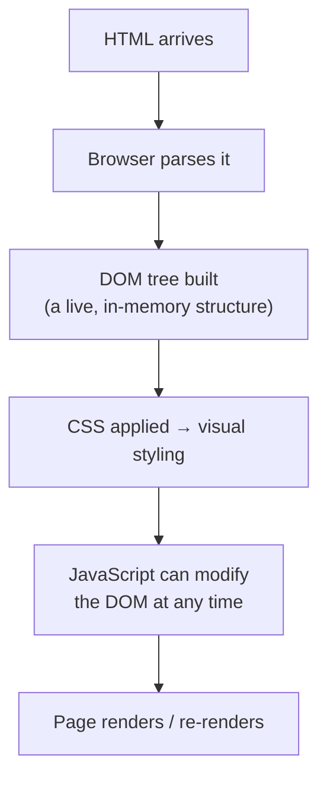

# How browsers render pages

The page-load-journey lesson walked through the request-response cycle. This lesson zooms into one specific step of that journey — what actually happens the instant HTML arrives in your browser, before you see anything on screen at all.

## Parsing HTML into the DOM

The browser reads incoming HTML top to bottom and builds the **DOM (Document Object Model)** — a live, in-memory tree representation of every element on the page. This is genuinely important to understand: the DOM isn't the HTML file itself, it's the browser's *interpretation* of it, and JavaScript (from the HTML-CSS-JS lesson) can modify this tree directly, changing what's displayed without ever touching the original HTML file at all.

## Why this matters for understanding XSS

The DOM being *live and modifiable* is exactly what makes **Cross-Site Scripting (XSS)**, briefly introduced in the HTML-CSS-JS lesson, actually work: if an attacker can get their own JavaScript to run on a page, that script has the exact same ability to read and modify the DOM as the page's own legitimate code does — including reading cookies, modifying displayed content, or capturing what a user types. Understanding that the DOM is just a live tree any running script can touch is the conceptual foundation Path 11's XSS material builds on directly.

## The critical rendering path, briefly

Browsers don't wait for absolutely everything to load before showing you something — they follow a **critical rendering path**: parse HTML, build the DOM, apply CSS, then paint pixels to the screen, updating incrementally as more resources arrive. This is why a slow-loading image doesn't block the rest of a page from appearing, but a `<script>` tag without special handling often does — by default, the browser pauses HTML parsing entirely to fetch and run a script, since that script might modify the DOM being built.

## Why this matters for security tooling specifically

Browser DevTools (covered fully two lessons from now) let you inspect the *live DOM* directly — not the original HTML source, but what the page actually looks like right now, after every script has run. This distinction matters enormously in real security work: "view page source" shows you the original HTML file, while DevTools' Elements panel shows you the current DOM state, and these two can be meaningfully different once JavaScript has modified the page — exactly the gap where a lot of real-world web investigation actually happens.

:::challenge Test yourself
Why might "View Page Source" (showing the original HTML) and a browser's DevTools Elements panel (showing the live DOM) display genuinely different content for the same page?

Show answer
"View Page Source" shows the raw HTML file exactly as it arrived from the server, before any JavaScript has run. The DevTools Elements panel, by contrast, shows the <em>current state of the DOM</em> — which JavaScript may have already modified by adding, removing, or changing elements after the initial page load, exactly as this lesson described. A page that dynamically loads additional content, builds parts of its interface with JavaScript, or gets modified by a script (legitimate or malicious) will show meaningfully different content in these two views — which is exactly why security investigators use DevTools rather than page source when they need to see what a page <em>actually</em> currently contains, not just what it originally shipped with.

:::

## Key terms

- **DOM (Document Object Model)** — the browser's live, in-memory tree representation of a page's elements, built from parsed HTML.
- **Critical rendering path** — the sequence of steps (parse HTML, build DOM, apply CSS, paint) a browser follows to display a page.

## Recap

- The DOM is a live, in-memory tree the browser builds from HTML — not the HTML file itself — and JavaScript can modify it directly at any time.
- This live, modifiable nature of the DOM is exactly what makes XSS attacks work, and it's the conceptual foundation Path 11 builds on.
- DevTools' Elements panel shows the current, possibly-modified DOM state, meaningfully different from "View Page Source"'s original HTML — a genuinely important distinction for real web investigation work.

**Next up →** [HTML, CSS & JavaScript](#/lesson/05-web-basics/html-css-js)
