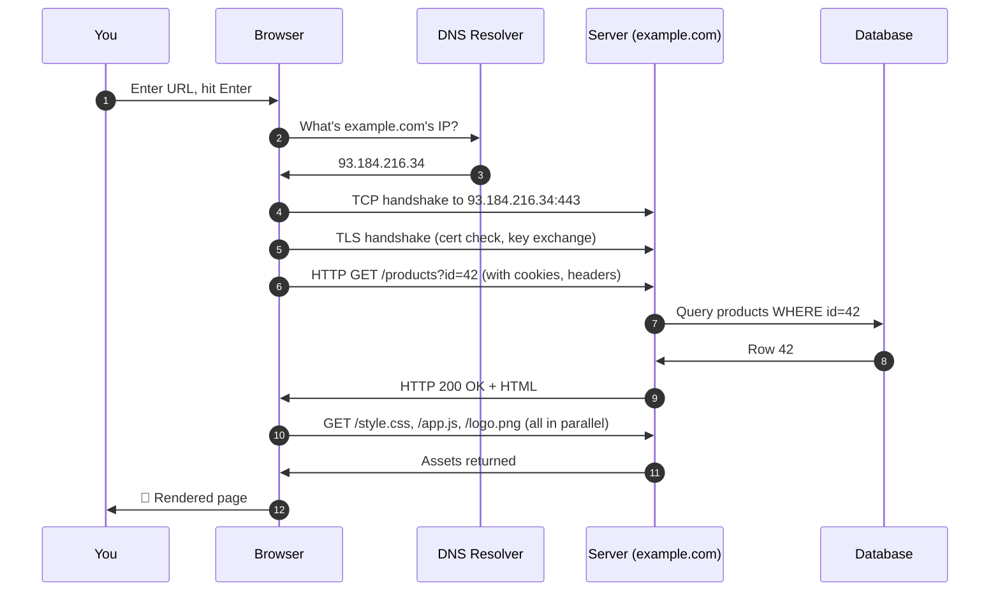

# The page-load journey

Web hacking makes far more sense once you can picture what actually happens when a page loads. In this lesson we trace every step from click to rendered page — the mental model everything else in Path 05 (and Path 07) hangs on.

## Where we're going

You already know a lot of the pieces from Path 02:

- **IP addresses** find the server
- **Ports** find the service (80 for HTTP, 443 for HTTPS)
- **DNS** turns the domain name into an IP
- **TCP** delivers reliably; **TLS** encrypts
- **HTTP** is the request/response language

This lesson stitches them into one continuous story.

## The 8 steps of loading a page

You type `https://example.com/products?id=42` and hit Enter. Behind the scenes:

Step by step:

1. **URL parsed.** The browser splits your URL into scheme (`https`), host (`example.com`), port (`443` by default for HTTPS), path (`/products`), and parameters (`id=42`).
2. **DNS lookup.** Browser asks a DNS resolver: *what IP is `example.com`?* Answer comes back, often cached from a recent lookup.
3. **TCP handshake.** The browser opens a TCP connection to the server's IP on port 443 — the SYN/SYN-ACK/ACK you met in Path 02.
4. **TLS handshake.** Because it's HTTPS, the server presents a certificate, they agree on encryption keys, and now the tunnel is private.
5. **HTTP request.** The browser sends the actual GET, including any cookies for that site and headers describing itself.
6. **Server processes.** The server routes the URL to the right code, possibly hits a **database**, and builds a response.
7. **HTTP response.** Server sends back a status code (usually 200), headers, and HTML.
8. **Assets and rendering.** The browser parses the HTML, discovers references to CSS, JS, and images, requests each of those (often in parallel), then paints the page and runs any JavaScript.

## Where each of Path 02's ideas fits

| Step | Path 02 idea |
|---|---|
| 2 | DNS |
| 3 | TCP three-way handshake |
| 4 | TLS / certificates |
| 5–7 | HTTP request/response, methods, status codes |
| — | Everything travels as packets over IP |

If any earlier lesson felt abstract, this is where they connect.

## Where security lives

Almost every web vulnerability lives in step 5 (the request as the server sees it), step 6 (how the server processes it), or step 8 (how the browser handles the response). A rough map:

| Where | Class of bug |
|---|---|
| **DNS** | Subdomain takeover, DNS spoofing |
| **TLS** | Weak ciphers, missing HSTS, cert mismatches |
| **HTTP request** | SQL injection, IDOR, SSRF, command injection |
| **Session (cookies)** | Session fixation, hijacking, missing flags |
| **Response HTML/JS** | XSS, clickjacking, CSRF |
| **Assets** | Subresource integrity issues, supply-chain attacks |

You'll meet each in Path 07. The point right now is that you can look at any web bug and ask *"which step is this abusing?"*

## First-party vs third-party requests

Modern pages don't just talk to one server. Loading `example.com` might trigger requests to *dozens* of other services — analytics, ad networks, CDNs, fonts, chat widgets. Each is a separate HTTP conversation.

Two implications for security:

- Compromising a **third-party script** on a page effectively compromises the page itself (see the Magecart supply-chain attacks).
- Content Security Policy (**CSP**) headers let a site restrict *where* the browser is allowed to fetch assets — a strong defence against XSS and third-party abuse.

## Caching everywhere

Speed is helped by aggressive caching:

- The **DNS cache** avoids repeated lookups.
- **Browser cache** stores CSS/JS/images so they don't reload each time.
- **CDN (Content Delivery Network)** caches assets close to users globally.
- **HTTP cache headers** (`Cache-Control`, `ETag`) tell everyone how long to keep things.

For security learners, caches matter because **cached content can leak between users** — a classic bug class called **web cache poisoning / deception**, popularised by researcher James Kettle.

## The critical rendering path — why some resources block the page

Not every resource loads and displays equally: the browser must fully download and parse CSS before it can safely paint anything to the screen (since styles can change layout entirely), which is why CSS is called **render-blocking** by default. JavaScript is worse — by default, a `<script>` tag pauses HTML parsing entirely until that script finishes downloading and executing, since the script might use `document.write()` to inject more HTML. This is exactly why modern pages use `async` or `defer` attributes on script tags, and why this course's own app.js lazy-loads Markdown/diagram libraries (referenced in this course's own architecture) rather than blocking the whole page on them. Understanding this **critical rendering path** — which resources genuinely must load before anything appears, versus which can load quietly in the background — explains both real performance engineering and, from a security angle, exactly why a slow or blocked third-party script can sometimes freeze an entire page (a legitimate site reliability concern, and occasionally a deliberate denial-of-service angle).

## 🧪 Lab — Trace a real page load

Open Firefox in Kali, then:

1. Press **F12** → **Network** tab.
2. Enable **Preserve log** and **Disable cache** at the top.
3. Type `https://example.com` in the URL bar and press Enter.
4. Study the list of requests. Click the very first one:
   - What method?
   - What status code?
   - Look at Headers (Request and Response). Familiar words from Path 02?
   - Look at Timings — where was the time actually spent?

You've just watched every step of the journey with your own eyes.

:::challenge Test yourself
When you type `example.com` in your browser, roughly what's the **first network activity** that happens after your keystroke?

Show answer
A <strong>DNS lookup</strong> — the browser needs to translate <code>example.com</code> to an IP address before it can open a TCP connection.

:::

## Key terms

- **URL parts** — scheme, host, port, path, query.
- **DNS lookup / TCP handshake / TLS handshake** — the three "before you ever see HTTP" steps.
- **Assets** — CSS, JS, images, fonts, requested after the HTML.
- **CDN** — geographically-distributed asset cache.
- **First-party / third-party requests** — same-site vs external.

## Recap

- Every page load: URL parse → DNS → TCP → TLS → HTTP request → server processing → response → assets → render.
- Almost every web vulnerability abuses one of the steps in the request/response cycle.
- Modern pages talk to many servers; third-party scripts are a huge attack surface.
- Caching everywhere creates its own class of bugs.

???refs
- [High Performance Browser Networking (free online book)](https://hpbn.co/) — Ilya Grigorik's masterwork; every chapter is gold.
- [MDN: How the web works](https://developer.mozilla.org/en-US/docs/Learn/Common_questions/Web_mechanics/How_does_the_Web_work)
- [Web cache deception — James Kettle](https://portswigger.net/research/practical-web-cache-poisoning) — the classic research paper.
- [What happens when you type a URL — GitHub gist collection](https://github.com/alex/what-happens-when) — deep dive.
???

**Next up →** [HTML, CSS & JavaScript](#/lesson/05-web-basics/html-css-js)
