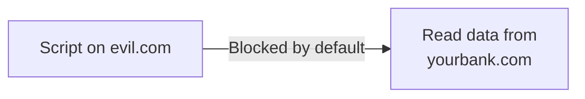

# Same-Origin Policy & CORS

You now understand cookies, storage, and how the DOM works. This lesson covers arguably the single most important security boundary in the entire web platform — one that quietly protects nearly everything else you've learned about in this path.

## What an "origin" actually is

An **origin** is defined by exactly three things together: the **scheme** (http vs. https), the **host** (the domain name), and the **port**. Two URLs share the same origin only if all three match exactly:

```
https://example.com:443/page1   and   https://example.com:443/page2   → SAME origin
https://example.com             and   http://example.com               → DIFFERENT origin (scheme differs)
https://example.com             and   https://api.example.com          → DIFFERENT origin (host differs)
https://example.com             and   https://example.com:8080         → DIFFERENT origin (port differs)
```

## The Same-Origin Policy: the web's default trust boundary

The **Same-Origin Policy (SOP)** is a browser-enforced rule: a script running on one origin cannot read data from a different origin by default — a script on `evil.com` cannot use JavaScript to read your cookies, localStorage, or the DOM content of a page open on `yourbank.com`, even if both are open in tabs at the same time. This single rule is the foundation nearly every other web security mechanism this course covers builds on top of.



## CORS: deliberately relaxing the boundary, safely

Sometimes a legitimate application genuinely needs to make requests across origins — a frontend on `app.example.com` calling an API on `api.example.com`. **CORS (Cross-Origin Resource Sharing)** is the mechanism that lets a server explicitly opt into allowing specific cross-origin requests, via response headers:

```
Access-Control-Allow-Origin: https://app.example.com
```

The server, not the browser or the requesting script, decides which origins are allowed — meaning a misconfigured CORS policy is entirely a server-side mistake, not a browser flaw.

## The dangerous misconfiguration: reflecting any origin

:::danger A genuinely common, serious CORS misconfiguration
```
Access-Control-Allow-Origin: *
Access-Control-Allow-Credentials: true
```
This combination — allowing *any* origin while also allowing credentials (cookies) to be included — effectively disables the Same-Origin Policy's protection entirely for that endpoint, since literally any website can now make authenticated, credentialed requests on a logged-in user's behalf and read the response. This exact misconfiguration pattern shows up repeatedly in real-world bug bounty reports (Path 15) and is directly related to the CSRF concepts covered later in Path 11.
:::

## Why this connects directly to your earlier lessons

- **Cookies** — the Same-Origin Policy is exactly what prevents a malicious site from directly reading your session cookie for a different site using JavaScript (though cookies still get *sent* automatically with cross-origin requests unless additional protections are configured — the exact mechanism behind CSRF, covered fully in Path 11)
- **localStorage** — protected by the same origin boundary; a script on a different origin genuinely cannot read another origin's localStorage at all, unlike the cookie-sending behavior above
- **APIs** — the next lesson's API calls frequently need CORS configured correctly specifically to let a legitimate frontend talk to a backend on a different subdomain

:::challenge Test yourself
Why is `Access-Control-Allow-Origin: *` combined with `Access-Control-Allow-Credentials: true` considered a serious misconfiguration, rather than just an overly permissive but harmless setting?
<details><summary>Show answer</summary>Together, these two headers tell the browser "any website in the world is allowed to make requests to this endpoint, <em>and</em> include the user's credentials (cookies) with those requests, and read the response." This effectively grants every other website on the internet the ability to make authenticated API calls on behalf of any user who happens to be logged in and visiting that malicious site — reading private data, and depending on the endpoint, potentially performing actions on the user's behalf too. This is exactly why browsers actually refuse to honor this specific combination in modern implementations (a wildcard origin combined with credentials is explicitly disallowed by the CORS specification) — but developers can still accidentally create an equivalent, exploitable misconfiguration by dynamically reflecting whatever origin a request claims to be from, rather than checking it against a genuine allow-list.</details>
:::

## Key terms

- **Origin** — the combination of scheme, host, and port that defines a security boundary on the web.
- **Same-Origin Policy (SOP)** — the browser-enforced default rule preventing cross-origin script access to another site's data.
- **CORS (Cross-Origin Resource Sharing)** — the server-controlled mechanism for deliberately permitting specific cross-origin requests.

## Recap

- The Same-Origin Policy is the foundational browser security boundary nearly every other web security mechanism in this course builds on.
- CORS lets a server deliberately, explicitly relax that boundary for specific trusted origins — but a misconfigured, overly permissive CORS policy (especially combined with credentials) can effectively disable the protection entirely.
- This boundary is exactly what protects your cookies and localStorage from being read by a different website's script, even when both are open simultaneously.

**Next up →** [APIs & JSON](#/lesson/05-web-basics/apis-json)
