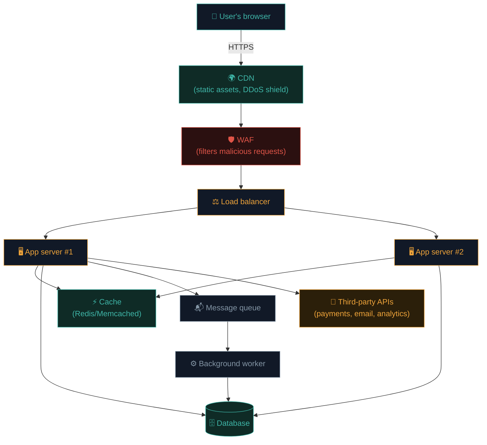

# Anatomy of a modern web app

Let's zoom all the way out and assemble every piece from Path 05 into one map. By the end you'll be able to look at *any* website and mentally sketch its architecture — the skill that makes every later path click faster.

## The full stack, layer by layer



Not every site has all of this — a small blog might just be CDN → single server → database. A large SaaS platform has every layer and more. But this is the mental map to reach for.

## What each layer does — and its typical bug class

| Layer | Job | Typical bug class |
|---|---|---|
| **CDN** | Serve static files fast, absorb traffic spikes | Cache poisoning, misconfigured CORS |
| **WAF** | Block obviously malicious requests (SQLi patterns, known bad bots) | Bypasses via encoding, HTTP smuggling |
| **Load balancer** | Spread traffic across servers | Request smuggling, inconsistent routing |
| **App server** | Runs your business logic | Nearly everything — SQLi, XSS, IDOR, auth bugs |
| **Cache** | Speed up repeated data | Cache poisoning, stale-data leaks |
| **Database** | Persistent storage | SQL injection, weak access controls |
| **Queue / worker** | Async / background jobs (emails, reports) | Insecure deserialization, injection via job data |
| **Third-party APIs** | Payments, email, analytics | SSRF pivoting, leaked keys, supply-chain compromise |

## Monolith vs microservices

- **Monolith** — one application does everything (auth, orders, emails, all in one codebase/server). Simpler to reason about; a single bug can expose everything.
- **Microservices** — many small services, each doing one job, talking over the network (often internal APIs). More resilient to a single bug, but the *internal* network between services becomes its own attack surface (Path 16 covers this in cloud/container contexts).

Most companies you'll test are somewhere in between — a big monolith with a few newer microservices bolted on.

## Where "the front-end" actually runs

Modern front-ends fall into three broad camps:

- **Server-rendered (SSR/MPA)** — every page navigation is a full server round-trip. Older style, still hugely common (WordPress, Django templates, Rails views).
- **Single-page app (SPA)** — one HTML shell, JavaScript takes over routing and fetches JSON. React, Vue, Angular apps.
- **Hybrid (SSR + hydration)** — server renders the first page for speed/SEO, then JavaScript "hydrates" it into a full SPA. Next.js, Nuxt, SvelteKit.

You can usually tell which is which with the View Source vs Inspector trick from last lesson.

## Authentication vs authorization — don't confuse these

Two words that sound similar and get conflated constantly, but mean very different things:

- **Authentication (AuthN)** — *"who are you?"* Logging in, proving identity.
- **Authorization (AuthZ)** — *"what are you allowed to do?"* Checking permissions on every action.

A huge fraction of real-world bugs are **authorization** failures on systems with *perfectly fine* authentication — you're definitely logged in as yourself, the app just forgot to check whether *you* should see *this* particular resource. That's IDOR (Path 11), and it's one of the most commonly found bugs in bug bounty (Path 15).

## Staging, development, and internal environments

Production isn't the only environment a company runs — most maintain `staging.example.com`, `dev.example.com`, or `internal.example.com` copies of the same application, used for testing changes before they ship to real users. These environments are consistently a rich hunting ground precisely *because* they're treated as less important: weaker passwords, verbose debug error pages left enabled, outdated software versions not yet patched, or sometimes no authentication at all because "no one will find it." Subdomain enumeration (Path 02's DNS lesson, formalised properly in Path 15's recon pipeline) is largely a hunt for exactly these forgotten, lower-guard copies of the real application.

## Reading a site's architecture in 5 minutes

A practical checklist you can run on any target:

1. **`curl -I` the homepage.** Look at `Server`, `X-Powered-By`, and any framework-specific headers.
2. **View Source vs Inspector.** SSR, SPA, or hybrid?
3. **F12 → Network → filter by domain.** How many third parties does it load?
4. **Check for a CDN.** `dig` the domain — Cloudflare/Akamai/Fastly IP ranges and headers (`CF-Ray`, `X-Cache`) are giveaways.
5. **Look for API docs.** Try `/api`, `/api/docs`, `/swagger`, `/graphql`.
6. **Check robots.txt and sitemap.xml.** Often reveal hidden or forgotten paths.

```bash
curl -sI https://example.com
curl -s https://example.com/robots.txt
curl -s https://example.com/sitemap.xml
dig example.com
```

This exact checklist is the opening move of Path 11's recon lesson and Path 15's bug bounty methodology — you're getting a head start right now.

## 🧪 Lab — Architect-sketch three real sites

Pick three websites you use regularly. For each, spend five minutes with the checklist above and sketch (on paper or in a notes app) your best guess at their architecture: CDN? WAF? SSR or SPA? Third parties loaded? Any exposed API docs?

Compare your sketches. You'll likely notice big, well-funded sites have more defensive layers (WAF, CDN, strict CSP) than small ones — a pattern that holds broadly across the industry and matters when you're prioritising targets in Path 15.

:::challenge Test yourself
A tester finds that Alice, logged in normally, can view Bob's private invoice by changing an ID in the URL. Is this an authentication bug or an authorization bug?

<details><summary>Show answer</summary><strong>Authorization.</strong> Alice's identity is correctly authenticated — the app knows she's Alice. The bug is that it fails to check whether Alice is <em>allowed</em> to view that specific invoice. This is the classic IDOR pattern.</details>
:::

## Key terms

- **CDN / WAF / load balancer** — the layers in front of your app server.
- **Monolith / microservices** — one big app vs many small ones.
- **SSR / SPA / hybrid** — where rendering happens.
- **Authentication vs Authorization** — who you are vs what you can do.
- **IDOR** — the classic authorization failure (full detail in Path 11).

## Recap

- Real web apps are layered: CDN, WAF, load balancer, app servers, cache, database, queues, third parties.
- Each layer has characteristic bug classes.
- Authentication and authorization are different — most real bugs are authorization failures.
- A 5-minute recon checklist (headers, source, network, robots.txt) reveals a lot about any site's architecture.

???refs
- [OWASP — Authentication vs Authorization](https://owasp.org/www-community/Broken_Access_Control) — the difference, explained properly.
- [High Performance Browser Networking](https://hpbn.co/) — the architecture chapters especially.
- [Cloudflare Learning Center](https://www.cloudflare.com/learning/) — excellent plain-English explainers on CDN, WAF, DDoS.
- [PortSwigger — Access control vulnerabilities](https://portswigger.net/web-security/access-control)
???

## 🎉 You've finished Path 05

You can now trace a full page load, distinguish HTML/CSS/JS, reason about client vs server trust boundaries, understand cookies and sessions, read and call JSON APIs, navigate DevTools fluently, and sketch the architecture of any real website. This is the complete mental model Path 11 (Web Security) builds directly on top of.

**Next up →** [Web caching basics](#/lesson/05-web-basics/web-caching-basics)
