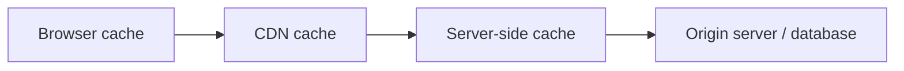

# Web caching basics

The web-anatomy lesson gave you the full picture of a modern web app's pieces. This lesson covers a piece that sits *between* those pieces, often invisibly: **caching** — storing a copy of content so it doesn't need to be regenerated or re-fetched every single time, and the real security considerations that come with it.

## Why caching exists

Regenerating a page from scratch, or re-fetching the same unchanged file over the network, on every single request wastes both time and server resources. **Caching** stores a copy of content somewhere faster to access than the original source, serving that copy for subsequent requests instead of repeating the full work.

## The layers where caching actually happens



- **Browser cache** — your own browser stores copies of images, stylesheets, and scripts locally, so revisiting a site doesn't re-download everything
- **CDN (Content Delivery Network)** — a globally distributed network of servers caching content geographically close to each user, reducing latency and load on the origin server
- **Server-side cache** — the application itself caching expensive database queries or computed results in memory, avoiding repeated work for identical requests

## Cache-Control headers: telling everyone how long to keep a copy

```
Cache-Control: public, max-age=3600
Cache-Control: private, no-store
```

`public` means any cache (browser, CDN) can store this response; `private` restricts caching to the browser only; `no-store` means don't cache this at all — genuinely important for anything containing sensitive, per-user data.

:::danger Caching sensitive, personalized content is a real vulnerability pattern
A page containing one user's private account information, accidentally served with caching headers permitting a CDN or shared cache to store it, can result in a *different* user later receiving that cached, personalized response meant for someone else entirely — a genuine, documented real-world vulnerability category. Sensitive or personalized responses should always be marked `private` or `no-store`, never left to a permissive default.
:::

## Cache poisoning: manipulating what gets cached

**Cache poisoning** is an attack where an attacker manipulates a request in a way that causes a *malicious* response to get cached and subsequently served to other, legitimate users — turning a caching layer meant to improve performance into a mechanism for distributing an attacker-controlled response at scale. This is a genuinely serious vulnerability class precisely because a single successful poisoning attempt can affect every user who subsequently receives the cached, malicious response, not just the original attacker's own request.

## Why this matters for security assessment specifically

Understanding caching layers explains a subtle but real class of finding: a vulnerability fix deployed to the origin server doesn't necessarily take effect immediately for every user, if a CDN or browser is still serving a stale, cached, pre-fix response — genuinely relevant when verifying that a reported security fix has actually, fully propagated.

:::challenge Test yourself
Why is serving a page containing one user's private data with `Cache-Control: public` a genuinely serious vulnerability, rather than just a minor performance-related mistake?
<details><summary>Show answer</summary><code>Cache-Control: public</code> explicitly tells every caching layer along the way — the browser, and critically, any shared CDN or intermediate cache — that this specific response is safe to store and reuse for <em>other</em> requests, not just the one that originally generated it. If that response actually contains one specific user's private, personalized data, a subsequent, completely different user requesting the same URL could receive the <em>first user's cached private data</em> instead of their own — a genuine cross-user information disclosure vulnerability, not a performance issue at all. This is exactly why personalized or sensitive responses need explicit <code>private</code> or <code>no-store</code> directives: caching's default assumption is that identical requests should get identical, shareable responses, which is fundamentally the wrong assumption for anything containing per-user, private information.</details>
:::

## Key terms

- **CDN (Content Delivery Network)** — a distributed network of servers caching content geographically close to users.
- **Cache-Control header** — an HTTP header specifying how, where, and for how long a response may be cached.
- **Cache poisoning** — manipulating a cache into storing and serving a malicious response to other users.

## Recap

- Caching happens at multiple layers (browser, CDN, server-side), each speeding up repeated requests by avoiding redundant work.
- Cache-Control headers determine what may be cached and by whom — personalized or sensitive content must be marked `private` or `no-store` to avoid a genuine cross-user data disclosure risk.
- Cache poisoning turns a performance-improving mechanism into a way of distributing a malicious response at scale, and understanding caching layers matters directly for verifying that security fixes have actually propagated.

**Next up →** [Web Frameworks: An Overview](#/lesson/05-web-basics/web-frameworks-overview)
