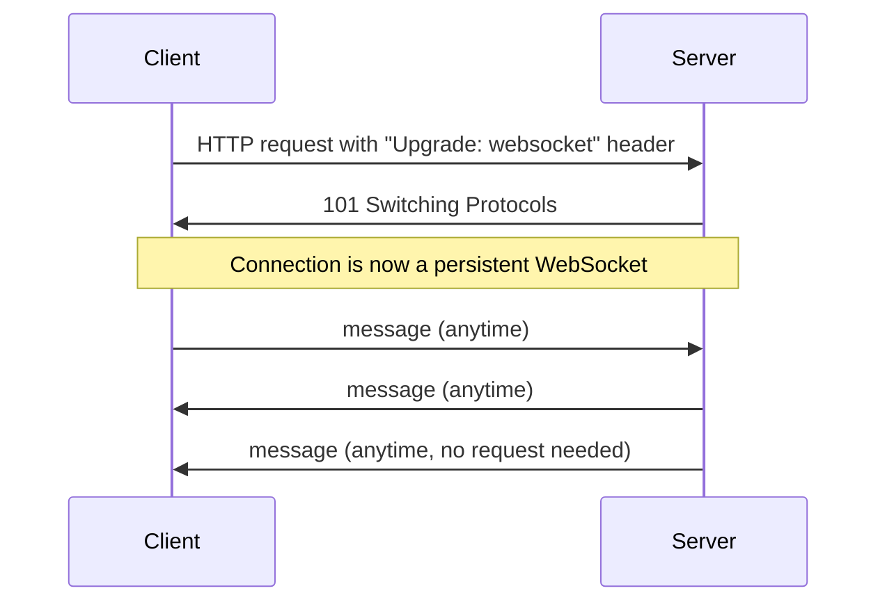

# WebSockets & the real-time web

Everything covered so far in this path follows the same basic pattern: the client asks, the server answers, the conversation ends. This lesson covers what happens when an application needs something more — a live chat, real-time notifications, a collaborative document — and the connection needs to stay open in both directions.

## The limitation WebSockets solve

Standard HTTP requests (from the methods-and-status-codes lesson) are fundamentally request-response: the client initiates, the server responds, done. For a chat application to show a new message the instant it arrives, without WebSockets, the client would need to repeatedly ask the server "anything new yet?" — a technique called **polling** — which is wasteful and introduces real delay between when something happens and when the client actually finds out.

## What a WebSocket actually is

A **WebSocket** connection starts as a normal HTTP request, then **upgrades** into a persistent, full-duplex connection — meaning both the client and server can send messages to each other at any time, without either side needing to initiate a new request first. Once established, the connection stays open, genuinely enabling real-time, bidirectional communication.

## Security considerations specific to WebSockets

- **The Same-Origin Policy applies differently** — WebSockets aren't fully governed by the same-origin restrictions the previous lesson covered for standard requests; a server needs to explicitly validate the `Origin` header itself if it wants to restrict which sites can open a WebSocket connection to it
- **Authentication doesn't automatically carry over cleanly** — since a WebSocket connection is established once and stays open, a server needs a deliberate strategy for authenticating that connection (often via a token passed during the initial handshake) rather than relying on the same per-request authentication pattern standard HTTP requests use
- **Input validation still applies fully** — messages sent over a WebSocket connection are still untrusted input from the client's perspective, and every injection risk covered elsewhere in this course (Path 11's web attacks, Path 21's API security) applies just as much to WebSocket message content as to a standard HTTP request body

## Where you'll actually encounter WebSockets

Live chat applications, real-time collaborative editing tools, live sports scores and stock tickers, and multiplayer browser games all commonly use WebSockets — genuinely worth recognizing the pattern when you see a page updating without ever appearing to reload or make a visible new page request.

:::challenge Test yourself
Why does a WebSocket-based application need a deliberate authentication strategy, rather than simply relying on the same cookie-based session pattern a standard web page uses?

Show answer
A standard HTTP request automatically carries cookies (from the cookies-sessions lesson) with every single request, letting the server authenticate the user on each individual request independently. A WebSocket connection, once established, stays open and handles many messages over that single connection — there's no repeated per-message "request" carrying fresh authentication data the way standard HTTP does. This means the server needs to authenticate the connection once, at the point it's established (commonly by validating a token passed during the initial handshake), and then trust that the connection remains legitimately tied to that same authenticated user for as long as it stays open — a genuinely different security model than the per-request authentication pattern the rest of this path has covered, and one that introduces its own considerations around session hijacking if the initial handshake isn't properly secured.

:::

## Key terms

- **WebSocket** — a persistent, full-duplex connection allowing bidirectional real-time communication between client and server.
- **Polling** — repeatedly requesting "anything new?" to simulate real-time updates without a persistent connection.
- **Protocol upgrade** — the process by which an HTTP request transitions into a WebSocket connection.

## Recap

- WebSockets solve the real-time communication limitation of standard request-response HTTP by upgrading into a persistent, bidirectional connection.
- Authentication and origin validation work meaningfully differently for WebSockets than for standard HTTP requests, requiring deliberate handling rather than relying on the same per-request patterns.
- Every input-validation concern covered elsewhere in this course applies just as fully to WebSocket message content as to a standard request body.

**Next up →** [Browser DevTools tour](#/lesson/05-web-basics/devtools)
