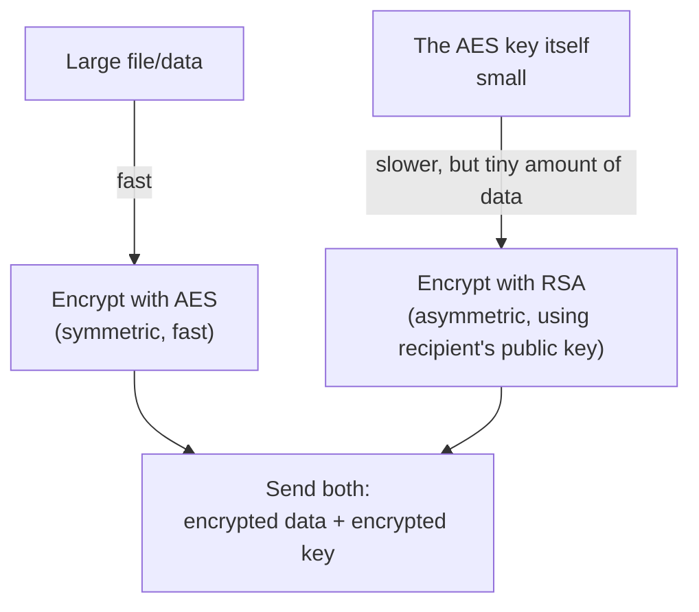

# Asymmetric Encryption

The previous lesson ended on symmetric encryption's core weakness: both parties need the same secret key beforehand, and safely getting that key to both sides is genuinely hard — especially over the internet, between two people who've never met. **Asymmetric encryption** solves this elegantly, and understanding it makes HTTPS (Path 02), JWTs (Path 11), and ransomware's key mechanics (Path 17) all click into place at once.

## The core idea — two mathematically linked keys

Asymmetric (or "public-key") encryption uses a **key pair**: a **public key**, which can be shared with literally anyone, and a **private key**, which must never leave its owner's control. The two are mathematically linked in a specific way: data encrypted with the public key can *only* be decrypted with the matching private key.

This directly solves the key distribution problem: Alice never needs to secretly share anything with Bob beforehand — she just needs Bob's public key, which Bob can publish openly, since it's useless for decryption without the matching private key.

## RSA — the classic algorithm

**RSA** (named after its inventors: Rivest, Shamir, Adleman) is the most widely known asymmetric algorithm, and it's exactly what appeared in Path 17's ransomware mechanics: files get encrypted quickly with symmetric AES, and *that* AES key gets encrypted with the attacker's RSA public key — meaning only the attacker's private key can ever recover it. This combination is called **hybrid encryption**, and it's genuinely how most real-world systems actually work, for a specific reason covered below.

RSA's security rests on a genuinely elegant mathematical fact: multiplying two large prime numbers together is fast, but factoring the resulting large product back into its two original primes is, for sufficiently large numbers, computationally infeasible with current technology — even for powerful computers, given how large the numbers involved actually are.

## Why hybrid encryption, not asymmetric alone

Asymmetric encryption is significantly slower than symmetric encryption — computationally expensive enough that using it to encrypt large amounts of data directly would be impractically slow. This is exactly why real systems use **hybrid encryption**: symmetric AES handles the actual bulk data (fast), while asymmetric RSA only encrypts the small AES key itself (the one operation that genuinely needs asymmetric's key-distribution property). HTTPS itself works this way — the TLS handshake uses asymmetric techniques briefly to securely agree on a shared symmetric key, and the actual page data that follows is encrypted with fast symmetric encryption using that agreed key.

## Digital signatures — asymmetric encryption in reverse

A genuinely elegant additional use of the same key pair: **digital signatures**, which flip the encryption direction to prove authorship instead of confidentiality. The signer encrypts a hash (Path 06's previous crypto lesson) of their message using their own *private* key — and since only their matching *public* key can successfully decrypt it, anyone can verify the signature came from that specific key pair's owner, without the signer ever revealing their private key. This is exactly the mechanism behind code signing (Path 17's static analysis lesson) and the certificates that make HTTPS trustworthy — covered in full in this path's next lesson.

## Elliptic Curve Cryptography — RSA's faster modern sibling

RSA isn't the only asymmetric algorithm in wide use today — **Elliptic Curve Cryptography (ECC)** achieves the same fundamental public/private key properties through entirely different underlying mathematics (the difficulty of solving a specific problem involving points on an elliptic curve, rather than factoring large primes), and it's increasingly the default choice for new systems for one very practical reason: **ECC achieves equivalent security with dramatically smaller keys**. A 256-bit ECC key provides roughly the same real-world security strength as a 3072-bit RSA key — meaning ECC operations are faster and the keys/signatures themselves are far more compact, genuinely significant advantages for anything resource-constrained (mobile devices, IoT hardware, high-volume TLS handshakes on a busy web server). You'll see ECC by name as **ECDSA** (Elliptic Curve Digital Signature Algorithm, for signing) and **ECDH** (Elliptic Curve Diffie-Hellman, for key exchange) throughout modern TLS configurations and SSH key generation — both are direct ECC-based replacements for the RSA-based equivalents, chosen by most modern systems specifically for the size and speed advantage described here.

:::tip A useful mnemonic
**Encrypt with the recipient's public key** (so only they can read it with their private key) for **confidentiality**. **Sign with your own private key** (so anyone can verify it with your public key) for **authenticity**. Mixing these two up is one of the most common beginner confusions in cryptography — the direction of "which key does what" flips depending on which property you're trying to achieve.
:::

:::challenge Test yourself
Why can't Bob's public key be used to decrypt a message Alice encrypted with it, and why is that exact property actually the whole point?

Show answer
RSA's key pair is deliberately designed so that whatever is encrypted with the public key can <em>only</em> be decrypted with the mathematically matching private key — the public key itself has no decryption capability at all, by design. This is precisely the property that makes public-key distribution safe: Bob can publish his public key anywhere, entirely openly, because possessing it only lets someone <em>encrypt</em> a message intended for Bob, never <em>decrypt</em> anything — decryption capability exists solely with Bob's carefully guarded private key. If the public key could also decrypt, publishing it openly would defeat the entire purpose, since anyone holding it could then read every message encrypted with it.

:::

## Key terms

- **Asymmetric encryption / public-key cryptography** — encryption using a mathematically linked public/private key pair.
- **RSA** — the classic, widely used asymmetric encryption algorithm, based on the difficulty of factoring large numbers.
- **Hybrid encryption** — combining fast symmetric encryption for bulk data with asymmetric encryption to protect just the symmetric key.
- **Digital signature** — using a private key to sign data so anyone with the matching public key can verify authenticity.

## Recap

- Asymmetric encryption uses a public/private key pair, solving symmetric encryption's key distribution problem — the public key can be shared openly.
- RSA's security relies on the practical difficulty of factoring the product of two large prime numbers.
- Real systems use hybrid encryption — symmetric for bulk data, asymmetric only for the small symmetric key — since asymmetric encryption alone is too slow for large data.
- Digital signatures flip the key direction: sign with your private key, verify with your public key, proving authorship without ever revealing the private key.

???refs
- [RSA Algorithm — a visual explanation](https://www.di-mgt.com.au/rsa_alg.html) — a solid, freely available walkthrough of the actual math.
- [Cloudflare: What is public key cryptography?](https://www.cloudflare.com/learning/ssl/how-does-public-key-encryption-work/) — an excellent, free, plain-language explainer.
???

**Next up →** [Hashing Explained](#/lesson/06-crypto-fundamentals/hashing-explained)
