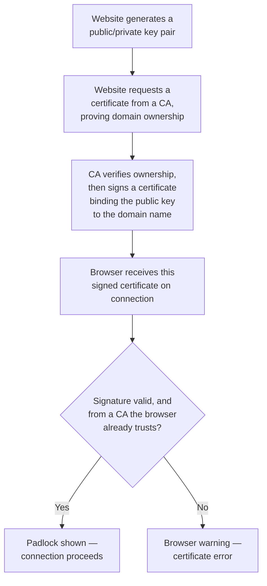

# Digital Signatures & Certificates

This lesson connects everything from this path so far — asymmetric encryption, digital signatures, hashing — into the system you've silently trusted every single time you've seen a padlock icon in a browser: the **certificate infrastructure** behind HTTPS.

## The problem certificates actually solve

Path 06's asymmetric encryption lesson explained how a public key lets anyone send Bob an encrypted message. But this raises an obvious question: **how does Alice know a given public key genuinely belongs to Bob**, and not to an attacker pretending to be Bob? Without solving this, an attacker could simply hand Alice their *own* public key while claiming to be Bob — a **man-in-the-middle attack**, referenced back in Path 02's networking fundamentals lesson. Certificates exist specifically to solve exactly this trust problem.

## Digital certificates — a signed statement of identity

A **digital certificate** is, structurally, a public key bundled together with identity information (a domain name, an organization name) and a **digital signature** (Path 06's asymmetric encryption lesson) from a trusted third party vouching that this specific public key really does belong to this specific identity.

## Certificate Authorities (CAs) — the trusted third party

A **Certificate Authority (CA)** is an organization whose job is specifically to verify that whoever is requesting a certificate for `yourbank.com` genuinely controls that domain, and then sign a certificate confirming that binding. Your browser and operating system ship with a pre-installed list of CAs they trust by default (this is the exact mechanism referenced in the "trust the CA bundle" setup instructions common across many development and testing environments) — when a website presents a certificate signed by one of these trusted CAs, the browser accepts it without any warning.

This is precisely why Burp Suite's certificate needed manual installation back in Path 11's setup — Burp acts as its own (locally trusted, once you install its cert) CA specifically to let you intercept and inspect HTTPS traffic during authorized testing, exactly the "trusted third party vouching for a key" mechanism, just deliberately extended to include Burp for testing purposes.

## What the padlock icon actually verifies (and doesn't)

:::warn A common, dangerous misunderstanding
The padlock icon confirms two things: the connection is *encrypted*, and the certificate is *validly signed by a trusted CA for that specific domain*. It says absolutely nothing about whether the site itself is trustworthy, legitimate, or safe — a phishing site can obtain a perfectly valid HTTPS certificate for its own attacker-controlled domain (`paypa1-secure.com`, say) with zero difficulty, since domain validation only confirms the requester controls that domain, not that the domain isn't malicious. Path 00's phishing lesson covers exactly this — always verify the actual domain name itself, not just the presence of a padlock.
:::

## The chain of trust — certificates vouching for certificates

A detail worth understanding beyond "the browser trusts the CA": in practice, browsers rarely trust the exact certificate that signed your bank's website directly. Instead, there's typically a **chain of trust** — a **root CA** certificate (extremely tightly guarded, kept offline as much as possible, and pre-installed in your browser/OS's trust store) signs an **intermediate CA** certificate, which in turn signs the actual **leaf certificate** presented by the website you're visiting. This layering exists specifically for risk management: if an intermediate CA is ever compromised or needs to be revoked, only certificates issued *through that specific intermediate* need to be distrusted, without needing to revoke the root CA itself and break trust for every certificate the entire CA ever issued. When your browser validates a certificate, it's actually walking this entire chain — leaf, to intermediate, to root — confirming each link's signature is valid before showing the padlock, which is exactly why a misconfigured server that fails to present its full intermediate chain (a surprisingly common real-world server misconfiguration) can cause certificate errors even when the leaf certificate itself is perfectly legitimate.

## Certificate revocation — what happens when a key leaks

Certificates are typically issued with an expiration date, but sometimes a private key needs to be invalidated *before* that natural expiry — if it's stolen, or the domain changes ownership unexpectedly. Two mechanisms exist for this: **CRLs (Certificate Revocation Lists)**, a downloadable list of revoked certificate serial numbers a browser can check against, and **OCSP (Online Certificate Status Protocol)**, a faster, more modern approach where a browser can query a CA's server in real time with "is this specific certificate still valid?" rather than downloading an entire list. Both mechanisms exist to answer a genuinely important question a certificate's signature alone can't answer: a signature only proves a certificate was *validly issued* at some point — it says nothing about whether that certificate has since been revoked, which is exactly the gap revocation checking closes.

## The TLS handshake, briefly connected to earlier lessons

When your browser connects to an HTTPS site, this certificate infrastructure combines directly with Path 06's hybrid encryption lesson: the server presents its CA-signed certificate (proving its public key's identity), the browser and server use that public key briefly to securely agree on a shared symmetric key (the asymmetric part, used only for this brief negotiation), and then all the actual page data flows encrypted with fast symmetric AES using that agreed key — precisely the hybrid pattern covered two lessons ago, now with its full real-world context filled in.

:::challenge Test yourself
A phishing site presents a perfectly valid, CA-signed HTTPS certificate — the browser shows a padlock with no warnings at all. Does this mean the site is safe to enter your banking password into? Why or why not?

Show answer
No. A valid certificate and padlock icon confirm only two things: the connection between your browser and whatever server you're actually talking to is encrypted, and a trusted CA verified that whoever requested the certificate genuinely controls the specific domain name shown in the address bar. Domain validation says nothing whatsoever about whether that domain belongs to a legitimate organization or a scammer — an attacker can register a lookalike domain (<code>paypa1-secure.com</code> instead of <code>paypal.com</code>) and obtain a completely valid certificate for <em>that domain</em> with no special difficulty, since the CA is only confirming domain control, not vetting intent or reputation. The padlock protects the <em>data in transit</em> from interception, but provides zero guarantee about the trustworthiness of whoever is actually receiving that data on the other end — exactly why checking the actual domain name character-by-character (Path 00's phishing lesson) remains essential regardless of the padlock's presence.

:::

## Key terms

- **Digital certificate** — a public key bundled with identity information and signed by a trusted third party.
- **Certificate Authority (CA)** — a trusted organization that verifies domain ownership and signs certificates.
- **TLS handshake** — the process of establishing an encrypted HTTPS connection, combining asymmetric and symmetric encryption.
- **Domain validation** — a CA confirming the certificate requester controls the domain, without vetting the domain's legitimacy or intent.

## Recap

- Certificates solve the "how do I know this public key really belongs to who it claims to" trust problem underlying asymmetric encryption.
- A Certificate Authority verifies domain ownership and signs a certificate binding a public key to that specific domain.
- The padlock icon confirms encryption and valid domain-bound signing — nothing about the site's actual trustworthiness or intent.
- The full HTTPS connection process combines this path's asymmetric encryption (for the initial handshake) with symmetric encryption (for the actual bulk data) — exactly the hybrid encryption pattern from earlier in this path.

???refs
- [Let's Encrypt: How It Works](https://letsencrypt.org/how-it-works/) — a free, widely-used CA's clear explanation of the certificate issuance process.
- [Cloudflare: What happens in a TLS handshake?](https://www.cloudflare.com/learning/ssl/what-happens-in-a-tls-handshake/) — an excellent, free, detailed walkthrough.
???

**Next up →** [Common Crypto Mistakes](#/lesson/06-crypto-fundamentals/common-crypto-mistakes)
