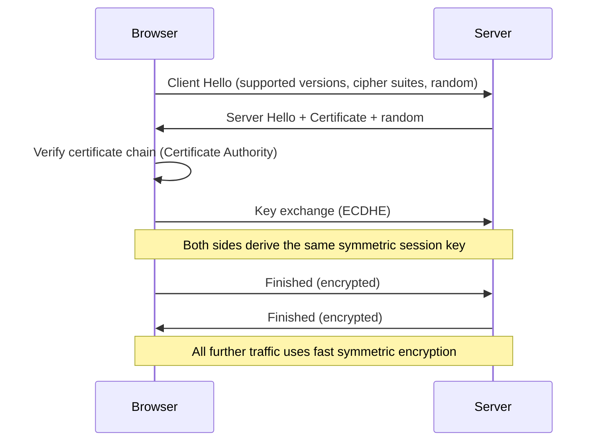

# The TLS Handshake, Step by Step

Every earlier lesson in this path taught one piece — symmetric encryption, asymmetric encryption, key exchange, hashing, digital signatures. This lesson shows how HTTPS actually assembles all of those pieces together, in order, the moment you visit a website.

:::tip
By the end of this lesson, the padlock icon from Path 00's browser-safety lesson should stop being an abstract symbol and start being something you can actually explain step by step — genuinely one of the most satisfying "it all clicks" moments in learning cryptography.
:::

## What "TLS" actually is

**TLS (Transport Layer Security)** is the protocol that HTTPS runs on top of — it's the thing actually doing the encryption, authentication, and integrity protection that the padlock icon represents. The **TLS handshake** is the negotiation that happens in the first fraction of a second of every HTTPS connection, before any actual page content is exchanged.

## The handshake, step by step

1. **Client Hello** — your browser sends a message listing which TLS versions and cipher suites (combinations of algorithms) it supports, plus a random value
2. **Server Hello** — the server picks a TLS version and cipher suite from the client's list, sends back its own random value, and sends its **digital certificate** (from the digital-signatures-certificates lesson) — proving its identity
3. **Certificate verification** — the browser checks the certificate's chain of trust back to a trusted Certificate Authority, exactly as the certificates lesson described, and confirms the domain name matches
4. **Key exchange** — using ECDHE (from the key-exchange and elliptic-curve lessons), both sides compute a shared secret without ever transmitting it directly
5. **Symmetric session key derivation** — the shared secret from step 4 gets used to derive a fast symmetric encryption key (from the symmetric-encryption lesson) — asymmetric crypto did the hard job of secure key agreement, but everything from here on uses fast symmetric encryption for actual data
6. **Finished messages** — both sides send a final message, encrypted with the newly derived key, confirming the handshake completed correctly and wasn't tampered with in transit

After this, your actual page content (HTML, images, everything) travels encrypted using the fast symmetric key established in step 5 — the expensive asymmetric operations only happened once, during the handshake itself.

## Why this design — asymmetric for setup, symmetric for data — makes sense

This exact split answers a question earlier lessons in this path raised but didn't fully resolve: why use two different types of cryptography at all, instead of just one? Asymmetric encryption elegantly solves "how do two strangers agree on a secret without meeting first," but it's computationally expensive at scale. Symmetric encryption is fast enough to encrypt an entire video stream in real time, but requires a shared key that has to come from *somewhere* safe. TLS uses each type for exactly the job it's best suited to: asymmetric methods to safely establish a session key once, then fast symmetric encryption for the (often much larger) actual data that follows.

## What TLS 1.3 improved

Modern TLS 1.3 (the current standard) trimmed the handshake to fewer round-trips than older TLS 1.2, made forward secrecy (from the key-exchange lesson) mandatory rather than optional, and removed support for several older, weaker cipher suites entirely — directly reflecting lessons learned from real-world cryptographic weaknesses discovered in earlier TLS versions, several of which the upcoming cryptographic-attacks lesson covers by name.

:::challenge Trace a handshake failure
A browser shows "Your connection is not private" when visiting a site. Investigation shows the site's certificate is valid and unexpired, but was issued for `www.example.com` while the browser was visiting `example.com` (no "www").

Hint
Which specific handshake step checks this, and what exactly is it comparing?

Show answer
This fails at step 3, certificate verification — specifically the domain-name matching check. TLS certificates are issued for specific domain names (sometimes covering a list of allowed names), and the browser checks that the certificate presented actually covers the exact domain being visited. A certificate valid for <code>www.example.com</code> doesn't automatically cover the bare <code>example.com</code> unless it was specifically issued to cover both (common in practice, but not guaranteed) — this is a deliberate security check, not a bug, since without it, a certificate for one legitimate domain could be misused to impersonate a completely different one.

:::

## 🧪 Hands-on lab — watch a real handshake

Using your browser's developer tools (the Network or Security tab, depending on browser), visit an HTTPS site and inspect the connection details — most browsers will show you the negotiated TLS version, cipher suite, and certificate details directly.

:::challenge Test yourself
1. Why does TLS use asymmetric cryptography only during the handshake, rather than for the entire connection?
2. What does the "Finished" message at the end of the handshake actually verify?
3. Name one concrete improvement TLS 1.3 made over TLS 1.2.
:::

## Key terms

- **TLS (Transport Layer Security)** — the protocol underlying HTTPS that provides encryption, authentication, and integrity.
- **TLS handshake** — the negotiation process that establishes a secure connection before any application data is exchanged.
- **Cipher suite** — a specific combination of algorithms (key exchange, encryption, and integrity check) used for a TLS connection.

## Recap

The TLS handshake is where every cryptographic concept covered so far in this path comes together in a real, working system: asymmetric key exchange establishes a shared secret safely, certificates provide identity verification, and fast symmetric encryption handles the actual data that follows — each doing exactly the job it's best suited to. Understanding this sequence turns the padlock icon from an abstract trust symbol into something you can genuinely explain, step by step.

???refs
- [Cloudflare — What happens in a TLS handshake?](https://www.cloudflare.com/learning/ssl/what-happens-in-a-tls-handshake/) — a detailed walkthrough with diagrams
???

**Next up →** [Common Cryptographic Attacks](#/lesson/06-crypto-fundamentals/cryptographic-attacks-overview)
