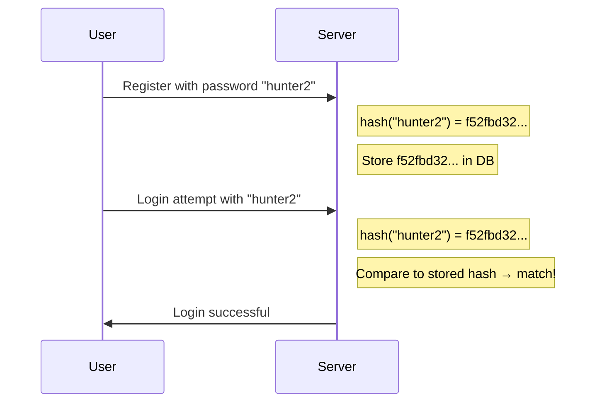

# Passwords & hashing

You built a password-strength checker in Path 04. Now let's go deeper into what happens *after* you hit submit — how passwords should (and shouldn't) be stored, and why this topic has caused more breaches than almost any other single mistake.

## The golden rule: never store plaintext passwords

If a company stores your password as literally `hunter2` in their database, then **anyone** who gets read access to that database — a hacker, a rogue employee, a misconfigured backup — instantly has every user's real password. This has happened, repeatedly, to real companies, and it's considered one of the most basic, unforgivable security failures.

## Hashing — the one-way transformation

A **hash function** takes any input and produces a fixed-size, seemingly-random output — deterministically (same input always gives same output) but **irreversibly** (you can't go from output back to input).

```python
import hashlib
print(hashlib.sha256("hunter2".encode()).hexdigest())
# 'f52fbd32b2b3b86ff88ef6c490628285f482af15ddcb29541f94bcf526a3f6c'
```

Instead of storing the password, the server stores the **hash**. On login, it hashes what you typed and compares the *hashes* — never the plaintext.



Even if an attacker steals the entire database, they get hashes, not passwords — in theory. In practice, this protection depends entirely on **which** hash function was used.

## Why MD5 and SHA-1 are wrong for passwords

MD5 and SHA-1 were *designed* to be extremely fast — great for verifying file integrity (Path 03), terrible for passwords. Fast hashing means an attacker with stolen hashes can try **billions of guesses per second** on modern hardware (especially GPUs), making short/common passwords crackable in minutes to hours.

```
MD5:     ~50 billion guesses/second on a decent GPU
bcrypt:  ~50,000 guesses/second on the same GPU
```

That thousand-fold slowdown is the entire point of a proper password hashing algorithm.

## Purpose-built password hashing algorithms

Real password storage uses algorithms **deliberately** designed to be slow and resource-intensive:

| Algorithm | Notes |
|---|---|
| **bcrypt** | Battle-tested since 1999, widely supported, configurable "cost factor" |
| **scrypt** | Also memory-hard (needs lots of RAM, resisting GPU/ASIC cracking) |
| **argon2** | Winner of the 2015 Password Hashing Competition; the current recommended default |

These all share three properties: **slow by design**, **tunable** (you can increase the difficulty as hardware gets faster), and **memory-hard** (hard to parallelise cheaply on specialised cracking hardware).

```python
# Using bcrypt in Python (pip install bcrypt)
import bcrypt

password = b"hunter2"
hashed = bcrypt.hashpw(password, bcrypt.gensalt())
print(hashed)   # includes the salt automatically

# Verifying:
if bcrypt.checkpw(password, hashed):
    print("Password matches!")
```

## Salting — defeating rainbow tables

A **rainbow table** is a precomputed lookup table mapping millions of common passwords to their hashes — allowing instant reverse lookup for any password already in the table.

A **salt** is a random value added to the password *before* hashing, unique per user:

```
hash("hunter2" + "aB3xK9") = completely different from hash("hunter2" + "Zq8mP2")
```

Because the salt is different for every user, an attacker can't use one precomputed rainbow table against the whole database — they'd need to precompute a fresh table for every single salt, which defeats the entire economic advantage of rainbow tables.

**Good news:** bcrypt, scrypt, and argon2 all handle salting **automatically** — you never manually manage it. This is one of many reasons to use a battle-tested library instead of writing your own crypto.

:::danger NEVER ROLL YOUR OWN CRYPTO
This phrase gets repeated constantly in security for good reason. Cryptography is full of subtle mistakes invisible to non-experts. Always use well-reviewed, standard libraries (bcrypt, argon2, or your language's blessed crypto library) — never invent your own hashing scheme "just to be different."
:::

## Password cracking — how attackers actually attack hashes

Once an attacker has stolen password hashes, they typically try:

- **Dictionary attack** — try every word in a wordlist (like `rockyou.txt`, containing 14 million real leaked passwords) plus common mutations (`password` → `Password1!`).
- **Brute force** — try every possible combination of characters up to some length. Effective only against short passwords due to combinatorial explosion.
- **Rainbow tables** — precomputed hash lookups (defeated by salting, as above).
- **Credential stuffing** — not cracking at all; trying passwords **leaked from other breaches** against this site, betting on password reuse (extremely effective in practice — this is why unique passwords per site matter so much).

Tools like **Hashcat** and **John the Ripper** (both pre-installed on Kali) do this at massive scale using GPU acceleration. You'll use them hands-on in Path 09.

## What makes a password actually strong, revisited

From Path 04's checker, now with the "why":

- **Length beats complexity.** A 20-character passphrase (`correct-horse-battery-staple`) is far stronger than an 8-character complex one (`P@ssw0rd!`), because length increases the *search space* exponentially.
- **Uniqueness per site.** Because of credential stuffing, reusing a password anywhere means a breach *anywhere* endangers you *everywhere*.
- **A password manager** (Bitwarden, 1Password, KeePass) solves both problems at once — long, random, unique passwords per site, with only one master password to remember.

## Multi-factor authentication (MFA) — the crucial backstop

Even a perfect password can be phished, leaked, or guessed. **MFA** requires a second, independent proof of identity:

- **Something you know** — a password.
- **Something you have** — a phone (TOTP app, SMS code), a hardware key (YubiKey).
- **Something you are** — biometrics (fingerprint, face).

MFA doesn't need to be perfect to be hugely valuable — Microsoft and Google have both publicly reported that **MFA blocks over 99% of account compromise attacks**, even against phished or leaked passwords, because the attacker rarely has the second factor too.

SMS-based MFA is the weakest form (vulnerable to SIM-swapping); app-based TOTP (Google Authenticator, Authy) and hardware keys (YubiKey, using the **FIDO2/WebAuthn** standard) are considerably stronger.

## 🧪 Lab — See hashing algorithm speed differences yourself

```bash
# On Kali, time how fast you can hash something a million times with different algorithms:

python3 -c "
import hashlib, time
start = time.time()
for _ in range(1_000_000):
    hashlib.sha256(b'hunter2').hexdigest()
print(f'SHA-256: {time.time()-start:.2f}s for 1M hashes')
"

pip install bcrypt --break-system-packages
python3 -c "
import bcrypt, time
start = time.time()
for _ in range(100):
    bcrypt.hashpw(b'hunter2', bcrypt.gensalt())
print(f'bcrypt: {time.time()-start:.2f}s for just 100 hashes')
"
```

Notice the dramatic difference — SHA-256 does a million hashes almost instantly; bcrypt takes noticeably longer for just a hundred. That deliberate slowness is bcrypt's entire security value proposition against offline cracking.

:::challenge Test yourself
Why does adding a unique random salt per user defeat precomputed rainbow tables, even if the attacker knows the salting scheme?

<details><summary>Show answer</summary>A rainbow table's value comes from being <em>precomputed once, used against many hashes</em>. If every user has a different salt, the attacker would need to precompute an entirely new table for every single salt value — which is exactly as expensive as just brute-forcing each password individually. The economic advantage of rainbow tables is destroyed even though the salting method itself is public knowledge (security doesn't rely on the salt being secret — only unique).</details>
:::

## Key terms

- **Hash function** — one-way, deterministic transformation of input to fixed-size output.
- **Salt** — random per-user value added before hashing to defeat rainbow tables.
- **bcrypt / scrypt / argon2** — purpose-built slow, salted password hashing algorithms.
- **Rainbow table** — precomputed hash lookup table.
- **Credential stuffing** — reusing breached credentials against other sites.
- **MFA / TOTP / FIDO2** — multi-factor authentication and its modern standards.

## Recap

- Never store plaintext passwords — always hash, and use a purpose-built slow algorithm.
- MD5/SHA-1 are fast and unsuitable for passwords; bcrypt/scrypt/argon2 are correct.
- Salting defeats rainbow tables by making precomputation uneconomical.
- Length beats complexity; uniqueness per site defeats credential stuffing; password managers solve both.
- MFA is one of the single highest-value security controls available today.

???refs
- [OWASP Password Storage Cheat Sheet](https://cheatsheetseries.owasp.org/cheatsheets/Password_Storage_Cheat_Sheet.html) — the authoritative modern guidance.
- [NIST SP 800-63B — Digital Identity Guidelines](https://pages.nist.gov/800-63-3/sp800-63b.html) — official US password/MFA guidance.
- [Have I Been Pwned](https://haveibeenpwned.com/) — check if your own accounts have been in a breach.
- [Hashcat](https://hashcat.net/hashcat/) — the industry-standard password recovery/cracking tool (Path 09).
???

**Next up →** [Phishing & social engineering](#/lesson/06-fundamentals/phishing)
