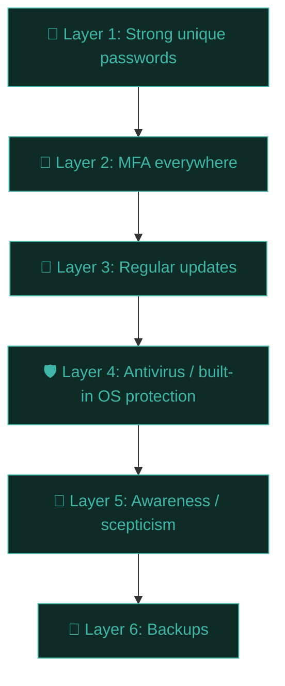

# Protect yourself: practical hardening

Time for the practical payoff of this entire path. Here's a genuinely thorough personal security checklist — the exact set of changes worth making to your own devices and accounts this week.

## Defense in depth — the core philosophy

No single control is perfect. **Defense in depth** means layering multiple, independent controls so that if one fails, others still protect you — the same principle as the kill chain lesson, applied to your personal life.

## 1. Passwords — the foundation

- **Install a password manager today** if you don't have one: Bitwarden (free, open-source) or 1Password are excellent choices.
- Let it **generate** long, random, unique passwords for every account — you should not know most of your own passwords.
- Set one very strong, memorable **master password** (a long passphrase) for the manager itself, and enable MFA on the manager account.
- Run your existing passwords through [Have I Been Pwned](https://haveibeenpwned.com/) — change anything flagged as breached, especially if reused elsewhere.

## 2. Multi-factor authentication — turn it on everywhere

Priority order for enabling MFA:

1. **Email accounts first** — email is the "master key" that can reset almost everything else.
2. **Password manager.**
3. **Banking and financial accounts.**
4. **Social media** (account takeovers are used for scams against your contacts).
5. **Work accounts.**

Prefer, in order of strength: **hardware key (FIDO2/YubiKey)** > **authenticator app (TOTP)** > **SMS** (better than nothing, but vulnerable to SIM-swapping — avoid if better options exist).

## 3. Updates — patch promptly

Most real-world exploitation targets **known, already-patched** vulnerabilities that victims simply hadn't installed yet — not exotic zero-days. Turn on automatic updates for:

- Your OS (Windows Update, macOS Software Update, Linux `apt upgrade`)
- Your browser (usually auto-updates already — verify it's not disabled)
- Apps, especially anything internet-facing (browsers, PDF readers, messaging apps)
- Router/IoT firmware (commonly neglected — check manually every few months)

## 4. Device hardening basics

- **Full-disk encryption** — BitLocker (Windows), FileVault (macOS), LUKS (Linux). Protects your data if a device is lost or stolen.
- **Screen lock** with a real PIN/password/biometric, short auto-lock timeout.
- **Firewall enabled** (on by default on most modern OSes — verify it hasn't been disabled).
- **Uninstall unused software** — every installed app is potential attack surface, even if you never open it.
- **Review app permissions** periodically (camera, mic, location) — revoke anything that doesn't need it.

## 5. Network hardening at home

- Change the router's **default admin password** immediately — this is one of the most common real-world compromises (Mirai botnet territory from the malware lesson).
- Use **WPA3** (or WPA2 at minimum) for Wi-Fi, never WEP or open networks.
- Consider a **separate guest network** for visitors and IoT devices, isolated from your main devices.
- Disable **WPS** (WiFi Protected Setup) — historically riddled with vulnerabilities.

## 6. Backups — your availability insurance

Follow the **3-2-1 rule**: **3** copies of important data, on **2** different types of media, with **1** copy off-site (cloud or physically elsewhere).

- Automate backups so you don't rely on remembering.
- **Test restoring** from backup occasionally — an untested backup is a hope, not a plan.
- This is your single best defence against ransomware: if your files are safely backed up elsewhere, an encryption attack loses most of its leverage over you.

## 7. Awareness habits — becoming "phishing-resistant"

- Apply the verification checklist from the previous lesson to anything urgent, financial, or credential-related.
- Hover over links before clicking; check the actual domain, not just the display text.
- Be suspicious of **any** unexpected attachment, even from known contacts (their account may be compromised).
- When in doubt, navigate to the site **directly** (type the URL or use a bookmark) rather than clicking a link in an email.

## 8. Social media and OSINT self-hygiene

Recall Path 06's kill chain — reconnaissance often starts with public social media. A quick self-audit:

- Search your own name; see what a stranger (or attacker) would find in 5 minutes.
- Review privacy settings on Facebook/Instagram/LinkedIn — who can see your posts, friends list, phone number?
- Be mindful of oversharing real-time location, travel plans, and workplace details publicly.
- Consider what a spear-phisher could learn about you from public info alone — that's exactly the reconnaissance an attacker would do (Path 09 teaches this from the offensive side).

## A prioritised action list for this week

If you do nothing else from this lesson, do these five things, roughly in this order:

1. Install a password manager, start migrating your most important accounts.
2. Enable MFA on your email account (the master key to everything else).
3. Check Have I Been Pwned for your main email; act on any hits.
4. Turn on automatic OS/browser updates.
5. Set up one automated, tested backup for anything you couldn't bear to lose.

## Security is a practice, not a product

No single purchase or checklist makes you "done." Security is an ongoing practice — reviewing settings periodically, staying aware of new scam patterns, and maintaining healthy scepticism without becoming paranoid or paralysed. The goal is **reasonable, sustainable** protection, not perfection.

## 🧪 Lab — Personal security audit

Go through this checklist against your own real accounts and devices, right now:

- [ ] Password manager installed and in active use
- [ ] MFA enabled on email
- [ ] MFA enabled on at least 2 other important accounts
- [ ] Checked Have I Been Pwned for your main email
- [ ] Automatic updates confirmed on for OS and browser
- [ ] Router admin password changed from default
- [ ] Full-disk encryption confirmed on
- [ ] At least one automated backup configured
- [ ] Searched your own name to see your public footprint

Whatever's unchecked, pick one to actually complete before moving to the next lesson. Small, real action beats a perfect plan you never start.

:::challenge Test yourself
Why is enabling MFA on your **email account** specifically considered higher priority than almost any other account?

Show answer
Email is typically the <strong>account recovery mechanism</strong> for nearly everything else — banking, social media, work accounts. If an attacker controls your email, they can usually trigger "forgot password" resets to take over most of your other accounts too. It's the single highest-leverage account to protect.

:::

## Key terms

- **Defense in depth** — layering multiple independent controls.
- **3-2-1 backup rule** — 3 copies, 2 media types, 1 off-site.
- **Password manager** — tool that generates/stores unique strong passwords per account.
- **FIDO2 / TOTP / SMS MFA** — in decreasing order of security strength.

## Recap

- Layer multiple defences; no single control is perfect.
- Password manager + MFA on email first are the two highest-leverage actions.
- Keep systems updated; most real attacks exploit already-patched vulnerabilities.
- Back up important data following the 3-2-1 rule, and actually test restores.
- Security is an ongoing practice, not a one-time checklist.

???refs
- [CISA — Cybersecurity for individuals](https://www.cisa.gov/secure-our-world) — official US guidance for personal security.
- [Have I Been Pwned](https://haveibeenpwned.com/) — check your accounts against known breaches.
- [Bitwarden](https://bitwarden.com/) — free, open-source password manager.
- [EFF Surveillance Self-Defense](https://ssd.eff.org/) — excellent deep-dive personal security guide.
???

**Next up →** [Security frameworks & standards](#/lesson/06-fundamentals/frameworks)
