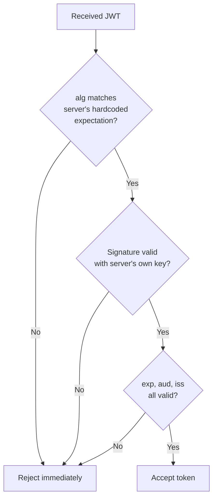

# Advanced JWT Lab

This course's CTF Zone already walked you through one specific JWT attack (`alg=none` forgery) as a self-contained puzzle. This lab goes broader — practicing the full range of real JWT attacks against a live vulnerable lab, plus (just as importantly) implementing the fix correctly.

## Lab tasks

1. **Exploit the `alg: none` vulnerability**, exactly as practiced in the CTF Zone's **Forge the Token** challenge — but this time against a real, interactive lab (PortSwigger's JWT-focused labs are the best free option) rather than a static puzzle. Notice how much slower real exploitation is compared to a pre-packaged CTF challenge — you have to discover the vulnerability exists in the first place, not just solve a puzzle already framed for you.
2. **Perform a key confusion attack, if the lab supports it.** This is a more advanced JWT attack: some servers use asymmetric signing (RS256, where a private key signs and a public key verifies) but fail to check *which* algorithm was actually used — an attacker who knows the server's public key can sign a forged token with HMAC (HS256), using the public key itself as the HMAC secret, and a careless server will incorrectly treat it as validly signed.
3. **Crack a weak secret with hashcat.** If the lab provides a token signed with a symmetric (HS256) algorithm and a weak, guessable secret, extract the token's signing material and attempt a dictionary attack:
   ```bash
   hashcat -a 0 -m 16500 jwt.txt rockyou.txt
   ```
   (`rockyou.txt` is a widely used, freely available password wordlist referenced throughout password-cracking exercises in this course.) A JWT secured with a weak, short, or dictionary-word secret is exploitable exactly the same way a weak login password is.
4. **Implement proper validation — the defensive half of this lab.** Using pseudocode or a real language of your choice, write out what correct JWT validation looks like: the server must hardcode which algorithm(s) it accepts (never trust the token's own `alg` header to decide), and must explicitly check `exp` (expiration), `aud` (intended audience), and `iss` (issuer) claims — not just verify the signature and stop there.



:::warn Never reuse rockyou.txt-style wordlists outside authorized labs
Everything in Task 3 must happen against a lab you own or are explicitly authorized to test — cracking attempts against real production systems without permission cross directly from "practice" into unauthorized access, exactly the line Path 01's golden rule establishes.
:::

:::challenge Bypass, then fix
Using your lab environment, successfully bypass authentication with at least two different JWT attacks from this lab. Then — this is the part many learners skip — actually write out (or implement, if you're comfortable with code) the corrected validation logic that would have stopped both attacks. Understanding the fix as deeply as the exploit is what separates a tester from someone who can only break things.
:::

## Key takeaway

Every JWT attack in this lab shares one root cause: **trusting client-supplied metadata to decide how to validate the client's own data** (algorithm choice, in every case here). This generalizes far beyond JWTs — it's one of the most common security anti-patterns across web applications broadly, and recognizing the pattern is more valuable than memorizing any single JWT-specific technique.

**Next up →** [SSRF & JWT Lab](#/lesson/07-web-security/ssrf-jwt-lab)
