# Web reconnaissance

Before you can find a bug, you need to understand what you're actually looking at. Recon is the unglamorous, essential first phase of every real web assessment — and where a huge fraction of eventual findings actually originate.

## Passive vs active recon

- **Passive recon** — gathering information *without ever touching the target directly*. Search engines, public records, cached pages. Invisible to the target.
- **Active recon** — directly interacting with the target (visiting pages, sending requests, using tools). Detectable in logs, and requires you to be in-scope/authorised.

Always start passive, then move to active once you understand the landscape.

## Passive recon techniques

### WHOIS and DNS

From Path 02, now applied purposefully:

```bash
whois example.com
dig example.com ANY
dig example.com MX
dig example.com TXT      # often reveals SPF/DKIM, verification tokens, sometimes internal hints
```

### Subdomain enumeration

Most organisations have far more subdomains than their main site suggests — old staging environments, forgotten admin panels, internal tools accidentally exposed.

```bash
# Certificate transparency logs reveal EVERY subdomain that's ever had a TLS cert issued:
curl -s "https://crt.sh/?q=%.example.com&output=json" | jq -r '.[].name_value' | sort -u

# Tool-based (installed on Kali or via go install):
subfinder -d example.com
amass enum -passive -d example.com
```

**Certificate Transparency (CT) logs** are a goldmine — every publicly-trusted TLS certificate ever issued is logged permanently and publicly, which means every subdomain that ever got HTTPS also got logged, forever, even if it's since been taken down.

### Search engine dorking

Specially crafted search queries reveal indexed content the site owner may not realise is public:

```
site:example.com filetype:pdf
site:example.com inurl:admin
site:example.com "index of /"
site:example.com ext:sql | ext:env | ext:log
```

This technique — called **Google dorking** — has its own curated database of powerful queries.

### Wayback Machine / archive.org

Historical snapshots of a site can reveal old endpoints, removed features, or leaked info that's since been "fixed" on the live site but still indexed in history:

```bash
pip install waybackpy --break-system-packages
python3 -c "
from waybackpy import WaybackMachineCDXServerAPI
cdx = WaybackMachineCDXServerAPI('example.com')
for snap in list(cdx.snapshots())[:10]:
    print(snap.archive_url)
"
```

### Shodan and Censys

Search engines that continuously scan the *entire internet* and index what they find — open ports, banners, exposed services, even default login pages, all searchable.

```
shodan search hostname:example.com
```

## Active recon techniques

### Directory and file brute-forcing

Trying common paths against the live target to find pages that aren't linked anywhere:

```bash
gobuster dir -u https://example.com -w /usr/share/seclists/Discovery/Web-Content/common.txt

# Or with ffuf (faster, more flexible):
ffuf -u https://example.com/FUZZ -w /usr/share/seclists/Discovery/Web-Content/common.txt
```

This is exactly why the **SecLists** wordlists you installed back in Path 03 matter — `/usr/share/seclists/Discovery/Web-Content/` has curated lists specifically for this.

### Technology fingerprinting

Identifying the frameworks, CMS, and libraries in use — each with its own known vulnerability history:

```bash
whatweb https://example.com
# Or check headers manually:
curl -sI https://example.com
```

Look for `Server`, `X-Powered-By`, cookie names (`PHPSESSID` implies PHP, `JSESSIONID` implies Java), and JS library version strings in page source.

### Crawling

Systematically following every link to map the entire application:

```bash
katana -u https://example.com -d 3 -o urls.txt
```

Burp's **Target → Site map**, built passively as you browse (Path 07.2), is a form of crawling too.

### robots.txt and sitemap.xml

Often overlooked, sometimes genuinely revealing:

```bash
curl -s https://example.com/robots.txt
curl -s https://example.com/sitemap.xml
```

`robots.txt` in particular has a long history of accidentally telling attackers exactly which paths the site owner *doesn't want indexed* — often because those paths are sensitive.

### Parameter discovery

Finding hidden parameters an endpoint quietly accepts — beyond what's visible in the UI — is its own valuable recon subtask, since apps frequently support debug flags, legacy parameters, or admin-only options that were never removed from the code even after the corresponding UI was:

```bash
# Fuzz for hidden GET parameters against a known endpoint:
ffuf -u "https://example.com/profile?FUZZ=1" -w /usr/share/seclists/Discovery/Web-Content/burp-parameter-names.txt -fs <baseline-response-size>

# Or the purpose-built tool:
arjun -u https://example.com/profile
```

A parameter like `?debug=true`, `?admin=1`, or `?format=xml` that the UI never sends can sometimes unlock behaviour the developers assumed was safely hidden simply because nothing in the visible interface exposed it.

## Building a recon pipeline

Professional recon chains multiple tools together, each feeding the next:

```mermaid
flowchart LR
    Domain["Target domain"] --> Sub["Subdomain enum<br/>(subfinder, amass, crt.sh)"]
    Sub --> Resolve["Resolve & filter live hosts<br/>(dnsx, httpx)"]
    Resolve --> Crawl["Crawl<br/>(katana)"]
    Crawl --> Fuzz["Directory fuzz<br/>(ffuf, gobuster)"]
    Fuzz --> Tech["Tech fingerprint<br/>(whatweb, wappalyzer)"]
    Tech --> Manual["Manual testing<br/>(Burp)"]

    style Domain fill:#111927,color:#8496A6,stroke:#8496A6
    style Sub fill:#0f2b26,color:#3FB6A8,stroke:#3FB6A8
    style Resolve fill:#0f2b26,color:#3FB6A8,stroke:#3FB6A8
    style Crawl fill:#0f2b26,color:#3FB6A8,stroke:#3FB6A8
    style Fuzz fill:#2b1f0a,color:#EFA43A,stroke:#EFA43A
    style Tech fill:#2b1f0a,color:#EFA43A,stroke:#EFA43A
    style Manual fill:#2b1010,color:#E05548,stroke:#E05548
```



You'll build a real, automated version of this exact pipeline in Path 10 (Bug Bounty) using your Python and Bash skills from Paths 03–04.

## What you're actually looking for

Recon isn't just "collect data" — it's collecting data **with specific questions in mind**:

- What subdomains exist that the "main" site doesn't link to? (staging, dev, admin, api, internal tools accidentally exposed)
- What technologies are in use, and do any have known CVEs?
- What parameters and endpoints exist that aren't obvious from clicking around the UI?
- What did the site look like historically that might reveal old, forgotten functionality still technically live?
- Are there any exposed files that shouldn't be (`.git/`, `.env`, backup files like `.sql`, `.bak`)?

## JavaScript source mining

Modern SPAs (Path 05's web-anatomy lesson) ship most of their logic as downloadable JavaScript bundles — which means those bundles are, functionally, a map of the entire application handed directly to anyone who looks. Downloading and searching every JS file a site loads for API endpoint strings, feature-flag names, and even leftover comments is a distinct, high-value recon step:

```bash
# Download every JS file a site references, then grep for interesting strings:
katana -u https://example.com -jc -o urls.txt
grep -oE '"/api/[a-zA-Z0-9/_-]+"' *.js | sort -u
```

Tools like **LinkFinder** and **SecretFinder** automate exactly this — scanning JS for endpoint-shaped strings and accidentally-committed API keys/tokens respectively. This is the automated, at-scale version of the manual Sources-panel searching from Path 05's DevTools lab, and it consistently turns up endpoints the site's own visible navigation never links to.

## 🧪 Lab — Full recon pass on a legal target

Run this full chain against `testphp.vulnweb.com` (a legal public target) or a target you're authorised to test:

```bash
# 1. DNS and WHOIS
whois testphp.vulnweb.com
dig testphp.vulnweb.com ANY

# 2. Robots and sitemap
curl -s http://testphp.vulnweb.com/robots.txt

# 3. Tech fingerprint
whatweb http://testphp.vulnweb.com

# 4. Directory brute-force
gobuster dir -u http://testphp.vulnweb.com \
  -w /usr/share/seclists/Discovery/Web-Content/common.txt \
  -o gobuster-results.txt

# 5. Review findings
cat gobuster-results.txt
```

Write a short summary of what you learned: technologies detected, interesting paths found, anything that surprised you. This is exactly the kind of summary that opens a real penetration test report.

:::danger SCOPE DISCIPLINE
Active recon tools generate real traffic against real servers. Only ever run active techniques (brute-forcing, crawling, scanning) against targets you explicitly own or have written authorization to test — like the practice targets linked throughout this course. Passive recon (WHOIS, crt.sh, Wayback Machine, Shodan searches) is generally lower-risk since you're querying third-party public records, not the target directly — but always respect each service's own terms of use.
:::

:::challenge Test yourself
Why are Certificate Transparency logs (crt.sh) such a powerful passive subdomain enumeration technique?

<details><summary>Show answer</summary>Every publicly-trusted TLS certificate issued by any Certificate Authority is <strong>permanently and publicly logged</strong> as part of the CT system (designed to prevent fraudulently-issued certificates). Since getting HTTPS on a subdomain requires a certificate, this means virtually every subdomain that's ever had HTTPS enabled — including old, forgotten, or supposedly "hidden" ones — is discoverable in these logs, with zero direct interaction with the target required.</details>
:::

## Key terms

- **Passive / active recon** — without vs with direct interaction with the target.
- **Certificate Transparency (CT) logs** — public, permanent record of issued TLS certificates.
- **Google dorking** — crafted search queries revealing indexed sensitive content.
- **Directory brute-forcing** — trying wordlists of paths against a live target.
- **Technology fingerprinting** — identifying frameworks/CMS/libraries in use.

## Recap

- Recon splits into passive (invisible, third-party sources) and active (direct interaction).
- Subdomain enumeration via CT logs is one of the highest-value passive techniques.
- Directory brute-forcing and crawling reveal content not linked from the visible UI.
- Real recon chains many tools into a pipeline, each feeding the next.
- Always respect scope — active techniques require explicit authorization.

???refs
- [OWASP Testing Guide — Information Gathering](https://owasp.org/www-project-web-security-testing-guide/) — the methodical reference.
- [crt.sh](https://crt.sh/) — the essential Certificate Transparency search tool.
- [SecLists](https://github.com/danielmiessler/SecLists) — the wordlists behind most brute-forcing.
- [ProjectDiscovery tools](https://github.com/projectdiscovery) — subfinder, httpx, katana, and more, all built for exactly this pipeline.
- [Google Hacking Database (GHDB)](https://www.exploit-db.com/google-hacking-database) — curated dork queries.
???

**Next up →** [IDOR — Broken Access Control](#/lesson/07-web-security/idor)
