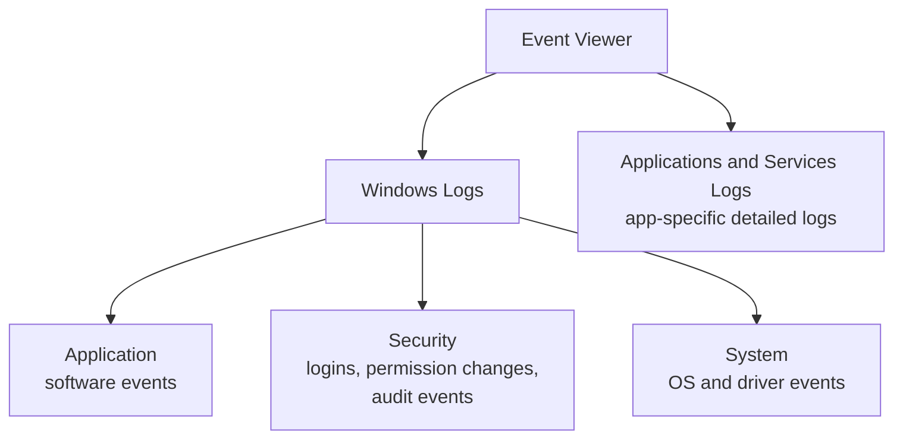

# Windows Event Viewer

Path 03's Linux forensics lab and Path 16's DFIR lab both leaned heavily on `/var/log/auth.log` for investigating a Linux system. Windows has its own, differently-structured equivalent — the **Event Viewer** — and this lesson is where you learn to actually read it, directly transferring the log-analysis mindset built earlier in this course to a Windows context.

## Opening and navigating Event Viewer

Launch it via `eventvwr.msc`, or search "Event Viewer" in the Start menu. The main logs worth knowing:



The **Security** log is the one most relevant to security work — it's the direct Windows equivalent of Linux's `auth.log`, recording login attempts, permission changes, and (if configured) detailed audit events.

## Reading Security log entries — Event IDs

Every logged event has a numeric **Event ID** identifying exactly what happened — memorizing the most security-relevant ones is genuinely useful, the same way recognizing common `auth.log` patterns (Path 16's forensics lessons, this course's CTF Zone forensics challenge) pays off on Linux:

| Event ID | Meaning |
|---|---|
| **4624** | Successful logon |
| **4625** | Failed logon attempt |
| **4634** | Logoff |
| **4720** | A new user account was created |
| **4732** | A member was added to a security-enabled local group (e.g., added to Administrators) |
| **1102** | The audit log itself was cleared — a major red flag, often an attacker covering tracks |

A burst of **4625** events for the same account, followed by a **4624** success — this is the exact Windows equivalent of the brute-force pattern you already learned to spot in this course's CTF Zone forensics challenge, just represented through Event IDs instead of `auth.log` text lines.

## Filtering effectively

Event Viewer's raw log volume can be overwhelming — use **Filter Current Log** (right-click any log) to narrow by Event ID, time range, or specific user, exactly the same filtering discipline Path 12's Wireshark lessons taught for network captures, applied here to event logs instead of packets.

```
# A quick way to check recent failed logons via PowerShell instead of the GUI:
Get-WinEvent -FilterHashtable @{LogName='Security'; ID=4625} -MaxEvents 20
```

## The 1102 event — a critical incident response signal

:::danger Cleared logs are themselves evidence
Event ID **1102** ("The audit log was cleared") is one of the single most important entries to watch for in incident response — a legitimate administrator rarely has reason to clear the security log, and an attacker attempting to cover their tracks after gaining access very often does exactly this. Its *presence* (even though the surrounding evidence it might reveal is now gone) is itself a strong indicator something happened worth investigating immediately, connecting directly to the anti-forensics awareness from Path 14's advanced exploitation lab discussion.
:::

## More Event IDs worth recognizing on sight

Beyond the core logon/account events above, a few more Event IDs come up constantly enough in real investigations to be worth memorizing alongside them. **4648** (logon attempted using explicit credentials) can reveal lateral movement — a process on one machine authenticating to another using a *different* account's credentials than the one currently logged in, exactly the pattern Path 16's Active Directory lesson describes when an attacker moves between compromised machines. **4688** (a new process was created) is the process-creation equivalent of the logon events, and — critically, only when Advanced Audit Policy's command-line auditing is enabled — includes the full command line the process was launched with, letting an investigator see exactly what arguments a suspicious `powershell.exe` invocation actually used. **5140** (a network share object was accessed) helps trace whether an attacker browsed or copied data from shared folders, directly relevant to detecting the kind of data staging that typically precedes exfiltration.

## PowerShell-specific logging — where a lot of real attacks hide

Recall Path 10.3's "living off the land" concept and Path 16's Windows privesc material — a huge share of real intrusions rely heavily on PowerShell precisely because it's a legitimate, always-present, deeply capable tool. Windows offers dedicated PowerShell logging beyond the generic process-creation event above: **Script Block Logging** (Event ID 4104) records the actual *content* of PowerShell commands and scripts as they execute — including scripts that were deliberately obfuscated or encoded before execution, since Windows logs the content after PowerShell's own engine has decoded it internally. Enabling this specific logging (via Group Policy → PowerShell settings) is widely considered one of the single highest-value logging changes a Windows environment can make, precisely because so much real attacker activity — credential harvesting scripts, download-and-execute one-liners, lateral movement tooling — happens through PowerShell rather than a compiled executable that would show up more obviously in traditional antivirus scanning.

## Sysmon — going beyond the built-in logs

Microsoft's free **Sysmon** (System Monitor, part of the Sysinternals suite referenced in this path's fundamentals lesson) provides dramatically more detailed logging than Windows' default configuration — process creation with full command lines, network connections, and file creation events, all with much richer detail than the default Security log captures out of the box. Path 16's threat hunting and DFIR labs both assume this level of visibility is available; Sysmon is exactly how real Windows environments achieve it.

:::tip Enable more detailed auditing before you need it
By default, Windows' Security log configuration is relatively minimal — enabling "Advanced Audit Policy" settings (via `secpol.msc` or Group Policy) for object access, process creation, and privilege use dramatically increases the log detail available *later*, during an actual investigation. Configuring this proactively, before an incident happens, is a genuinely important real-world practice — you cannot retroactively generate logs for events that already happened without adequate logging enabled at the time.
:::

:::challenge Practice reading your own Security log
Open Event Viewer on your own machine, navigate to the Security log, and filter for Event ID 4624 (successful logons) over the past week. Note the pattern of your own normal login times and methods — this "know your own baseline" exercise mirrors exactly the baseline-building practice from Path 16's Linux forensics lab, just applied to Windows.
:::

## Key terms

- **Event Viewer** — Windows' built-in log viewing and management tool.
- **Event ID** — a numeric identifier for a specific type of logged event.
- **Sysmon** — a free Microsoft tool providing dramatically more detailed system event logging than Windows' defaults.

## Recap

- The Security log is Windows' direct equivalent of Linux's auth.log, recording logon events and permission changes.
- Specific Event IDs (4624/4625 for logon success/failure, 4720/4732 for account/group changes, 1102 for cleared logs) are worth recognizing on sight.
- A cleared audit log (Event ID 1102) is itself a major red flag, often indicating an attacker covering their tracks.
- Sysmon dramatically expands default logging detail and is standard in real, security-mature Windows environments.

???refs
- [Microsoft: Windows Security Event IDs reference](https://learn.microsoft.com/en-us/windows/security/threat-protection/auditing/) — the official, comprehensive event ID reference.
- [Sysmon documentation](https://learn.microsoft.com/en-us/sysinternals/downloads/sysmon) — official docs for the free, widely-used detailed logging tool.
???

**Next up →** [Recognizing a Compromised Windows Machine](#/lesson/07-windows-security/recognizing-windows-compromise)
