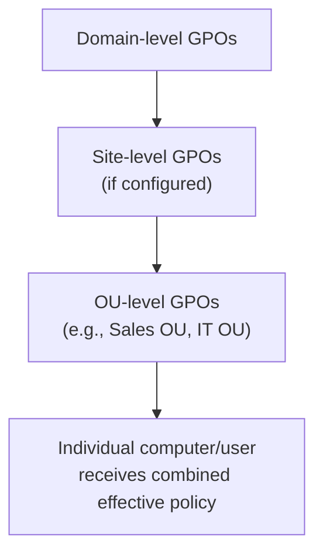

# Windows Group Policy Basics

The Active Directory lesson introduced OUs and groups as ways of organizing an organization's users and computers. This lesson covers the tool that actually *enforces* consistent settings across all of them at once: **Group Policy**.

:::tip
Think of Group Policy as the AD-scale version of the individual security settings you configured by hand back in the Windows Security Settings lesson — instead of visiting each machine one at a time, an administrator defines a policy once and it applies automatically to every relevant computer or user across the entire domain.
:::

## What a Group Policy Object actually is

A **Group Policy Object (GPO)** is a collection of configuration settings — anything from password complexity requirements to which applications are allowed to run — that gets linked to a domain, site, or specific Organizational Unit (from the previous lesson) and automatically applied to every user or computer within that scope.

## How GPOs actually get applied: inheritance and scope

GPOs apply hierarchically, and this hierarchy matters a lot for both administration and security assessment:

- **Inheritance** — a computer in a specific OU inherits GPOs applied at the domain level *and* any GPOs applied specifically to its OU, with more specific (OU-level) settings generally overriding broader (domain-level) ones where they conflict
- **Scope** — an administrator can deliberately apply a stricter policy to a sensitive OU (say, an IT-admin-accounts OU) than to a general-employee OU, directly extending the OU-based organization from the Active Directory lesson into actual enforced behavior

## Common security-relevant Group Policy settings

- **Password and account lockout policy** — enforcing minimum password length, complexity, and lockout thresholds domain-wide, rather than relying on individual users to configure this themselves
- **Software restriction / AppLocker policies** — controlling which applications are allowed to run at all, a genuinely powerful defense against unauthorized or malicious software execution
- **Audit policy** — controlling exactly which events actually get logged to the Security log the Event Viewer lesson covered — without the right audit policy configured, the events you'd want to investigate later may never have been recorded in the first place
- **Windows Firewall and Defender configuration** — enforcing consistent security-tool settings across every machine, rather than trusting each user not to disable protection locally

## Why Group Policy misconfiguration is a real security finding

Just as the Active Directory lesson covered misconfigured permissions creating attack paths, misconfigured or overly permissive GPOs are a genuine, commonly-found security weakness in real assessments — a GPO that grants broader software-installation rights than intended, or that fails to actually enforce the password policy an organization believes is in effect, undermines security silently and at scale, precisely because the misconfiguration applies automatically to every machine in its scope rather than being an isolated, one-off mistake.

:::challenge Diagnose an inheritance conflict
A domain-level GPO sets minimum password length to 12 characters. An OU-level GPO applied specifically to the "Contractors" OU sets minimum password length to 8 characters. A contractor's account currently uses an 8-character password.

Hint
Given how GPO inheritance and scope work, which policy actually takes effect for an account in the Contractors OU?

Show answer
The OU-level policy (8 characters) takes effect for accounts within the Contractors OU, since more specific, closer-scoped GPOs generally override broader domain-level ones where a direct conflict exists — meaning the contractor's 8-character password is technically compliant with the effective policy actually governing their account, even though it violates the domain-wide baseline. Whether this is an intentional, deliberate exception or an accidental misconfiguration is exactly the kind of question a real security review would need to ask — and it's a good illustration of why understanding GPO inheritance and scope matters for security assessment, not just IT administration: the "effective" policy an account is actually subject to isn't always obvious just from looking at the domain-level settings alone.

:::

## 🧪 Hands-on lab — trace an inheritance chain

For a hypothetical domain with a domain-level GPO enforcing 90-day password expiration and an OU-level GPO on a "Service Accounts" OU setting password expiration to "never," determine the effective policy for an account in that OU, and write one sentence on whether this specific override seems like a reasonable, deliberate exception or a security risk worth investigating further.

:::challenge Test yourself
1. What is a Group Policy Object, and what problem does it solve compared to configuring each machine individually?
2. In GPO inheritance, which generally takes precedence when a domain-level and an OU-level setting conflict?
3. Why does audit policy configuration matter for incident investigation, even though it doesn't directly prevent an attack?
:::

## Key terms

- **Group Policy Object (GPO)** — a collection of configuration settings automatically applied to users or computers within its scope.
- **Inheritance (Group Policy)** — the hierarchical application of GPOs from domain level down through OUs, with more specific settings generally overriding broader ones.
- **AppLocker** — a Windows feature for controlling which applications are permitted to run.

## Recap

Group Policy is Active Directory's mechanism for enforcing consistent security configuration automatically across every relevant computer and user, rather than requiring manual configuration machine by machine. Understanding GPO inheritance and scope matters for security assessment specifically because the "effective" policy governing a given account isn't always obvious from domain-level settings alone — and misconfigured or overly permissive GPOs are a genuine, commonly-found weakness in real-world Active Directory environments, applying silently at scale rather than as isolated mistakes.

???refs
- [Microsoft — Group Policy Overview](https://learn.microsoft.com/en-us/windows/win32/srvnodes/group-policy) — the official technical reference
???

**Next up →** [Windows Command Line Basics](#/lesson/07-windows-security/windows-command-line-basics)
