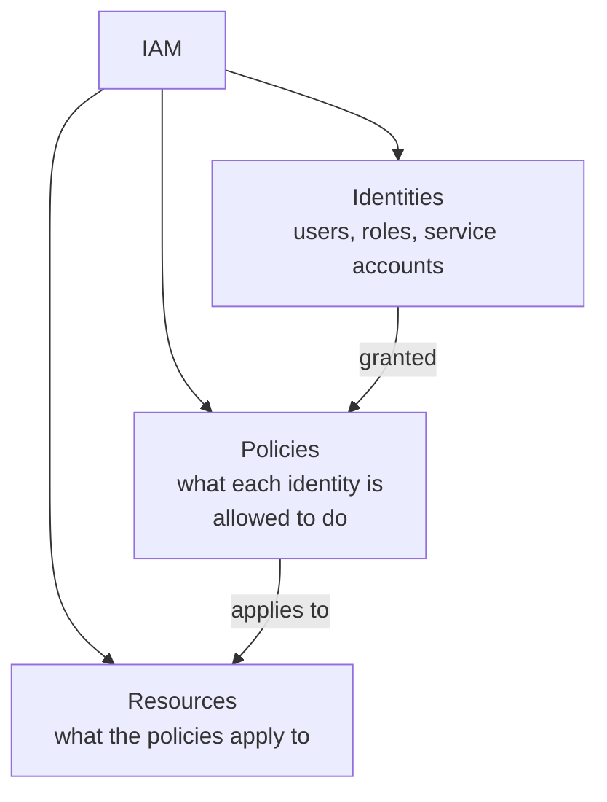

# Cloud Identity & Access Management

Path 16's cloud security lesson references "overly permissive IAM roles" as a core risk category — this lesson explains exactly what IAM is and how it works, since it's genuinely the central security control underlying nearly everything else in cloud computing.

## Why IAM is cloud's most important security layer

In traditional on-premises security, physical access and network segmentation (Path 12) provide meaningful natural boundaries — an attacker generally needs to be on your network, or physically present, to reach much of anything. In the cloud, almost everything is reachable via API calls from anywhere on the internet, protected *only* by authentication and authorization — meaning **IAM (Identity and Access Management)** effectively replaces the physical/network perimeter as the primary security boundary.



## Users, groups, and roles

- **IAM users** — represent individual people or applications with their own long-term credentials.
- **IAM groups** — collections of users sharing the same set of permissions, letting you manage many users' access consistently at once, rather than configuring each individually.
- **IAM roles** — a genuinely important, distinct concept: roles are *assumed temporarily* rather than tied to permanent credentials — an EC2 instance, a Lambda function, or a federated external user can "assume" a role, receiving temporary credentials with that role's specific permissions, which automatically expire. This is exactly the mechanism behind the instance metadata service credentials referenced in the previous lesson.

## The principle of least privilege, applied to IAM

Path 13's mobile fundamentals lesson introduced least privilege in the context of app permissions — IAM is where this principle matters most in cloud security specifically. An IAM policy should grant only the exact permissions a given identity genuinely needs, nothing more:

```json
{
  "Effect": "Allow",
  "Action": "s3:GetObject",
  "Resource": "arn:aws:s3:::my-app-uploads/*"
}
```

This policy allows reading objects from exactly one specific bucket — nothing else. Compare this to a dangerously over-broad alternative:

```json
{
  "Effect": "Allow",
  "Action": "*",
  "Resource": "*"
}
```

This second policy — genuinely common as a lazy shortcut during development, and genuinely dangerous if it ever reaches production — grants **every possible action on every possible resource**, meaning any credential compromise for that identity grants an attacker essentially unlimited access across the entire cloud account.

## Reading and auditing IAM policies

```bash
aws iam list-users
aws iam list-attached-user-policies --user-name someuser
aws iam get-policy-version --policy-arn arn:aws:iam::123456789:policy/SomePolicy --version-id v1
```

A genuinely valuable, quick audit technique: search every attached policy across an account for wildcard (`"Action": "*"` or `"Resource": "*"`) grants — exactly the pattern flagged above, and exactly the kind of finding Path 16's flAWS lab specifically walks you through discovering.

## Multi-factor authentication for cloud accounts

Path 00's passwords lesson already established MFA as blocking the overwhelming majority of account-takeover attempts — this matters with particular force for cloud provider root/administrator accounts specifically, since a compromised cloud root account potentially grants an attacker control over an organization's *entire* infrastructure, not just one application or service.

## IAM privilege escalation — when permissions grant more permissions

Recall Path 16.4's brief mention of IAM privilege escalation — worth expanding here now that this lesson has covered IAM's core building blocks. A specific, subtle danger exists whenever a policy grants permission to *modify permissions themselves* — a user who can attach policies to their own account, create new IAM roles, or modify an existing role's trust relationship can potentially escalate their own effective access far beyond what their original, seemingly-limited policy intended:

```json
{
  "Effect": "Allow",
  "Action": ["iam:CreatePolicyVersion", "iam:AttachUserPolicy"],
  "Resource": "*"
}
```

A user holding only this policy looks unprivileged at first glance — no direct access to any data at all — but `iam:AttachUserPolicy` lets them attach an administrator policy directly to their own account, and `iam:CreatePolicyVersion` lets them modify an existing policy's actual permissions. This is directly analogous to a Linux user who can edit their own `sudoers` entry (Path 16.1) or a Windows user who can add themselves to the Administrators group (Path 16.2) — the specific *permission to grant more permissions* is itself the vulnerability, regardless of how limited the account's other, more visible permissions appear. Tools like **Pacu** (mentioned in Path 16.4) and **PMapper** specifically automate discovering these escalation chains across a real IAM policy set, since manually tracing every possible combination of permissions across dozens of roles quickly becomes impractical by hand.

## Federation and single sign-on (SSO)

Larger organizations typically don't create individual IAM users for every employee manually — instead, they use **federation**, connecting cloud IAM to an existing identity provider (often the same Active Directory referenced in Path 16's AD attacks lesson, now extended into the cloud via Azure AD/Entra ID or similar), letting employees use one existing corporate identity to access cloud resources rather than managing separate cloud-specific credentials.

:::danger Leaked cloud credentials are a top real-world breach cause
IAM credentials (access keys, secret keys) accidentally committed to a public GitHub repository, hardcoded in application source code (echoing Path 13/16's static analysis lessons on hardcoded secrets), or leaked through misconfigured logging are consistently among the most common real-world causes of major cloud breaches. Never hardcode cloud credentials — use IAM roles (which provide automatically-rotating temporary credentials) wherever possible instead of long-lived access keys.
:::

:::challenge Test yourself
Why is an IAM *role* generally considered more secure than a permanent IAM *user* credential for something like an application running on a cloud server?
<details><summary>Show answer</summary>A permanent IAM user's access keys are long-lived credentials that must be securely stored somewhere the application can access them — creating exactly the hardcoded-secret risk flagged throughout this course (Path 13/16's static analysis lessons) if not handled carefully, and remaining valid indefinitely until manually rotated or revoked, meaning a leaked key stays dangerous for as long as it goes unnoticed. An IAM role, by contrast, is <em>assumed</em> by the resource (like an EC2 instance) at runtime, and the cloud provider automatically issues short-lived, temporary credentials that expire and rotate on their own — there's no long-lived secret to accidentally leak or hardcode in the first place, since the credentials are generated fresh and expire quickly even if somehow intercepted. This is exactly why the instance metadata service (previous lesson) exists: it's how an instance retrieves its role's temporary credentials at runtime, rather than needing them baked in anywhere.</details>
:::

## Key terms

- **IAM (Identity and Access Management)** — the system controlling who (or what) can do what within a cloud account.
- **IAM role** — temporarily assumable permissions with automatically expiring credentials, as opposed to a permanent user's long-lived credentials.
- **Principle of least privilege** — granting only the minimum permissions an identity genuinely needs.
- **Federation** — connecting cloud IAM to an existing external identity provider rather than managing separate credentials.

## Recap

- IAM effectively replaces the physical/network perimeter as cloud computing's primary security boundary, since nearly everything is reachable via authenticated API calls from anywhere.
- IAM roles provide temporary, auto-expiring credentials — meaningfully more secure than permanent user access keys, and exactly the mechanism behind instance metadata service credentials.
- Overly broad wildcard policies (`"Action": "*"`, `"Resource": "*"`) are a common, dangerous real-world misconfiguration, violating least privilege.
- Leaked long-lived credentials (hardcoded, committed to public repos) are consistently among the most common real-world causes of major cloud breaches.

???refs
- [AWS IAM Best Practices](https://docs.aws.amazon.com/IAM/latest/UserGuide/best-practices.html) — official, detailed, free guidance directly relevant to this lesson.
???

**Next up →** [Cloud Multi-Account Governance](#/lesson/08-cloud-basics/cloud-multi-account-governance)
