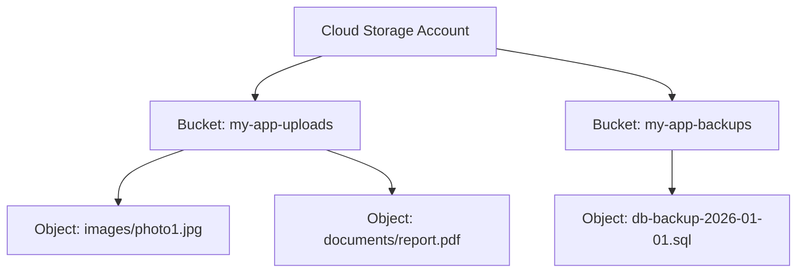
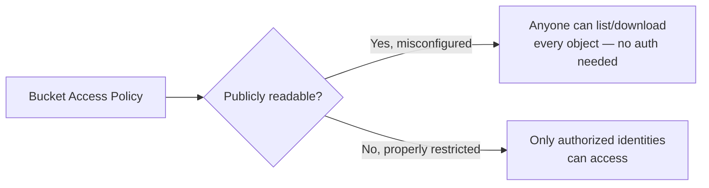

# Cloud Storage Basics

Path 16's cloud security lesson and flAWS lab both center heavily on misconfigured storage buckets — arguably the single most common real-world cloud misconfiguration category. This lesson slows down to explain exactly what cloud storage is and how it works, before you continue into that more advanced material.

## Object storage vs. traditional file systems

Path 00's files-and-folders lesson explained the traditional hierarchical file system: folders containing files containing folders, navigated by path. Cloud **object storage** works differently — it's a flat namespace of **objects** (essentially files, but stored without the same folder hierarchy underneath), each identified by a unique key, grouped into **buckets**.



Note that `images/photo1.jpg` *looks* like a folder path, but it's actually just part of the object's key (name) — cloud storage simulates folder-like organization for convenience, without genuinely implementing a hierarchical file system underneath.

## Why buckets are such a common misconfiguration

A bucket's **access policy** determines who can read or write to it — and this is exactly where Path 16's cloud security lesson's core finding lives: a bucket accidentally configured for public read access exposes every object inside it to anyone on the internet, with zero authentication or exploitation required at all.



This misconfiguration happens for genuinely understandable reasons: developers testing something quickly, a template or default configuration that's more permissive than intended, or someone deliberately making a bucket public for a legitimate use case (hosting static website assets, say) without realizing *other*, more sensitive objects also live in the same bucket.

## Checking bucket permissions, hands-on

Using the AWS CLI (referenced in the previous lesson) against a bucket you own or are authorized to test:

```bash
aws s3api get-bucket-acl --bucket your-bucket-name
aws s3api get-bucket-policy --bucket your-bucket-name
```

Or, for a quick unauthenticated check whether a bucket allows public listing (exactly the technique used in Path 16's flAWS lab):

```bash
aws s3 ls s3://target-bucket-name --no-sign-request
```

If this command succeeds without any credentials at all, the bucket is publicly listable — a direct, hands-on demonstration of exactly the misconfiguration class this lesson has been building toward.

## Storage classes and lifecycle — a brief note

Beyond access control, cloud storage typically offers multiple **storage classes** trading cost against retrieval speed (frequently-accessed "standard" storage versus cheaper, slower "archive" storage for rarely-accessed backups) — genuinely useful to know exists, though not itself a security-relevant distinction the way access policy is.

## Encryption at rest and in transit — two distinct guarantees

Cloud storage services typically offer **encryption at rest** (data encrypted while sitting in storage, using AES per Path 06's symmetric encryption lesson, protecting against someone who somehow gains direct access to the underlying physical storage media) and **encryption in transit** (data encrypted via TLS while moving between your application and the storage service, protecting against network interception per Path 12's MITM lesson) — worth understanding as two genuinely separate guarantees, since a bucket can have one enabled without the other, and neither one protects against the access-policy misconfiguration this lesson focuses on. This is a subtle but important point: encryption at rest protects data from someone stealing the physical disk; it does *nothing* to stop a legitimately-authenticated (or, worse, unauthenticated due to a public policy) request from simply reading the data through the normal API, since the storage service transparently decrypts data for any request it considers authorized. Many cloud providers now enable encryption at rest by default for new buckets specifically because it's a low-cost, broadly-applicable control — but never mistake "encryption is on" for "access is properly restricted," since they answer completely different security questions.

## Versioning and its security implications

Many cloud storage services support **versioning** — keeping previous versions of an object rather than overwriting them on update. This has a real, sometimes-overlooked security implication: even after "deleting" or "fixing" an exposed sensitive file, old versions may remain accessible unless versioning history is *also* explicitly cleaned up — directly echoing Path 13's mobile data-storage lesson's point about backups preserving data you thought was removed.

:::danger Public buckets remain a top real-world breach cause
Misconfigured public cloud storage has been the root cause behind numerous major, well-documented real-world data breaches — genuinely one of the single most consequential, and most preventable, cloud security failures. A five-minute access policy review catches exactly this category of risk before it becomes a breach.
:::

:::challenge Test yourself
Why does deleting a sensitive file from a cloud storage bucket not necessarily fully remove the exposure, if versioning is enabled?
<details><summary>Show answer</summary>When versioning is enabled, "deleting" an object typically doesn't erase it — it either creates a new "delete marker" while the actual previous version remains stored and potentially still accessible through direct version-specific requests, or simply adds the deletion as a new version in the object's history while earlier versions persist. If the bucket's access policy remains public, an attacker who already knows (or can guess/enumerate) the object's key can potentially still retrieve an older version even after what looks like a "fix" from the perspective of someone just checking the current, latest state of the bucket. Properly remediating an exposed sensitive file requires not just correcting the bucket's access policy going forward, but also explicitly checking and removing exposure from the object's full version history — exactly the same "backups can preserve what you thought was deleted" lesson from Path 13's mobile insecure storage lesson, here applied to cloud storage versioning instead of mobile app backups.</details>
:::

## Key terms

- **Object storage** — a flat, key-based storage model (buckets containing objects) rather than a traditional hierarchical file system.
- **Bucket access policy** — the configuration determining who can read or write to a storage bucket.
- **Versioning** — retaining previous versions of an object rather than fully overwriting them, with its own exposure implications.

## Recap

- Cloud object storage uses buckets and key-named objects rather than a traditional folder hierarchy, though it simulates folder-like organization for convenience.
- Misconfigured public bucket access policies are one of the most common and most consequential real-world cloud security failures.
- Checking bucket permissions — via console review or a simple unauthenticated CLI listing attempt — is a fast, high-value first check in any cloud security assessment.
- Versioning can preserve exposure even after a sensitive object appears deleted or a bucket's policy has been corrected, requiring explicit version-history remediation too.

???refs
- [AWS S3 Security Best Practices](https://docs.aws.amazon.com/AmazonS3/latest/userguide/security-best-practices.html) — official, detailed, free guidance directly relevant to this lesson.
???

**Next up →** [Cloud Databases Basics](#/lesson/08-cloud-basics/cloud-databases-basics)
