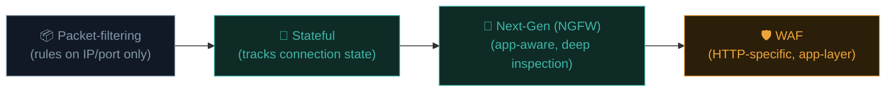
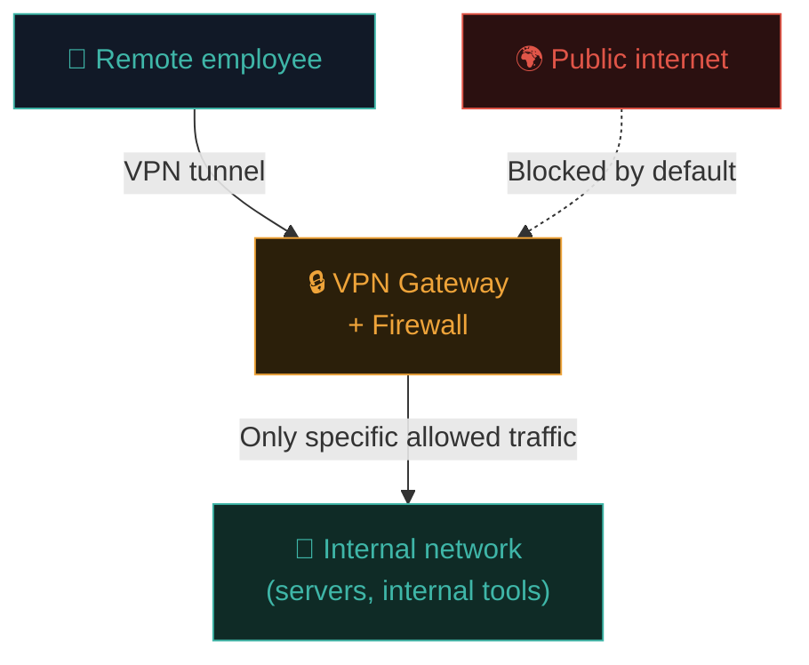

# Firewalls & VPNs

Two of the most fundamental network security controls — one restricts *what traffic is allowed*, the other protects *what traffic can be seen*. Every organisation's network relies on both, in various forms.

## Firewalls — the gatekeeper

A **firewall** inspects network traffic and allows or blocks it based on a set of rules. Conceptually, it's a checkpoint between two zones of differing trust — most commonly, between your internal network and the wider internet.

### Types of firewalls, by generation



- **Packet-filtering firewalls** — the earliest generation. Inspect individual packets against static rules (source/destination IP, port, protocol) with **no memory** of previous packets. Fast but simplistic.
- **Stateful firewalls** — track the state of active connections (recall the TCP handshake). Understands that an incoming packet is a legitimate *response* to an outbound request you initiated, vs. an unsolicited inbound connection attempt — a massive security improvement over stateless filtering.
- **Next-Generation Firewalls (NGFW)** — add application-layer awareness (distinguishing "this is Netflix traffic" from "this is a file transfer," even on the same port), integrated intrusion prevention, and often deep packet inspection.
- **Web Application Firewalls (WAF)** — specifically understand HTTP/HTTPS traffic and application-layer attack patterns (SQLi, XSS signatures from Path 07) — sitting in front of web applications specifically, distinct from network-level firewalls protecting entire infrastructure.

### Firewall rules — the basic logic

```
ALLOW  tcp  any        -> 10.0.0.5:443   (allow HTTPS to the web server)
ALLOW  tcp  10.0.0.0/24 -> 10.0.0.10:22  (allow SSH only from the internal subnet)
DENY   tcp  any        -> 10.0.0.10:22   (block SSH from everywhere else)
DENY   all  any        -> any            (default deny — the safest default policy)
```

The **default deny** principle — blocking everything not explicitly allowed, rather than allowing everything not explicitly blocked — is the foundational best practice across nearly all of security, not just firewalls (echoing the "deny by default" idea from Path 07.4's IDOR defences).

### A simple Linux firewall — iptables/nftables basics

Kali (and most Linux systems) ship with kernel-level firewall capability, configured via `iptables` (legacy) or `nftables` (modern):

```bash
# View current rules:
sudo iptables -L -v

# Allow SSH:
sudo iptables -A INPUT -p tcp --dport 22 -j ACCEPT

# Allow established/related connections back in (stateful):
sudo iptables -A INPUT -m state --state ESTABLISHED,RELATED -j ACCEPT

# Default deny everything else inbound:
sudo iptables -P INPUT DROP
```

Even a personal Linux machine benefits from a properly configured firewall — this is exactly the kind of hardening step from Path 06.7 made concrete at the OS level.

### UFW — a friendlier front-end

```bash
sudo apt install ufw -y
sudo ufw default deny incoming
sudo ufw default allow outgoing
sudo ufw allow ssh
sudo ufw enable
sudo ufw status verbose
```

**UFW** ("Uncomplicated Firewall") wraps iptables with a much friendlier syntax — a great starting point for beginners hardening their own Kali VM or a personal Linux server.

## VPNs — encrypted tunnels

A **VPN (Virtual Private Network)** creates an encrypted tunnel between your device and a remote network (or VPN provider), making your traffic:

- **Encrypted** in transit, unreadable to anyone intercepting it along the path (recall your own Wireshark experiment from the previous lesson).
- **Appear to originate** from the VPN server's location/IP, rather than your own.


### Two very different use cases, often confused

- **Corporate/remote-access VPN** — lets employees securely connect to internal company resources (servers, internal tools) as if they were physically on the office network, while working remotely. This is the VPN context most relevant to enterprise security work.
- **Consumer/commercial VPN** (NordVPN, ExpressVPN, etc.) — primarily used to mask your IP/location from websites and your own ISP, and to protect traffic on untrusted networks (public Wi-Fi). Provides real privacy benefits, but **does not make you "anonymous" or "untraceable"** in any absolute sense — the VPN provider itself can typically see your traffic, shifting trust rather than eliminating it.

### Common VPN protocols

| Protocol | Notes |
|---|---|
| **OpenVPN** | Mature, widely supported, open-source, flexible |
| **WireGuard** | Modern, much simpler codebase, excellent performance, increasingly the default choice |
| **IPsec/IKEv2** | Common in enterprise and mobile contexts, good for fast reconnection when switching networks |

### A quick WireGuard config example

```ini
# /etc/wireguard/wg0.conf (client side)
[Interface]
PrivateKey = <your-private-key>
Address = 10.0.0.2/24
DNS = 1.1.1.1

[Peer]
PublicKey = <server-public-key>
Endpoint = vpn.example.com:51820
AllowedIPs = 0.0.0.0/0
```

```bash
sudo wg-quick up wg0     # bring the tunnel up
sudo wg-quick down wg0   # bring it down
```

WireGuard's config simplicity (compared to older OpenVPN configs) is a major reason for its rapid adoption industry-wide.

## Firewalls and VPNs working together — a typical enterprise pattern



An employee's traffic is encrypted via VPN in transit, then the firewall at the gateway enforces exactly which internal resources that authenticated tunnel is allowed to reach — layering encryption (confidentiality) with access control (least privilege), rather than relying on either alone.

## The rise of Zero Trust — a modern evolution

Traditional network security assumed "inside the firewall/VPN = trusted." **Zero Trust** architecture instead assumes **no** implicit trust based on network location alone — every request, from anywhere, must be authenticated and authorised on its own merits, continuously, regardless of whether it originates "inside" the traditional perimeter. This is a significant, ongoing industry shift worth being aware of as you progress — the old "castle and moat" model is increasingly considered insufficient on its own.

## 🧪 Lab — Configure UFW on your Kali VM

```bash
sudo apt install ufw -y

# Set sensible defaults:
sudo ufw default deny incoming
sudo ufw default allow outgoing

# Allow only what you actually need:
sudo ufw allow ssh
sudo ufw allow from 192.168.56.0/24    # allow your lab network specifically

# Enable and verify:
sudo ufw enable
sudo ufw status verbose

# Try connecting to a port you haven't allowed from another VM/device
# and confirm the connection is refused/blocked as expected.
```

You've just hardened your own lab machine using exactly the default-deny principle covered in this lesson.

:::challenge Test yourself
An employee's VPN client successfully establishes an encrypted tunnel to the company network. Does that alone guarantee they can access every internal server? Why or why not?

<details><summary>Show answer</summary>No. The VPN provides an <strong>encrypted, authenticated path into the network</strong> — but the <strong>firewall</strong> (and any further internal access controls) still determines exactly which specific internal resources that connection is permitted to reach. Encryption and access control are separate, complementary layers; a VPN alone doesn't imply unrestricted internal access, especially under a properly-implemented Zero Trust model.</details>
:::

## Key terms

- **Firewall** — inspects and allows/blocks traffic based on rules.
- **Stateful inspection** — tracking connection state rather than evaluating packets in isolation.
- **NGFW / WAF** — application-aware and HTTP-specific firewall variants respectively.
- **Default deny** — blocking everything not explicitly allowed; the safest baseline policy.
- **VPN** — an encrypted tunnel protecting traffic confidentiality and/or masking origin.
- **Zero Trust** — assuming no implicit trust from network location alone; continuous verification everywhere.

## Recap

- Firewalls have evolved from simple packet filters to application-aware NGFWs and HTTP-specific WAFs.
- Default deny is the safest baseline firewall policy, mirroring the "deny by default" principle from Path 07.
- VPNs encrypt traffic in transit and can mask origin — but corporate and consumer use cases serve very different purposes.
- WireGuard's simplicity is driving rapid industry adoption over older protocols like OpenVPN.
- Zero Trust represents a significant shift away from "inside the perimeter = trusted."

???refs
- [NIST SP 800-41 — Guidelines on Firewalls](https://csrc.nist.gov/pubs/sp/800/41/r1/final) — official US guidance.
- [WireGuard official site](https://www.wireguard.com/) — protocol documentation and design rationale.
- [UFW documentation — Ubuntu/Debian wiki](https://help.ubuntu.com/community/UFW)
- [NIST SP 800-207 — Zero Trust Architecture](https://csrc.nist.gov/pubs/sp/800/207/final) — the official Zero Trust reference.
???

**Next up →** [IDS, IPS & SIEM](#/lesson/08-network-security/ids-ips-siem)
