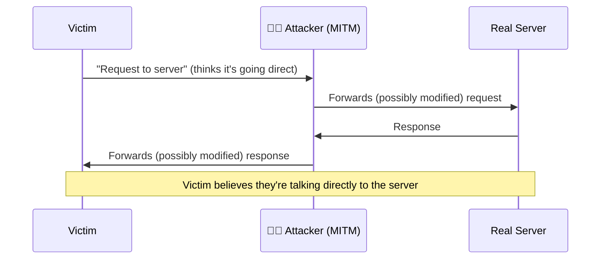

# Man-in-the-middle attacks

You've been using a man-in-the-middle setup deliberately and legitimately throughout Path 07 — that's exactly what Burp Suite does. This lesson covers the same fundamental technique used **maliciously**, and how to defend against it.

## The core concept

A **man-in-the-middle (MITM)** attack happens when an attacker secretly positions themselves between two communicating parties, able to intercept, read, and potentially modify traffic passing between them — while both parties believe they're communicating directly with each other.



The victim's traffic still appears to work normally — pages load, logins succeed — while the attacker silently observes or tampers with everything passing through.

## How attackers actually get into the middle

### ARP spoofing (on a local network)

Recall Path 02's ARP protocol — devices on a local network use it to map IP addresses to MAC addresses. ARP has **no authentication built in**, so an attacker can send forged ARP replies claiming "I am the router" to the victim, and "I am the victim" to the router — redirecting all traffic between them through the attacker's machine.

```bash
# Using arpspoof (part of dsniff, on Kali):
sudo arpspoof -i eth0 -t <victim-ip> <gateway-ip>
sudo arpspoof -i eth0 -t <gateway-ip> <victim-ip>

# Enable IP forwarding so traffic still reaches its real destination
# (otherwise you'd just break the victim's connection instead of intercepting it):
echo 1 | sudo tee /proc/sys/net/ipv4/ip_forward
```

### Evil twin Wi-Fi (previous lesson)

Tricking a victim into connecting to an attacker-controlled access point puts all their traffic through the attacker by design — no ARP trickery needed, since the attacker's machine is genuinely the network gateway from the victim's perspective.

### DNS spoofing

Recall Path 02's DNS lesson — if an attacker can intercept or influence DNS responses (via ARP spoofing plus a malicious DNS responder, or a compromised/misconfigured DNS server), they can redirect a victim's `bank.com` lookup to the attacker's own server instead of the real one.

### Rogue/compromised network infrastructure

A compromised router, a malicious public Wi-Fi hotspot deliberately set up to intercept, or a compromised ISP-level device can all provide the same "in the middle" position without needing any active attack technique at all — simply because the attacker already controls a legitimate point in the path.

## What an attacker actually does once in the middle

- **Passive eavesdropping** — simply reading unencrypted traffic (exactly what your Wireshark lab in the earlier lesson demonstrated).
- **SSL stripping** — downgrading an HTTPS connection to HTTP by intercepting the initial request before it upgrades to HTTPS, tricking the victim's browser into using an unencrypted connection the attacker can read (largely mitigated today by **HSTS** — see below).
- **Session hijacking** — stealing session cookies observed in transit (recall Path 05.4 — this is exactly why the `Secure` cookie flag matters, since it prevents the cookie from ever being sent over an unencrypted connection an MITM could read).
- **Content injection** — modifying pages in transit (injecting ads, malware, or altering displayed content) before forwarding them to the victim.
- **Credential harvesting** — presenting fake login forms or capturing plaintext credentials directly from intercepted unencrypted traffic.

## Why HTTPS/TLS is the primary defence

Recall Path 02 and Path 05.1's TLS handshake — when done correctly, HTTPS defeats MITM attacks specifically because:

1. The server presents a **certificate**, cryptographically signed by a trusted Certificate Authority, proving its identity.
2. The browser **verifies** this certificate against known trusted CAs.
3. If an attacker tries to intercept and present their *own* certificate instead (exactly as Burp does, deliberately, in Path 07.2), the browser will **reject** it with a prominent warning — unless the attacker's certificate has somehow also been explicitly trusted by the victim's device (which is precisely why installing Burp's CA certificate was a deliberate, informed step you took yourself).

This is the exact reason **browser certificate warnings should never be dismissed casually** — a warning like "this connection is not private" or "certificate not trusted" is the browser actively detecting a potential MITM attempt (or, far more commonly in practice, a simple misconfiguration) and refusing to proceed silently.

## HSTS — closing the SSL-stripping gap

**HSTS (HTTP Strict Transport Security)** is a response header telling the browser: *"Always use HTTPS for this domain, for the next N seconds, no exceptions — never even attempt a plain HTTP connection."*

```http
Strict-Transport-Security: max-age=31536000; includeSubDomains; preload
```

Once a browser has seen this header once for a domain, it will **refuse** to connect over plain HTTP for that domain for the specified duration, even if an attacker tries to intercept and strip the initial HTTPS upgrade — directly closing the SSL-stripping attack window described above. Modern browsers also maintain a **built-in preload list** of major sites that enforce HTTPS-only from the very first connection, with no prior visit needed.

## Certificate pinning — an even stronger (if less flexible) defence

**Certificate pinning** goes further than standard CA validation — the application (commonly used in mobile apps) is hardcoded to only trust one **specific** certificate or public key, rather than any certificate from any generally-trusted CA. This defeats MITM attempts even if an attacker somehow obtained a fraudulently-issued but technically "valid" certificate from a compromised or coerced CA — at the cost of added operational complexity when legitimately rotating certificates.

## Defending against MITM, consolidated

- **Always verify HTTPS is in use** and heed certificate warnings rather than clicking through them.
- **HSTS** on your own websites/services closes the SSL-stripping gap.
- **VPN** (previous lesson) protects traffic confidentiality on untrusted networks (public Wi-Fi) even if an MITM position is achieved at the network layer.
- **Avoid sensitive activity on untrusted public Wi-Fi** without a VPN — banking, logins, anything sensitive.
- **Static ARP entries** or **dynamic ARP inspection** (on managed switches) can mitigate ARP spoofing specifically within an organisation's own network.
- **Certificate pinning** for high-security mobile/native applications.

## 🧪 Lab — Observe an MITM position yourself, safely

You've actually already done this in Path 07.2 — Burp Suite **is** a deliberate, consensual MITM setup between your own browser and target servers. Revisit that lesson's lab with fresh eyes:

1. With Burp's proxy configured and its CA certificate trusted, visit an HTTPS site.
2. Notice your browser shows **no warning** — because you explicitly told it to trust Burp's certificate.
3. Now, in a **different** browser profile where you haven't imported Burp's CA certificate, configure the same proxy settings and try visiting the same HTTPS site.
4. You should see a genuine, unmistakable **certificate warning** — this is exactly the browser protection this lesson describes, catching an MITM attempt in real time, precisely because trust wasn't established beforehand.

That contrast — trusted vs. untrusted proxy certificate — is the entire mechanism by which HTTPS defeats real-world MITM attacks, made directly visible using a tool you already know how to use.

:::danger AUTHORIZATION REQUIRED
ARP spoofing and MITM techniques against real networks and devices you don't own or lack explicit written authorization for are illegal, exactly as established throughout Path 01 and reinforced in the previous Wi-Fi lesson. Only practise ARP spoofing techniques within your own isolated lab network (Path 03.7's Host-only setup), never against production networks, public Wi-Fi, or any device you don't have clear written authorization to test.
:::

:::challenge Test yourself
A victim's browser displays a certificate warning while connecting to their bank's website over public Wi-Fi. What should they do, and why does this warning specifically suggest a possible MITM attempt?

<details><summary>Show answer</summary>They should <strong>not proceed</strong> — close the connection and try again on a trusted network, ideally using cellular data or a VPN instead. The warning means the certificate presented doesn't match what the browser expects/trusts for that domain, which is <em>exactly</em> what happens when an attacker intercepts the connection and presents their own certificate instead of the bank's genuine one — the core mechanism this entire lesson describes. While misconfiguration is a more common innocent cause than an actual attack, the correct response is identical either way: don't proceed until the warning is resolved through a trusted channel.</details>
:::

## Key terms

- **MITM (man-in-the-middle)** — an attacker secretly intercepting communication between two parties who believe they're communicating directly.
- **ARP spoofing** — forging ARP replies to redirect local network traffic through an attacker's machine.
- **SSL stripping** — downgrading an HTTPS connection to unencrypted HTTP during interception.
- **HSTS** — a header forcing browsers to always use HTTPS for a domain, closing the SSL-stripping gap.
- **Certificate pinning** — hardcoding trust to a specific certificate/key rather than any generally-trusted CA.

## Recap

- MITM attacks position an attacker secretly between two communicating parties, via ARP spoofing, evil twin Wi-Fi, DNS spoofing, or compromised infrastructure.
- HTTPS/TLS certificate validation is the primary defence — browser certificate warnings should never be dismissed casually.
- HSTS closes the SSL-stripping attack window by forcing HTTPS-only connections after first contact.
- Burp Suite itself is a deliberate, consensual demonstration of exactly this technique, already familiar from Path 07.
- VPNs protect traffic confidentiality specifically on untrusted networks where an MITM position may already exist.

???refs
- [OWASP — Man-in-the-middle attack](https://owasp.org/www-community/attacks/Man-in-the-middle_attack)
- [MDN — Strict-Transport-Security (HSTS)](https://developer.mozilla.org/en-US/docs/Web/HTTP/Headers/Strict-Transport-Security)
- [HSTS Preload List — hstspreload.org](https://hstspreload.org/) — the official browser-maintained preload list submission site.
- [dsniff/arpspoof documentation](https://www.kali.org/tools/dsniff/) — Kali tool reference.
???

**Next up →** [Your network security roadmap](#/lesson/08-network-security/netsec-roadmap)
