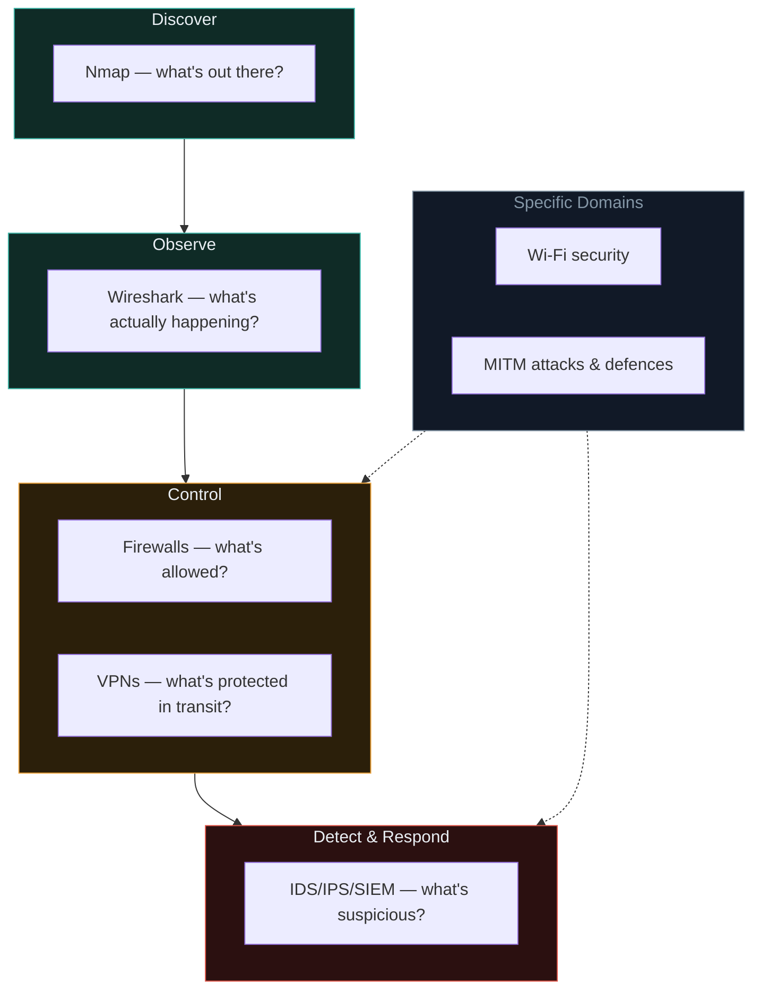
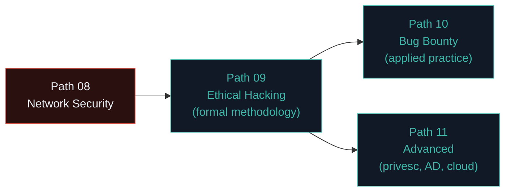

# Your network security roadmap

You've covered the essential toolkit of network security — scanning, packet analysis, perimeter controls, detection systems, wireless security, and interception attacks. This closing lesson consolidates everything and points toward what's next.

## The complete network security picture

## A practical network assessment checklist

For any network you're authorised to assess (your own lab, or a professional engagement in Path 09/10):

**Discovery & mapping**
- [ ] Host discovery sweep completed (`nmap -sn`)
- [ ] Full port scan with version detection on live hosts
- [ ] Targeted NSE vulnerability scripts run against identified services
- [ ] Network topology roughly mapped (segments, gateways, key servers)

**Traffic analysis**
- [ ] Sample traffic captured and reviewed for unencrypted credentials
- [ ] DNS queries reviewed for anything unusual or unexpected
- [ ] Any suspicious destination IPs/domains cross-checked

**Perimeter & access controls**
- [ ] Firewall rules reviewed — is default-deny actually enforced?
- [ ] VPN configuration reviewed — is it Enterprise/802.1X where appropriate, are unused legacy protocols disabled?
- [ ] Network segmentation reviewed — can a compromise in one zone reach everything else?

**Detection capability**
- [ ] IDS/IPS coverage checked against expected attack patterns
- [ ] SIEM correlation rules reviewed for key scenarios (brute force + new admin account, etc.)
- [ ] Logging confirmed to actually be flowing to the SIEM, not just generated and forgotten

**Wireless & interception**
- [ ] Wi-Fi protocol confirmed as WPA2/WPA3, WPS disabled
- [ ] Certificate warnings/HSTS reviewed on key internal and external services
- [ ] ARP spoofing / rogue AP detection capability considered, if relevant to the environment

This checklist becomes a direct input into the formal penetration testing methodology of Path 09, and the automated recon pipelines of Path 10.

## How network security connects to what you've already learned

- **Path 02** gave you the protocol vocabulary (IP, TCP/UDP, DNS, HTTP) that every tool in this path directly operationalises.
- **Path 06** gave you the conceptual framework (CIA triad, kill chain, risk) that explains *why* each control in this path matters.
- **Path 07** showed application-layer attacks; this path showed the infrastructure layer beneath them — together, they cover the two broad surfaces most real assessments need to consider.

## What's ahead

- **Path 09 (Ethical Hacking)** formalises everything from Paths 07–08 into the professional 5-phase penetration testing methodology, with proper scoping, rules of engagement, and reporting.
- **Path 11 (Advanced)** goes much deeper into what happens *after* an initial network or application foothold — privilege escalation, Active Directory attacks, and cloud-specific network security (VPCs, security groups — the cloud-native evolution of firewalls covered in this path).

## Tools worth exploring further

Beyond Nmap and Wireshark, as you progress:

- **Masscan** — an extremely fast port scanner for internet-scale scanning (used carefully and only with authorization).
- **Responder** — captures and exploits weaknesses in Windows network authentication protocols (directly relevant to Path 11's Active Directory content).
- **Bettercap** — a modern, powerful framework for MITM attacks, Wi-Fi reconnaissance, and network manipulation, effectively a more comprehensive successor to some `aircrack-ng`/`ettercap` functionality.
- **Zeek (formerly Bro)** — a powerful network analysis framework, popular in SOC/threat-hunting contexts for deep traffic inspection beyond what Wireshark alone typically handles at scale.

## 🧪 Lab — Full lab network assessment

Using your Kali VM and (ideally) a second target VM on your isolated Host-only network from Path 03.7:

1. Run a full Nmap discovery and scan sequence against your lab network.
2. Capture and analyse a sample of your own lab traffic with Wireshark, looking specifically for anything unencrypted.
3. Configure UFW on your Kali VM following the default-deny principle.
4. Set up basic auditd monitoring on a sensitive file.
5. Write a short summary (a paragraph or two) as if this were the "Network Security" section of a real assessment report — what you found, what's already well-configured, and what you'd recommend improving.

That summary format — findings plus recommendations — is exactly the skeleton you'll formalise fully in Path 09's reporting lesson.

:::challenge Reflection
Which single tool or concept from this path do you think you'll use most in your own security work — Nmap, Wireshark, firewall/VPN configuration, SIEM concepts, or MITM defence awareness? Why?

A thought on this
There's no single right answer, but it's worth noticing that for an <strong>AppSec-focused</strong role (like Ishfaq's own professional context), Wireshark and SIEM/detection concepts often come up less in daily hands-on tool use than Nmap-style reconnaissance and understanding how findings map to detection coverage — while for a <strong>SOC or network security</strong> role, IDS/IPS/SIEM concepts would likely dominate daily work instead. Recognising which of these maps most closely to your own career direction is a genuinely useful piece of self-assessment at this stage.

:::

## Key terms

- **Network assessment** — the systematic process of discovering, analysing, and testing a network's security posture.
- **Segmentation** (revisited) — the recurring defensive theme limiting how far a compromise can spread.

## Recap

- This path's tools — Nmap, Wireshark, firewalls/VPNs, IDS/IPS/SIEM, Wi-Fi security, MITM — form a complete, practical network security toolkit.
- A structured assessment checklist turns individual tool knowledge into a repeatable professional methodology.
- Network security and application security (Path 07) together cover the two broad surfaces most real security assessments address.
- Path 09 formalises this into professional penetration testing methodology; Path 11 goes deeper into post-compromise and cloud-native contexts.

???refs
- [SANS Institute — Network Security resources](https://www.sans.org/security-resources/) — extensive free resources across every topic in this path.
- [Zeek documentation](https://docs.zeek.org/) — deep network traffic analysis framework.
- [Bettercap documentation](https://www.bettercap.org/) — modern MITM and network attack framework.
- [NIST SP 800-115 — Technical Guide to Information Security Testing](https://csrc.nist.gov/pubs/sp/800/115/final) — official US methodology guidance covering much of this path's content.
???

## 🎉 You've finished Path 08

You now have hands-on familiarity with network scanning, packet analysis, firewalls, VPNs, intrusion detection, SIEM concepts, wireless security, and man-in-the-middle attacks and defences — the complete infrastructure-layer counterpart to Path 07's application security depth.

**Next up →** [Path 09: What is ethical hacking?](#/lesson/09-ethical-hacking/what-is-eh)
