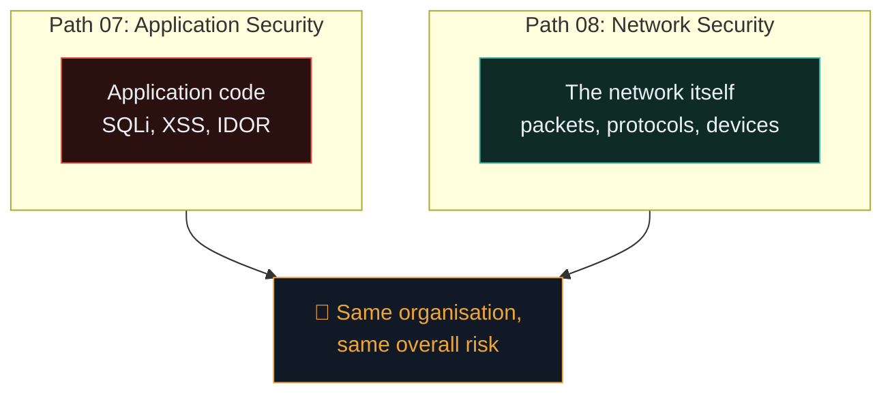

# Why network security matters

Path 07 lived entirely at the application layer — HTTP, HTML, databases. Path 08 drops down a level: the network itself. Even a perfectly-coded application can be compromised through the infrastructure carrying its traffic.

## Two different worlds, one target

An attacker doesn't care which layer gets them in. If the web app is perfectly secured but the Wi-Fi is using outdated encryption, or an internal server exposes an unauthenticated database port to the internet, that's the path they'll take instead.

## What network security actually protects

Recall the CIA triad from Path 06.1, now applied at the network layer:

- **Confidentiality** — preventing eavesdropping on traffic (packet sniffing, unencrypted protocols).
- **Integrity** — preventing tampering with data in transit (man-in-the-middle attacks).
- **Availability** — preventing network-layer denial of service (flooding, resource exhaustion).

## Why this still matters in a "the cloud does everything" world

A common misconception among beginners: "Everything's in the cloud now, network security is old news." In reality:

- **Cloud environments have their own internal networks** — VPCs, subnets, security groups — with the exact same fundamental concepts (Path 11 covers cloud specifically).
- **Corporate networks still connect employees, offices, and remote workers** — VPNs, Wi-Fi, and internal segmentation remain daily operational realities.
- **IoT and OT (Operational Technology)** — factories, hospitals, and critical infrastructure run enormous numbers of network-connected devices, often with weak security by design.
- **Real breaches routinely start or pivot through network-layer weaknesses** — even sophisticated attacks against well-secured web applications often use network reconnaissance and lateral movement once an initial foothold is gained (recall the kill chain from Path 06.3).

## The layers you already know, revisited

Path 02 gave you the vocabulary. This path teaches you to **attack and defend** at each of those layers:

| Path 02 concept | Path 08 application |
|---|---|
| IP addresses, subnets | Network segmentation, scanning |
| Ports, services | Nmap scanning, service enumeration |
| TCP/UDP | Packet capture and analysis (Wireshark) |
| DNS | DNS-based attacks, monitoring |
| HTTP/HTTPS | Traffic interception, MITM |

## A quick tour of what's ahead in this path

- **Nmap** — the definitive network scanning tool, for discovering hosts and services.
- **Wireshark** — capturing and analysing raw network traffic, packet by packet.
- **Firewalls and VPNs** — the core infrastructure controls that segment and encrypt network traffic.
- **IDS/IPS/SIEM** — detection systems that watch network traffic for malicious patterns.
- **Wi-Fi security** — the specific weaknesses and defences of wireless networks.
- **Man-in-the-middle attacks** — intercepting and manipulating traffic between two parties.

## The defender's perspective, up front

Unlike Path 07 (which leaned heavily offensive), network security has an unusually strong **defensive** flavour even in day-to-day offensive work — because so much of network security is about *visibility* (can you even see what's happening on your network?) and *segmentation* (if one thing is compromised, how far can it spread?).

This connects directly to Ishfaq's real professional world: supply chain security, SOC operations, and the broader "can we detect and contain this" mindset that runs through every mature security program.

## 🧪 Lab — Map your own home network

Before diving into tools next lesson, do a simple manual exercise:

1. Log into your home router's admin panel (usually `192.168.1.1` or `192.168.0.1` — check the label on the router itself).
2. Find the **connected devices** list. How many devices are actually on your network right now? Any you don't recognise?
3. Check what Wi-Fi security protocol is configured (WPA2? WPA3? Anything older should be upgraded immediately).
4. Check whether the router's **admin password** is still the factory default (a huge, hugely common real-world vulnerability, as covered in Path 06.7).

This is a miniature version of exactly the kind of network reconnaissance and hardening review you'll formalise throughout this entire path.

:::challenge Test yourself
Why might an organisation with a "perfectly secure" web application still suffer a serious breach through network-layer weaknesses?

Show answer
Attackers target whichever layer offers the easiest path in — application security and network security are <em>separate</em> attack surfaces protecting the same overall organisation. A hardened web app doesn't protect against, say, an exposed unauthenticated database port, weak Wi-Fi encryption, or a compromised VPN — the attacker simply routes around the strong layer and through the weak one.

:::

## Key terms

- **Network security** — protecting the confidentiality, integrity, and availability of data in transit and the infrastructure carrying it.
- **Segmentation** — dividing a network into isolated zones to limit how far a compromise can spread.
- **VPC / subnet / security group** — cloud-native equivalents of traditional network security concepts.

## Recap

- Application security and network security are distinct but equally important attack surfaces protecting the same organisation.
- Network security remains essential even in cloud-heavy environments — the same concepts apply at a different layer.
- This path builds directly on Path 02's networking vocabulary, now applied offensively and defensively.
- Visibility (can you see what's happening?) and segmentation (how far can a compromise spread?) are the recurring defensive themes.

???refs
- [CISA — Network security guidance](https://www.cisa.gov/topics/cybersecurity-best-practices) — official US guidance.
- [NIST SP 800-41 — Guidelines on Firewalls and Firewall Policy](https://csrc.nist.gov/pubs/sp/800/41/r1/final)
- [Cloudflare Learning Center — Network layer security](https://www.cloudflare.com/learning/network-layer/)
???

**Next up →** [Nmap — network scanning](#/lesson/08-network-security/nmap)
